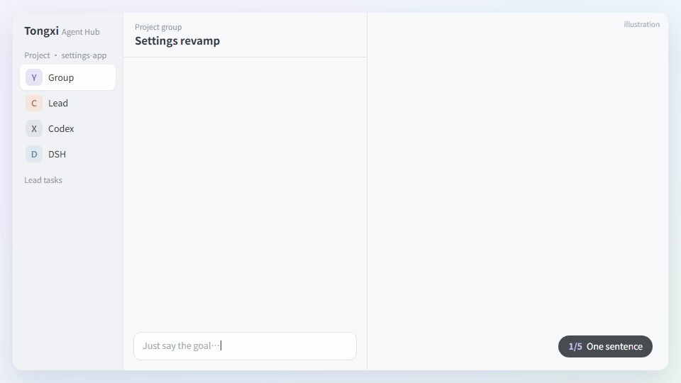

<div align="center">

<h1>Tongxi · Agent Hub</h1>

<p><b>Seat the AI coding agents already on your machine at one table.</b></p>

[](https://github.com/mydosu/tongxi/releases/latest) [](#quick-start) [](https://v2.tauri.app/) [](LICENSE)

**[Download](https://github.com/mydosu/tongxi/releases/latest)** · [Quick start](#quick-start) · [Project mode](#project-mode) · [FAQ](#faq) · [中文](README.md)

<br />



<sub>Illustration: one sentence → the lead plans → members work in parallel → hand back &amp; merge → the savings ledger. Amounts are examples.</sub>

</div>

<br />

Tongxi (同席, "sharing a table") is a Windows desktop app that brings the agent CLIs you already use — **Codex, Claude Code, Hermes, DSH and OpenCode** — into one workspace:

- Chat with any of them one-on-one.
- Pull several into a group chat.
- Bind a code repository and let one of them lead the others through the work.

There is also a seat for your own companion, if you have one.

> Tongxi is only the table. Models, keys, tools, MCP servers and plugins all stay in each CLI's own config; Tongxi does not change them.

**Why not just open a few terminals?** Three reasons: you can hand over real work (a lead agent plans, delegates, reviews and merges, inside the permissions you set), you can see what it cost (every task is priced and compared with doing it all on the expensive model), and it keeps up with CLI upgrades (verified versions, diagnostics, isolated updates).

<br />

## Quick start

| Step | What to do |
|:---:|---|
| **1** | Windows 10 / 11 with the [WebView2 Runtime](https://developer.microsoft.com/microsoft-edge/webview2/) (built into Windows 11). |
| **2** | Download `Agent-Hub-vX.Y.Z.exe` from [Releases](https://github.com/mydosu/tongxi/releases/latest) and run it. No installer, no admin rights. |
| **3** | On start Tongxi scans the machine and connects every member it finds. If none are installed it takes you to **Members & services → Add members** for one-click installs. |
| **4** | Pick a chat in the sidebar, or press **＋** for a new chat or group. |

The UI is in Chinese for now.

<br />

## Members

Open **Members & services** at the bottom of the sidebar. For a member that isn't installed, click **Install**: Tongxi shows the official command first and runs it in a new terminal after you confirm, then walks you through login.

| Member | Install | First setup | Needs | Docs |
|---|---|---|---|---|
| **Codex** | `npm install -g @openai/codex` | `codex login` | Node.js 18+ | [openai/codex](https://github.com/openai/codex) |
| **Claude Code** | `irm https://claude.ai/install.ps1 \| iex` | run `claude` once to log in | — | [Setup](https://code.claude.com/docs/en/setup) |
| **Hermes** | `iex (irm https://hermes-agent.nousresearch.com/install.ps1)` | the installer's wizard, later `hermes setup` | its own Python | [Windows guide](https://hermes-agent.nousresearch.com/docs/user-guide/windows-native) |
| **DSH** | `npm install -g @deepseek-ai/dsh` | `dsh web` (enter a DeepSeek key) | Node.js 22.19+ | [deepseek-harness](https://github.com/deepseek-ai/deepseek-harness) |
| **OpenCode** (optional) | `npm install -g opencode-ai` | `opencode auth login` | Node.js | [opencode.ai](https://opencode.ai/docs) |

If Node.js is missing, the install script gets it first with `winget install OpenJS.NodeJS.LTS`. Installed somewhere unusual? Point Tongxi at it with `AGENT_HUB_CODEX_EXE`, `AGENT_HUB_CLAUDE_EXE`, `AGENT_HUB_HERMES_PYTHON`, `AGENT_HUB_DSH_INSTALLATION` or `AGENT_HUB_DSH_NODE`.

Each member card shows the connection, the running and installed versions, and an **unverified version** badge when your CLI version hasn't been tested with Tongxi yet. Codex and DSH updates are installed into an isolated slot, verified, then switched over — with one-click rollback.

<br />

## Everyday use

| | |
|---|---|
| **Chats** | Several independent chats per member. Thinking, tool calls and text are shown in the order they happen. |
| **Interjecting** | Keep typing while a member is replying: Codex and Claude take it in mid-turn without being interrupted; the others get it right after. Esc stops the reply. |
| **Native sessions** | Continue a member's own existing session, or hand the chat to its CLI with **Open in CLI** — when the CLI closes, Tongxi picks the new turns back up. |
| **Groups** | One to five members. Private chats are never carried into groups. |
| **Model & effort** | The model pill above the composer switches model and reasoning effort for this chat only. |
| **Attachments** | Drag files in, paste images, or use **＋**. |
| **HUD** | Ctrl+Shift+H opens a floating input bar for quick questions while you code. |

<br />

## Project mode

In a group, choose **Select project folder** to bind a directory, then just say what you want in the group. If the folder isn't a Git repo yet, Tongxi initialises one locally with a safety baseline commit and never pushes it anywhere.

### The lead

Every project has a **lead** — the project member you pick (a strong model is recommended). It has its own session at the top of the project sidebar.

- **Talking in the group is talking to the lead.** The group only gets progress summaries: who was given what, and what came back.
- **One thing at a time, members in parallel.** New requests queue behind the current one unless you say otherwise.
- **Task briefs and a plan.** For long or hard work the lead writes a brief in `.tongxi/任务书/` and ticks it off as it goes; lasting decisions go into `.tongxi/计划.md`, which you can edit too. That folder is never committed.
- **One round, one session.** After a round the lead writes `.tongxi/交接.md` (a handoff) and the next message starts a fresh session from it — unless the prompt cache is still warm.
- **Lead tasks page.** Every delegated task with its member, model, worktree, status and result; the lead's plan drawn as a flowchart; the lead's token usage and context size.

### The lead's tools

| Tool | What it does |
|---|---|
| `hub_delegate` | Give a concrete task to a member session, optionally with a model and effort. Code changes get their own Git worktree. |
| Hand-back | When a member finishes, its final `## 交回` (hand-back) section comes back to the lead as a new message. |
| `hub_team` / `hub_member` | Who is available, their models, how busy they are, quota left, and how each model has done on each kind of task over 30 days. |
| `hub_tell_member` / `hub_stop_member` | Correct a member's course, or stop it. |
| `hub_finish_worktree` | Merge a worktree back after review, or discard it. The lead resolves conflicts itself. |
| `hub_ask_user` | Ask you — only about *what* to do, or about irreversible outside actions you haven't authorised. Questions wait in the project's Q&A panel, not in the chat. |
| `hub_broadcast` | Post a progress note to the group. |

The rule of thumb in the lead's prompt: expensive models think, judge and wrap up; cheaper models do the legwork. Per-model notes live in `src-tauri/prompts/models.md` — edit them to match your experience.

### Cost, limits and permissions

- **Savings ledger.** Every turn's tokens are priced at API rates (a daily-updated price table with a built-in fallback; subscription lines are priced the same way and labelled as such; unknown models show "price unknown" instead of a guess). Each task and plan step shows what it cost and what it would have cost on the lead's model. The project ledger totals it by day, member and model.
- **Daily spend caps.** Set a per-member dollar cap per project. Once a member hits it, the lead stops giving it new work and tells you in the Q&A panel; running work is not killed.
- **Permission tiers.** *Full* (default), *worktree only* (members may change the project and their worktrees but not push, release or merge PRs; you see the diff before a merge), or *read only*. Claude switches permission mode, Codex and DSH use their sandboxes; Hermes is limited by prompt only.
- **Standing grants.** Write a sentence in project settings, e.g. "allowed to commit and push main". The lead and members treat it as your own words.

### Sessions, worktrees and memory

- Up to four sessions of the same member per project, treated as separate members.
- Members can continue **their own existing native sessions**.
- Code changes happen on their own branch and worktree, so members can change code in parallel.
- **Project memory**: shared and private notes per member. With OpenViking installed (set `AGENT_HUB_OPENVIKING_PYTHON` or put `ov` on PATH) notes go there; otherwise they are markdown files under `.tongxi/记忆/` in the project. Same rules either way, and anything that looks like a credential is refused.

<br />

## Your companion

The fifth seat is for your own companion. Any **OpenAI-compatible endpoint** works (`GET /v1/models` and streaming `POST /v1/chat/completions`): your own service, Ollama, LM Studio, DeepSeek, OpenAI… Give it a name, avatar, URL, key (none, typed in and encrypted with Windows DPAPI, an environment variable, or a `.env` file), an optional model and an optional persona. Companions only join private chats.

<br />

## Data & privacy

- **Local only.** Chats, messages and settings live in a local SQLite database at `%LOCALAPPDATA%\local.personal.agenthub\hub.db`, backed up before upgrades.
- **Member credentials untouched.** Tongxi does not read or store the CLIs' logins and doesn't change their config.
- **Pushes need your say-so.** Tongxi itself never pushes. Pushes and deploys only happen when you authorise them.
- **Signed self-updates.** Tongxi checks GitHub Releases on start. Updates are only applied if the manifest's Ed25519 signature and the file's size and SHA-256 all match.
- **Diagnostics.** **Export diagnostics** on the members page writes a redacted text report (versions, connections, recent failure reasons — no chat content) to your Downloads folder.

<br />

## FAQ

<details>
<summary><b>A member is installed but Tongxi says it isn't</b></summary>

<br />Click <b>Rescan</b>. For unusual install locations, use the environment variables listed under <a href="#members">Members</a>.
</details>

<details>
<summary><b>DSH connects but messages fail</b></summary>

<br />Usually there is no key yet. Use <b>Login / first setup</b> on the DSH card, enter a key in <code>dsh web</code>, then reconnect.
</details>

<details>
<summary><b>A member hit its usage limit</b></summary>

<br />The lead sees each provider's 5-hour and weekly quotas before delegating, gets the failure reason when a member hits a limit, and can hand the work to someone else. Codex work that hit a limit resumes automatically when the window resets.
</details>

<details>
<summary><b>Something breaks after a CLI update</b></summary>

<br />Check the member card for an <b>unverified version</b> badge, then use <b>Export diagnostics</b> and attach the file to an issue.
</details>

<br />

## Tech stack

A native Windows app: hand-written TypeScript UI (no framework) and a Rust core, running in Tauri 2.

| Layer | Tech |
|---|---|
| Shell | [Tauri 2](https://v2.tauri.app/) · WebView2 |
| UI | TypeScript 5 · [Vite 6](https://vite.dev/) · plain DOM + CSS · [KaTeX](https://katex.org/) |
| Core | Rust · `serde` · `rusqlite` (SQLite) · `ureq` · `ring` · `windows-sys` (DPAPI, Job Objects) |

| Member | How it connects |
|---|---|
| Codex | `codex app-server`, JSON-RPC over stdio |
| Claude Code | `claude_bridge.mjs` turns ACP into `claude -p --output-format stream-json`, resuming the same native session |
| Hermes | `hermes_bridge.py` extends the installed Hermes ACP in-process |
| DSH | `dsh_bridge.mjs` loads the installed DeepSeek harness over ACP |
| OpenCode | its built-in ACP (`opencode acp`) |
| Companion | any OpenAI-compatible endpoint |

<br />

## Development

```powershell
npm ci --no-audit --no-fund
npm run build                                   # type-check and bundle the UI
cargo test --manifest-path src-tauri/Cargo.toml # backend tests
npm run desktop                                 # run in dev mode
npm run desktop:build                           # build release/Agent Hub.exe
```

Building needs Rust (MSVC), Node and WebView2 — see the [Tauri prerequisites](https://v2.tauri.app/start/prerequisites/). The demo GIFs above are rebuilt with `python scripts/build_demo_gif.py` (Playwright + ffmpeg).

The full changelog is in the [Chinese README](README.md#版本记录).

<br />

## Credits

The Claude and Codex avatars come from [LobeHub Icons](https://github.com/lobehub/lobe-icons) (MIT). Hermes and DSH avatars are read at runtime from their own installs and aren't redistributed. All marks belong to their owners and are only used to identify the matching member.

## License

[MIT](LICENSE)
