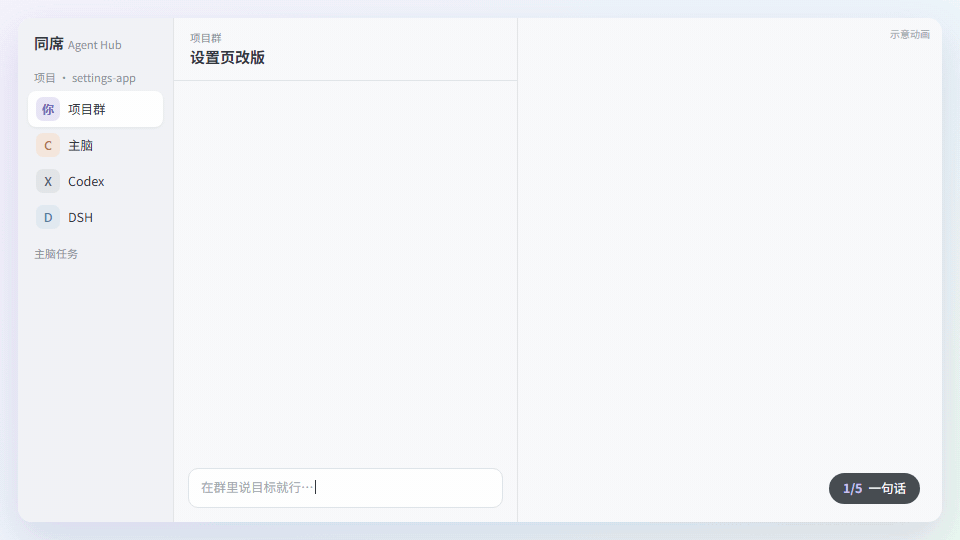
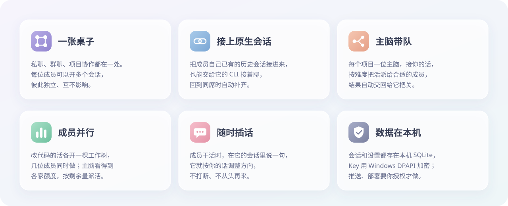

<div align="center">



<br />

[](https://github.com/mydosu/tongxi/releases/latest) [](#快速开始) [](https://v2.tauri.app/) [](LICENSE)

**[下载最新版](https://github.com/mydosu/tongxi/releases/latest)** · [快速开始](#快速开始) · [项目协作](#项目协作) · [常见问题](#常见问题) · [版本记录](#版本记录) · [English](README.en.md)

<br />



<sub>示意动画：一句话 → 主脑拆计划 → 成员并行 → 交回合并 → 省钱账。金额是示例。</sub>

</div>

<br />

同席是一个 Windows 桌面应用，把你电脑上已经装好的 **Codex、Claude Code、Hermes、DSH** 接进同一个工作空间：

- 可以一对一私聊。
- 可以拉进群里一起讨论。
- 可以绑定一个代码仓库，交给一位主脑带着其他成员分工去做。

开发之余，还能接入你自己的情感陪伴聊聊天。

> 同席只是这些助手的「桌子」。模型、Key、工具、MCP、插件都沿用各自 CLI 的配置，同席不会修改它们。

<br />

## ✨ 亮点



<br />

## 快速开始

| 步骤 | 做什么 |
|:---:|---|
| **1** | 准备 Windows 10 / 11，并装好 [WebView2 Runtime](https://developer.microsoft.com/microsoft-edge/webview2/)（Windows 11 自带）。 |
| **2** | 从 [Releases](https://github.com/mydosu/tongxi/releases/latest) 下载 `Agent-Hub-vX.Y.Z.exe`，双击运行。不用安装，也不用管理员权限。 |
| **3** | 同席启动时自动扫描本机，把装好的成员连上。一个都没找到时，会带你到「成员与服务 → 接入成员」一键安装。 |
| **4** | 在侧栏选一个私聊，或者点「＋」新建私聊、群聊，就可以开始了。 |

<br />

## 🧩 接入成员

打开侧栏底部的 **成员与服务**，顶部的「接入成员」横条会显示本机找到了几位成员。没装的成员点 **下载安装**，同席会先给你看要执行的官方命令，确认后在新终端里安装，装完接着登录或初次配置。

| 成员 | 安装命令 | 初次配置 | 前置条件 | 官方说明 |
|---|---|---|---|---|
| **Codex** | `npm install -g @openai/codex` | `codex login` | Node.js 18+ | [openai/codex](https://github.com/openai/codex) |
| **Claude Code** | `irm https://claude.ai/install.ps1 \| iex` | `claude`（首次运行登录） | 无 | [安装文档](https://code.claude.com/docs/en/setup) |
| **Hermes** | `iex (irm https://hermes-agent.nousresearch.com/install.ps1)` | 安装器自带向导，之后可用 `hermes setup` | 无（自备 Python） | [Windows 指南](https://hermes-agent.nousresearch.com/docs/user-guide/windows-native) |
| **DSH** | `npm install -g @deepseek-ai/dsh` | `dsh web`（在网页里填 DeepSeek Key） | Node.js 22.19+ | [deepseek-harness](https://github.com/deepseek-ai/deepseek-harness) |
| **OpenCode**（可选） | `npm install -g opencode-ai` | `opencode auth login` | Node.js | [opencode.ai](https://opencode.ai/docs) |

需要 Node.js 而本机没有时，安装脚本会先用 `winget install OpenJS.NodeJS.LTS` 装好。

<details>
<summary><b>成员卡片上能做什么</b></summary>

<br />

| 操作 | 说明 |
|---|---|
| **换头像** | 点卡片上的头像，可以选纯色头像（纯色底 + 名字首字）、上传图片，或恢复默认的原生图标。 |
| **改名** | 卡片标题旁的 ✎。私聊、群聊、所有地方都跟着变，清空就恢复默认名。 |
| **启动时自动接入** | 默认打开。每次启动扫描本机，把已安装、还没连上的成员逐个连上；失败不打扰，在卡片上显示原因。 |
| **重新扫描** | 刚装好某个成员后点一下。同席会重新读取系统 PATH，不用重启。 |
| **登录 / 初次配置** | 在终端里跑成员自己的配置命令。 |

</details>

<details>
<summary><b>DSH 的模型和 Key、手动指定安装位置</b></summary>

<br />

- **DSH 的模型和 Key**：全用 DSH 自己的配置，和其他成员互不相干。在 `dsh web` 的 Models 页面里填官方 DeepSeek 的 Key，或者添加任意 OpenAI 兼容的服务商；同席启动 DSH 时直接读这份配置，Key 留在 DSH 自己的凭据库里。什么都没配时默认官方 `deepseek-v4-flash`。
- **手动指定位置**：装在非常规目录时，用这些环境变量告诉同席：`AGENT_HUB_CODEX_EXE`、`AGENT_HUB_CLAUDE_EXE`、`AGENT_HUB_HERMES_PYTHON`、`AGENT_HUB_DSH_INSTALLATION`、`AGENT_HUB_DSH_NODE`。

</details>

<br />

## 💞 接入你的陪伴

每个人都可以有自己的情感陪伴，同席把第五个座位留给它。在 **成员与服务** 里找到陪伴卡片，点 **配置陪伴**，按下面的顺序填：

1. **名字、一句话介绍、头像**：头像点一下就能换，会自动裁成方形。
2. **接口地址**：陪伴需要提供 **OpenAI 兼容接口**（`GET /v1/models` 和流式 `POST /v1/chat/completions`）。只写到主机时，会自动补上 `/v1`。
3. **Key**，四种来源任选一种：
   - **不需要**。
   - **直接填写**：用 Windows DPAPI 加密保存。
   - **环境变量**。
   - **.env 文件**。
4. **模型**（可选）：留空就用服务返回的第一个。
5. **人设**（可选）：会作为 system 消息放在最前面。

| 你的陪伴在哪里 | 接口地址 | Key | 人设 |
|---|---|---|---|
| 自建陪伴服务（人格、记忆都在服务里） | 例如 `http://127.0.0.1:8650` | 按服务要求 | 留空 |
| 本机 Ollama | `http://127.0.0.1:11434/v1` | 不需要 | 写在人设里 |
| 本机 LM Studio | `http://127.0.0.1:1234/v1` | 不需要 | 写在人设里 |
| 云端 DeepSeek | `https://api.deepseek.com` | 直接填写或环境变量 | 写在人设里 |
| 云端 OpenAI 或其他兼容服务 | `https://api.openai.com/v1` 等 | 直接填写或环境变量 | 写在人设里 |

保存后点 **连接** 就能私聊。每一轮都会带上这段私聊的历史，陪伴不会失忆。

- 陪伴只参加私聊，不进群聊和项目。
- 在项目里打开「开发摘要共享」后，陪伴能知道项目的开发进展。

<br />

## 💬 日常使用

| | |
|---|---|
| **私聊** | 每位成员可以开多个私聊，互不影响。Enter 发送，Shift+Enter 换行；思考、工具调用和正文按发生的先后穿插显示。 |
| **插话** | 成员回复到一半也能接着说：Codex、Claude 原生追加、不打断；其他成员等它说完自动发出。想打断就按 Esc 或点「■ 停止」。 |
| **原生会话** | 把成员**自己已有的历史会话**接进来接着聊。也可以点「在 CLI 中打开」交给它的命令行，CLI 关掉后自动收回，新增的对话补回同席。 |
| **群聊** | 选一到五位成员。私聊的内容不会自动带进群聊。 |
| **模型与思考强度** | 消息上方的「模型」胶囊，点开就能切换。只影响这个会话的下一条消息，不改成员的全局设置。 |
| **提问** | 成员需要你补充信息时，问题下面会出现「回答」按钮，侧栏也有提示。 |
| **附件** | 拖入文件、粘贴图片，或点「＋」选择。 |
| **HUD 浮窗** | 标题栏的 ▣ 或 Ctrl+Shift+H，打开一个透明的悬浮输入条，适合边写代码边问。 |

### 名字分两级

- **成员名**是全局的，在「成员与服务」里改。
- **会话名**只在一个项目里生效，在「项目成员配置」里给每个会话起名。
- 没起名时：一位成员只有一个会话就显示成员名；开了多个会话，就编号成「成员名 1号 / 2号」。
- 主脑也认这些名字。

<br />

## 项目协作

在群聊里点 **选择项目目录**，绑定一个文件夹，然后直接在群里说目标就行。如果目录还不是 Git 仓库，同席会在本地初始化一个仓库，并提交一个安全基线，不会推送到任何远端。



### 🧠 主脑

每个项目有一位主脑，就是项目成员里你选的那位（在「项目成员配置」里改「主脑由谁当」，建议配强模型）。它有一条自己的会话，排在项目侧栏的第一项：

- **在群里说就是跟主脑说**：项目群里的话直接交给主脑，你也可以打开它的会话和它细聊。群里只放进展摘要：派了谁、谁交回了什么。
- **一件一件做**：主脑同一时间只推进一件事，可以同时派几位成员并行。你中途提的新事排在后面，做完手上的再接；你说先做新的，它会把当前这件停在稳妥的地方再换。
- **任务书与计划**：长或难的活，主脑先在 `.tongxi/任务书/` 里写一份任务书，边做边勾进度，换会话或上下文被压缩后照着接着做。要长期记住的结论、约定和踩过的坑，写进 `.tongxi/计划.md`，你也可以直接改。这个目录不进提交。
- **一轮一个会话**：主脑一轮协作做完（派出的活都交回）就写一份 `.tongxi/交接.md`，下一条消息开新会话，只带主脑说明和这份交接，不拖着整段旧上下文。没写交接就接着用旧会话。被中断时也先写交接：主脑要停下来等很久（等额度重置、等你回答）时自己写；你在主脑页点停止、或关同席时主脑正在回复，同席先让它写好交接再停（最多等两分钟，再点一次停止或再关一次就立即停）。
- **项目之间互不相干**：不同项目的主脑各管各的。
- **主脑任务**：项目侧栏的「主脑任务」列出主脑分配给成员的每项任务：分配给谁、任务原文、模型和思考强度、所在工作树、进行中还是已完成、用时多久，已完成的可展开查看提交的结果。进行中的任务可以直接停止（点两下确认），主脑会收到说明；顶上能看到主脑正在回复还是空闲，以及主脑今天和累计的用量（新写入、缓存写、缓存读、输出）和上下文长度；下面是主脑的「计划与任务书」：长期计划和每份任务书都能展开看，任务书按勾选标出做到第几步（如 3/7），主脑改了文件几秒内跟着更新。侧栏角标显示进行中的任务数。
- **计划流程图**：主脑任务页顶上是主脑的计划，画成一张流程图：列按先后排，卡片颜色是状态，进行中的描一圈流光，待你处理的轻轻呼吸，阻塞后续步骤的标「阻塞 N 项」。鼠标在一步上停一下，它的前置步骤和依赖它的后续步骤整条链亮起来；点开看全文、负责人、前置步骤，已分配任务的能直接跳过去查看或打开那位成员的会话。上面一排按状态分类（进行中、待审核、待你处理、等待中、未开始、已完成），「全部」把每一步都摆出来，不选时折叠不影响后续的已完成步骤。图上滚轮或右上角按钮缩放，按住拖着看；缩小后卡片只留标题，指上去浮出全文。

### 🧰 主脑手里的工具

| 工具 | 做什么 |
|---|---|
| **派活** `hub_delegate` | 把一件具体的事交给某位成员的会话，可以指定模型和思考强度（不指定就沿用这个席位上次的设置）。改代码的活给它开一棵独立的 Git 工作树。派完立即返回，回执写明实际用的模型和这家当前的额度 |
| **成员交回** | 成员做完，最后那段「## 交回」自动作为一条新消息送回主脑，过程不送；主脑正在回复时就当插话送进去。还有成员在做时，先交回的攒 30 秒一起送 |
| **看成员** `hub_team` / `hub_member` | 有谁、各自能用哪些模型、忙不忙、额度还剩多少、别的项目正在用哪些成员、近 30 天各模型在各类活上的完成情况，以及某位成员最近的活和最后的回复 |
| **插话、停止** `hub_tell_member` / `hub_stop_member` | 成员跑偏时纠正方向，或者直接停下 |
| **合并工作树** `hub_finish_worktree` | 看过没问题就合并回项目，不要了就丢弃；合并冲突主脑自己解决 |
| **问你** `hub_ask_user` | 只问两类事：做什么，和授权里没有、又收不回的对外操作。挂在项目的「协作问答」面板里，侧栏角标提示，不刷进群聊 |
| **群摘要** `hub_broadcast` | 往项目群发一条进展 |

挑模型的原则写在主脑说明里：贵的模型想、判断、收口，便宜的模型干体力活；拿不准时宁可高一档一次做成。各家模型的特点见 `src-tauri/prompts/models.md`，可以按自己的体验改。

### 🙋 插话与授权

- **在成员的会话里插话**：成员正在干活时，在它的会话里发一句话，就会作为插话交给它，不会打断。Codex、Claude 立即收到；Hermes、DSH 在当前这一步说完后接着收到。
- **长期授权**：在项目设置里写一段话，比如「允许提交并推送 main」。主脑和成员都当作你亲口授权。
- **没授权的不可逆操作**：推送到没授权的远端、花钱、动没授权的生产，主脑会挂到问答面板上问你。其余的小事它自己定，收不回的换成收得回的做法（删除改成归档，远端只加不改），做完说一句。

### 🌿 会话与工作树

- **同一成员多开会话**：同一位成员在项目里最多开 4 个会话，彼此平行、不分主次，主脑把它们当作不同成员来派活。
- **会话绑定**：新建项目时，或者项目进行中，都可以让主脑和成员续接**它们自己已有的原生会话**。
- **独立工作树**：改代码的活在自己的分支和工作树里做，几位成员可以并行改，互不干扰。
- **项目记忆**：成员可以读写项目笔记，分共享区和各自的私有区。本机装了 OpenViking 记忆服务（用 `AGENT_HUB_OPENVIKING_PYTHON` 指定它的 python，或者把 `ov` 放进 PATH）就存进 OpenViking；没装就存成项目里 `.tongxi/记忆/` 下的 markdown。

<details>
<summary><b>项目目录的登记与解除</b></summary>

<br />

- 项目目录全局只登记一次。
- 用过它的群都归档后，目录就空出来了：可以用新名字重新登记（沿用原来的项目记录），也可以在「已登记项目」里点 **解除登记**，把它从列表里拿掉。
- 归档群的聊天、主脑会话和成员会话都会保留。
- 「项目成员配置」里可以随时增减成员。移出的成员，会话和历史都保留，加回来就恢复。主脑还有派出去没交回的活时不能调整成员。

</details>

<br />

## 🎨 主题与外观

点侧栏底部的调色板图标，打开 **主题背景**：

- **内置背景**：晨雾、薄荷、杏光、海盐、暮紫、素净，都是不含人物的柔光背景。
- **导入图片**：
  - 可以一次选多张，图片压缩后只存在本机。
  - 竖图默认当「立绘」放在右侧，横图默认铺满窗口。
- **背景浓淡**：淡雅、适中、清晰三档，同时调整背景上的薄纱和面板的磨砂程度。

界面是浅色磨砂玻璃风格：换页时旧页面像玻璃起雾一样淡出、新页面从雾里清晰；侧栏选中的底色滑到新位置；有成员在回复时，输入框描一圈慢慢转的流光。系统开启「减少动态效果」时，这些动效都会关掉。

<br />

## 🔒 数据与隐私

- **都在本机**：所有会话、消息和设置都存在本机 SQLite 数据库里，位于 `%LOCALAPPDATA%\local.personal.agenthub\hub.db`。升级前会自动备份到同目录的 `backups`。
- **不碰成员的凭据**：同席不读取、不保存各成员 CLI 的登录凭据，也不改它们的配置。
- **陪伴的 Key**：直接填写的用 Windows DPAPI 加密保存；环境变量和 .env 只记位置，用的时候现读。Key 只发给你配置的那个接口。
- **推送要你授权**：同席本身不推送代码。项目里的推送、部署，只有你授权后（这次的原话或长期授权）才由成员执行。
- **没有调试端口**：普通启动不打开调试端口。

<br />

## 常见问题

<details>
<summary><b>装好了成员，同席还是显示未安装？</b></summary>

<br />点「重新扫描」。如果装在非常规目录，用 <a href="#-接入成员">接入成员</a> 里列的环境变量指定位置。
</details>

<details>
<summary><b>DSH 连上了，但发消息失败？</b></summary>

<br />多半是还没填 Key。点 DSH 卡片上的「登录 / 初次配置」，在打开的 <code>dsh web</code> 里填好 DeepSeek Key，然后重新连接。
</details>

<details>
<summary><b>陪伴测试连接报 404 / 401 / 403？</b></summary>

<br />

- 404 一般是地址不对。大多数服务以 <code>/v1</code> 结尾；路径不是 <code>/v1</code> 的要写完整，比如 <code>.../api/v3</code>。
- 401 / 403 是 Key 不对或没有权限。如果用的是环境变量，设置之后要重启同席。
</details>

<details>
<summary><b>成员撞上额度限制了怎么办？</b></summary>

<br />主脑能看到各家的 5 小时和每周额度，派活前会先看；某位成员撞了限额，主脑会收到失败原因，可以换一位额度充足的成员；Codex 撞限额的活到了重置时间会自动接着做。
</details>

<details>
<summary><b>想关掉启动时自动接入？</b></summary>

<br />在「成员与服务 → 接入成员」里，取消勾选「启动时自动接入」。
</details>

<br />

## 🧱 技术栈

同席是一个 Windows 原生桌面应用：界面用 TypeScript 手写（不依赖前端框架），后端是 Rust，二者跑在 Tauri 2 里。成员都通过各自官方的 CLI 或协议接入，同席不改它们的安装、不替它们保管登录凭据。

<details open>
<summary><b>整体分层</b></summary>

<br />

| 层 | 用到的技术 | 负责什么 |
|---|---|---|
| **桌面壳** | [Tauri 2](https://v2.tauri.app/) · WebView2 | 无边框主窗口、托盘图标、单实例、全局快捷键 `Ctrl+Shift+H` 唤出 HUD 浮窗 |
| **界面** | TypeScript 5 · [Vite 6](https://vite.dev/) · 原生 DOM + CSS | 私聊/群聊、主脑与成员会话视图、主题与背景；CSP 只放行本地资源 |
| **渲染** | 自写 Markdown 渲染 · [KaTeX](https://katex.org/) | 成员回复里的代码块、表格、数学公式，思考流和工具调用的折叠时间线 |
| **核心** | Rust 2021 · `serde` / `serde_json` | 会话与消息路由、成员运行时、主脑与成员工具、Git 工作树、额度查询 |
| **存储** | SQLite（`rusqlite`，内置编译） | 会话、消息、项目、主脑派出的活，全部在一个本地库里 |
| **系统接口** | `windows-sys` | DPAPI 加密 Key、Job Object 托管子进程（同席退出就一并结束）、剪贴板图片、拖入文件 |
| **网络** | `ureq`（同步 HTTP，带 TLS） | 陪伴的 OpenAI 兼容接口、额度查询 |

</details>

<details>
<summary><b>成员怎么接进来</b></summary>

<br />

| 成员 | 接入通路 | 会话存在哪 |
|---|---|---|
| **Codex** | 启动本机 `codex app-server`，走 stdio 上的 JSON-RPC | Codex 自己的 `~/.codex` |
| **Claude Code** | `claude_bridge.mjs` 把 ACP 转成 `claude -p --output-format stream-json`，每轮续接同一条原生会话 | Claude Code 自己的 `~/.claude` |
| **Hermes** | `hermes_bridge.py` 在进程内扩展已安装的 Hermes ACP，原生工具和 MCP 照常可用 | 同席给它单独的 SessionDB |
| **DSH** | `dsh_bridge.mjs` 直接加载已安装的 DeepSeek harness，走 ACP；模型和 Key 读 DSH 自己的配置（`dsh web` 里配的服务商） | DSH 的会话文件 |
| **陪伴** | 任意 OpenAI 兼容端点：`/v1/models` 取模型、`/v1/chat/completions` 收流式正文 | 对方服务里（同席只当客户端，不拉起它的进程） |

几个共性：

- **原生会话互通**：会话 ID 和工作目录记在同席里，内容留在成员自己的会话库，所以「在 CLI 中打开此会话」能把同一条会话交给 CLI 接着聊，CLI 关掉后同席自动收回。
- **桥接脚本只用 Node / Python 标准库**，不引入第三方依赖；stdio 上只走协议，日志另走。
- **成员更新**：DSH、Codex 的新版本先装到隔离目录里校验，确认后才替换，不动全局 npm 配置。

</details>

<details>
<summary><b>项目协作用到的部件</b></summary>

<br />

| 部件 | 实现 |
|---|---|
| **主脑** | 一位成员的长驻会话，带一组 MCP 工具（`project_brain.rs`）；派出的活和待送回的结果记在 SQLite 里，后台线程负责开跑成员、把交回的结果送进主脑会话 |
| **工作树** | 改代码的活一棵 `git worktree`、一条分支，主脑看过后合并或丢弃 |
| **额度** | Claude 读 Claude Code 登录留下的 OAuth 令牌查官方用量（只读、不刷新令牌）；Codex 走 app-server 的 `account/rateLimits/read`；DSH、Hermes 的 Command Code 线路用各自的 Key 只读查询计费接口。只给主脑看 |
| **插话** | 成员干活时把你的话作为 steer 注入当前回合，不中断、不重开 |
| **项目记忆** | 项目共享池 + 每位成员的私有笔记，显式分享。装了 OpenViking 走 `project_memory.py` 接它的客户端，没装由 `project_memory.rs` 存成项目里的 markdown，规则一样 |

</details>

<details>
<summary><b>构建与发布</b></summary>

<br />

- **构建**：`tauri build --no-bundle` 产出单个 exe；release 配置开了 LTO、`opt-level = "s"`、`strip`、`panic = "abort"`，整个程序约 9 MB。
- **留档**：`scripts/package-desktop.mjs` 把 exe 复制到 `release/Agent Hub.exe`，同时在 `release/vX.Y.Z/` 存一份，并写一份带 SHA-256 的 manifest。
- **测试**：Rust 单元测试覆盖会话与成员、工作树、附件、额度解析等；桌面验收脚本用 Python Playwright 通过 WebView2 CDP 驱动打包好的 exe（见下方）。

</details>

<br />

## 🛠 开发与测试

```powershell
npm ci --no-audit --no-fund
npm run build                                   # 前端类型检查与打包
cargo test --manifest-path src-tauri/Cargo.toml # 后端测试
npm run desktop                                 # 开发模式运行
npm run desktop:build                           # 构建 release/Agent Hub.exe 并在 release/vX.Y.Z 留档
```

构建需要 Rust（MSVC）、Node 和 WebView2，见 [Tauri 前置条件](https://v2.tauri.app/start/prerequisites/)。各部分用到的技术见上面的 [技术栈](#-技术栈)。

<details>
<summary><b>桌面验收脚本</b></summary>

<br />

这些脚本使用打包好的 exe 和隔离的数据目录，通过 WebView2 CDP 驱动界面，需要 Python Playwright。

| 脚本 | 内容 | 调用模型 |
|---|---|:---:|
| `scripts/smoke_desktop.py` | 会话管理、重启恢复、删除等基础回归 | — |
| `scripts/verify_hud.py` | HUD 浮窗 | — |
| `scripts/verify_v1.py` | 接入成员、陪伴配置与对话（本地模拟服务）、主题导入 | — |
| `scripts/verify_project_sessions.py` | 会话绑定、多开会话、成员栏、主题切换 | — |
| `scripts/verify_seats_live.py` | 同一成员的两个会话真实并行、续接已有原生会话 | 少量 |
| `scripts/verify_dsh_bridge.mjs` | DSH 桥接回归：私聊、项目、DSH 自己的 Key 几种接法；`--latest` 先装一份 npm 最新版来测，DSH 发新版时先跑它 | — |
| `scripts/verify_managed_update.py` | Codex 隔离更新：从旧版准备候选 → 启用 → 回退，外部安装全程不动 | — |

设置 `AGENT_HUB_AUTOCONNECT=0` 可以关闭启动时的自动接入，回归脚本默认已经设置。

</details>

<br />

## 版本记录

### v3.4.7 · 插话不再误断主脑

- **插话不再误断主脑**：给 Claude 插话打断前半段时，不再把中止当成回合结束，主脑写交接时点更新不会被杀掉。
- **连接按钮用成员本名**：成员管理页的连接 / 断开按钮和提示显示成员本名（如 Claude、DSH），不再显示项目里的席位昵称。

### v3.4.6 · 额度断流后主脑开新会话

- **断流不再重写缓存**：主脑一轮做到一半因额度用完等原因失败、没来得及写交接时，等恢复后如果缓存已经凉了，直接开新会话，不再续旧会话把整段重新写进缓存。新会话带上旧交接，并提示先看计划、在外的活和群消息再接着做。

### v3.4.5 · 主脑能自己开席位

- **主脑开席位**：主脑新增 `hub_add_seat`，能给项目群里的成员多开席位再派活；她开的席位还能用 `hub_rename_seat` 改名、`hub_remove_seat` 撤掉（空闲时才能撤，会话归档保留）。你手动开的席位和主席位她动不了。

### v3.4.4 · 连接成员不再弹回顶部

- **滚动不跳**：在「成员与服务」页往下翻后点连接或断开，页面停在原处，不再刷回最上方。

### v3.4.3 · 流式时展开详情不闪、归档不跳列表

- **展开不闪**：成员还在输出思考时，展开思考过程或工具详情不再狂闪（重画时保留你的开合，不再整块替换后重播展开动画）。
- **归档不跳列表**：归档或恢复会话后侧栏留在当前列表，不自动跳到「归档」。

### v3.4.2 · 主脑换会话不被在外的活卡住、看得到 Hermes 的上下文

- **会话太长照样换**：主脑上下文到 27 万时，就算还有派出去的活没交回也开新会话（交接里写着在外的活）；只是缓存凉了的仍等活都交回再换。
- **Hermes 上下文补上**：Hermes 回合结束时报最近一次调用的上下文大小，主脑在 `hub_team` 里看得到，能判断要不要给它开新会话。

### v3.4.1 · 主脑任务页不卡了

- **主脑任务页提速**：收着的结果、任务书、项目总账、「已结束」列表点开才排版，切「全部 / 已完成」、点步骤只重画流程图。几十件活的项目，进页面从约 0.9 秒降到约 25 毫秒，切分类从约 1.6 秒降到约 5 毫秒。
- **旧计划能翻回去看**：主脑清空重排计划前把旧计划存档（留最近 30 份），流程图标题旁的下拉框里切换查看。
- **协作问答及时刷新**：主脑提问后面板自己出现新问题，不用再点进去。

### v3.4.0 · 敢交权、看得见省钱、跟得上 CLI 升级

- **省钱账**：找回按天自动更新的价格表（联网不上用内置表），每回合用量按 API 价折成钱；订阅线路也折算并标明，没收录的型号显示「价格未知」不瞎估。主脑任务页每件活、每个计划步骤显示花了多少、全交给主脑的模型要多少、省了多少；「项目总账」按天、按成员、按模型汇总。
- **每日花费上限**：项目设置里按成员各设一个「美元 / 天」，只算按量计费的线路。某位成员到上限，主脑不再给它派新活，在协作问答里问你今天放不放开；在跑的活不掐。
- **权限档**：每个项目选全权（默认）/ 只改工作树 / 只读。Claude 按档换权限模式，Codex、DSH 用各自沙箱收紧到项目目录和手上活的工作树，Hermes 靠提示词；非全权档合并工作树前先在协作问答给你看 diff。
- **内置接入 OpenCode**（可选成员）：走它自带的 ACP（`opencode acp`），私聊、群聊、项目席位、派活、在 CLI 中打开、一键安装（`npm install -g opencode-ai`）都能用；默认不自动连接。
- **同席自己更新**：启动时查 GitHub 最新 Release，有新版侧栏版本号会亮，点开看说明、确认后下载替换并自动重启；有成员在回复或主脑的活没结束时不更新。新版 manifest 带 Ed25519 签名，签名、大小、sha256 有一样对不上就不更新。
- **项目记忆可降级**：没装 OpenViking 时存成项目里 `.tongxi/记忆/` 下的 markdown，共享 / 私有、只有作者能改共享笔记、拒存凭据这些规则不变。去掉写死的本机路径，改用 `AGENT_HUB_OPENVIKING_PYTHON` 或 PATH 上的 `ov`。**原来靠默认路径用 OpenViking 的，请设好这个环境变量**，否则记忆会存到项目里。
- **导出诊断**：「成员与服务」右上角一键把版本、系统、各成员连接与版本、最近 7 天失败原因脱敏写成文本存到「下载」，不含会话内容。加一张已验证 CLI 版本表，版本不在表里的成员卡片标「未验证版本」。
- **Hermes 用量补全**：走中转线路时 ACP 回包不带用量，改从它自己的会话库补上。
- README 顶上加演示动图，补英文 README。

### v3.3.4 · 成员长任务不再被误掐，空回复修好

- **不限一回合总时长，改看有没有动静**：以前同席给成员一回合定死上限（Hermes 10 分钟、DSH 30 分钟、Claude 1 小时），Hermes 跑长盘点做到一半就被掐。现在 Claude、DSH、Hermes、Codex 都一样：只要还在出思考、工具调用或正文就一直等，连续 30 分钟什么都没有才判卡住。按会话分开算，同一家几个席位互不掩盖。
- **Codex 卡死也会交回**：以前 Codex 卡住任务会一直挂在「进行中」，现在 30 分钟没动静就打断这一回合、记失败交回主脑。
- **Claude 空回复**：上一单留下没跑完的后台命令时，Claude 续会话会先为这条通知出一个空结果，同席误当成这一单做完，20 秒后把还在干活的成员关掉，交回空回复。现在跳过这种空结果，等真正的回复。
- **群聊、项目换头像能上传图片了**：顶栏按住能拖窗口，头像面板里的「上传图片」被当成拖窗口吃掉了点击，点了弹不出选文件窗口。
- 清理仓库：删掉 56 个早期一次性验证脚本。

### v3.3.3 · 主脑缓存还热就不换会话

- **缓存热着就续旧会话**：以前主脑一轮做完写了交接，下一条消息就开新会话；可缓存还热的时候，开新会话要把五六万字的开场说明重新写进缓存，反倒比接着读旧会话贵，一两个回合的短轮尤其不划算。现在写了交接后，要等缓存凉了（离主脑上一回合结束超过一小时）才换；隔一小时再续旧会话得把整段重新写进缓存，这时换才省。
- **会话太胖也换**：缓存热着，但上下文到了 27 万，也在下一条消息换新会话。再长读起来费额度，模型也变迟钝。
- 没到换的时候，交接留着不作废；等到要换时，带的是最新的那份。

### v3.3.2 · 主脑被中断前先写交接，动效不再跟随系统设置

- **停下来等很久也写交接**：主脑要停下来等额度重置、等你回答、等到某个时间，手上又没别的可做时，这轮没做完也写交接，写清在等什么、等到了先做什么。恢复时开新会话，不用在缓存早已过期的长会话上接着跑。
- **点停止先写交接**：主脑正在回复时，在主脑页点停止，同席先让它写好交接、自己收尾；最多等两分钟，再点一次停止就立即停。能插话的主脑（Claude、Codex）直接插话，不能插话的先停掉，趁缓存还在补发一条。
- **关同席先写交接**：关窗口或从托盘退出时，有主脑正在回复就先让它写交接，写完自动退出（最多两分钟），再关一次直接退出。主脑空闲时照常立即退出。
- 交接里多记一项：还在外面没交回的任务（编号、交给谁、做什么）。
- **动效不再跟随系统设置**：Windows 关了「动画效果」时，同席以前会把换页化雾、选中项滑动、悬停浮起这些动效全关掉，看起来像没改过；现在一直播放。
- **切会话侧栏不再闪**：以前每次切换都把整列会话卡片重建两遍，头像重画、展开的项目子栏重播展开动画；现在只就地改变了的地方，没变的卡片原样留着，子栏只在刚打开时展开一次。
- **换页不再卡顿**：从消息很多的会话切走时，换页动画要先把整页几千个节点挨个读一遍滚动位置，最长卡过 8 秒；现在只记真正滚过的那几个，切换最多一帧约 0.1 秒。化雾只留给退场的旧页面一层轻雾，新页面不再做模糊动画，帧率不再掉一半。
- **切会话不再顿一下、不再闪**：切过去先只画最后一屏左右的消息，更早的等换页动画放完、浏览器空闲时再分批补到上面，补的时候看着的地方不动；从长会话切走时，只把看得见的那几条带进淡出的雾层。实测几个会话切换都没有超过一帧的停顿（以前长会话卡 80–130ms）。侧栏选中项的滑块改成只用位移和缩放，主线程忙时也不停在半路。修了打开会话偶尔没滚到底、淡入后内容又往上跳一下的问题。
- **项目点开不再自动展开**：侧栏点项目会话只选中它，子栏的展开、收起交给卡片右侧的圆形箭头按钮（展开时箭头转向下）；以前的 `⌄` 小字符换成了这个按钮，也能用键盘 Tab 到它按回车。
- **成员会话的工具调用逐条出**：以前成员会话把所有工具调用收成顶上一行，只显示最新一项；现在和主会话一样，每次调用按发生的位置穿插在回复里，像各家 CLI 那样边做边出，点开看输入与输出。旧消息没有位置记录，仍汇总在顶上。
- **切项目会话侧栏不再回弹**：在两个项目会话之间切换时，选中项的滑块会滑到一半顿住再起步，子页的高亮还会从侧栏外面飞进来；现在一次滑到位，收起的子栏里的选中行不再当起点。
- **主脑任务页最后一张卡片不再被截断**：内容一多，最底下的任务卡会被压扁、滑不到底；协作问答页同样修好。
- **流程图卡片扫过不再一张张弹起**：指上去停一下才浮起，移开立刻落下。之前卡片的过渡被全局按钮样式盖住了，v3.3.1 说的「淡入淡出放慢」其实没生效，这次一并修好。

### v3.3.1 · 计划流程图的「全部」和缩放，项目板块用词规范化

- **「全部」真的是全部**：分类排第一个是「全部 N」，点了每一步都摆出来。之前「看全部」照样收着做完的步骤，反倒比「做完」显示得少。不选分类时还是折叠不影响后续的已完成步骤，旁边那句「已折叠 N 个…」点一下就展开。
- **能缩放**：在图上滚轮缩放（以鼠标所在处为中心），右上角有 −、百分比（点了回 100%）、+、适应窗口；双击空白处也是适应窗口。打开时自己缩到放得下，最小 60%。
- **没有滚动条了**：按住拖着看，从卡片上按下去拖也行（挪过几像素才算拖，不会误点开）；四边还有内容的那侧淡出一截。
- **缩小了字不挤**：缩小后卡片里的标题按比例反着放大，屏幕上看着差不多大，脚注收起；再小连图标也收起。被截掉的字指上去浮出全文，键盘切过去也会浮出。
- 缩放和拖到的位置按项目记着，任务有变化重画也不跳；换项目时分类和点开的那步清掉。从详情里点某个前置步骤，画布会挪过去。
- **扫过去不再闪**：鼠标在卡片上停一下才亮出整条链，快速扫过、路过卡片间的空当都不会让整张图忽明忽暗；淡入淡出也放慢了一点。
- **项目板块用词规范化**：「主脑派活」改名「主脑任务」，「活」统一叫「任务」；状态改成进行中、待审核、待你处理、等待中、未开始、已完成；协作问答、成员配置、团队对话接力线、输入框提示一并改成书面用语。

### v3.3.0 · 换页化雾、新图标、计划流程图能点

- **换页不再一闪而过**：切会话、切页面时，旧页面像玻璃起雾一样淡出，新页面从雾里清晰出来；同一页面里的刷新不播，免得闪。
- **选中项滑过去**：侧栏选中的会话卡片、项目里的席位行，底色从旧位置滑到新位置。
- **新消息浮上来**：新到的消息、成员会话里新出的条目从下面轻轻浮起。
- **有人在回复时，输入框描一圈流光**：淡紫、冰蓝、浅粉沿边框慢慢转，回复结束就收起。
- **弹窗、浮层、折叠块有进有出**：主题背景、设置浮层、服务菜单、头像选择淡入淡出；思考、工具记录这类折叠块展开收起是顺滑的高度过渡（刷新时还原你选的开合不播）。提示条弹一下出来。
- 滚动区上沿淡出，玻璃面板加一层很细的颗粒，上沿亮边更像受光的玻璃。
- **新图标**：取传统「方胜」纹样，一白一金两只菱形相扣，底板淡紫到冰蓝，意思是同心、同席。侧栏、任务栏、托盘一起换。
- **计划流程图更好看、能点**：点阵画布上的玻璃卡片，连线按状态上色，通向在做那一步的线会流动；在做的描流光，等你的轻轻呼吸。指到一步亮出它上下游整条链；点开看详情，能跳到那件活、打开成员会话；空白处按住能拖。
- **README 配图**：首图换上新图标，协作流程图改画成和派活页一样的流程图。
- 小修：在「成员与服务」页时侧栏按钮有选中态；设置浮层里「模型」两个字不再挤成竖排；欢迎语末尾不再单个词掉到下一行。
- 系统开了「减少动态效果」时，以上动效全部关掉。

<details>
<summary><b>更早的版本（v3.2.13 及以前）</b></summary>

<br />

### v3.2.13 · 计划流程图只摆要关心的步骤

- **做完的收起来**：做完、又不卡任何没做完步骤的收起，旁边写着收了几步，点「做完」展开；做完了但下游还没做完的留着，看得出它前面是什么。阿尔比恩 16 步的计划现在一屏看完。
- **等你手测的也算「等你」**：负责人写「你」的等待步骤（只有你能做的手测这类）和问答面板上的问题一样，算进「等你」。
- 卡片加高，两行标题不再被截掉半行。

### v3.2.12 · 计划流程图换成正规的分层排版

- **分层排版**：计划流程图改用 dagre 排版（Sugiyama 分层：network simplex 分层、跨列的长边插虚拟节点绕开卡片、逐层扫描减少交叉、再排坐标）。连线一律从上游卡片右边中点出、进下游卡片左边中点，长线从列间空当走，不压卡片。
- **老问题也能挂到步骤上**：主脑对一个还挂在问答面板上没答的问题再问一次（同一个 key），以前当成「已经答过」，这一步也挂不成等你；现在照样挂上，你答了就退回没做。

### v3.2.11 · 主脑的计划画成流程图

- **计划是一张流程图**：主脑用新工具 `hub_plan` 把活拆成几步，写清哪步要等哪步做完。派活页顶上画成流程图：列按先后排，卡片颜色是状态（在做 / 待审 / 等你 / 在等 / 没做 / 做完），箭头是依赖，卡住别人的步骤标「拖住 N 件」。顶上的状态条能点，点「等你」只亮出等你回答的步骤。
- **状态自己走**：派活挂在某一步上，这一步就是在做、负责人是那位成员；交回变成待审，主脑审过标做完、写一行结论和提交号。问用户挂在某一步上，这一步显示等你，你在问答面板答了就退回没做。
- **成员拿到上游结论**：派活挂在某一步上时，任务开头自动带上这一步和它上游步骤的结论，成员不用再去翻。
- 任务书只写方案细节和过程，不再在里面画状态表和勾选框。

### v3.2.10 · 派活、交回不再显示成「你」；主脑一轮做完在群里发进度报告

- **消息记在真正的发送者名下**：主脑派活、插话、成员交回、同席通知以前都借用户的名义送进会话，界面上一律标「你」，和你亲手发的混在一起。现在派活和插话记在主脑名下，交回记在那位成员名下，同席的通知记「同席」，攒在一起、来自不同人的交回也记「同席」；问答面板的回答本来就是你的话，仍标「你」。旧记录启动时按开头的【主脑派活】【成员交回】【同席】一次改好。
- **主脑一轮做完发进度报告**：写完交接后在项目群里发一份完整报告：做完了什么、没做的和原因、下一步、要你定的事。任务书和长期计划开头放状态表，每个板块一行（做完 / 在做 / 没做 / 等什么），做完的只留结论和提交号。
- **成员会话续用还是新开**：`hub_team` 给每个成员加了 `context`（会话现在多大）和 `idle_minutes`（上件活交回几分钟了）；`hub_delegate` 加了 `fresh`，先清掉成员会话再派活。续用还是新开由主脑按活相不相关、会话多大、缓存还在不在自己定。
- **旧调度问过、你后来才答的问题送到主脑**：重构前旧调度挂在问答面板上的问题，你答了以后主脑一直收不到，还当成没答、按默认处理。现在这些回答也送给主脑。

### v3.2.9 · 主脑按实际完成情况挑人；撞额度的活续跑完照常交回

- **成员战绩**：`hub_team` 多了 `track_record`：近 30 天各成员 × 模型 × 思考强度在各类活上派了几件、做完几件、失败几件（撞额度单列）、被停几件、做完的平均用时。`hub_delegate` 多了 `category`（实现、排查、测试构建、审查、文档、部署这类短词），统计按它分。模型档案当先验，有数据按数据来。只给主脑看，界面不显示。
- **撞额度的活续跑完照常交回**：Codex 撞额度失败的派活，同席到点会在成员会话里自动续跑；以前续跑做完的结果送不回主脑，主脑一直等。现在续跑那一回合跑完就作为这件活的交回送给主脑（成员会话之后又被派了新活就不认）。实测：阿尔比恩的 B6 撞额度后到点续跑做完，主脑收到后审查、合并、部署，任务书走完。
- **主脑自己调研资源**：模型档案改成所有项目共用、由主脑维护的一份（数据目录下 `prompts/models.md`），第一行是调研日期。没调研过就在项目开始前查一次；之后主脑觉得档案不准了（派活撞额度、`hub_team` 里出现档案没写的线路和模型）再查。要查清的是有哪些订阅、哪些按 token 计费的服务商和余额、能选哪些模型、能力和价钱，写回档案再派活。出厂档案标着「未调研」。免费模型只认 id 带 `:free` / `-free` 的（MiniMax 的免费档已撤，换成 Beam）。
- **Codex、DSH、Hermes 当主脑**：三家都实测过派活、交回、汇总。
- **修 Hermes 当主脑拿不到主脑工具**：每个会话的工具服务器都叫同一个名字，Hermes 一个进程里同名只连一次，后开的主脑会话用上了先开的成员会话的工具和身份。现在按会话起名。
- **Hermes 额度用光记成失败**：Hermes 调模型失败时把报错当回复、照常结束，以前被记成「做完」。现在认出它的计费、调用失败报错，记成失败（计费的算撞额度）。
- **Claude 不再查 npm 新版**：Claude Code 会自己自动更新。「成员与服务」里检查更新时，比较连接时的版本和磁盘上现在的版本，不同就提示「已自动更新，重启会话以应用」，在卡片上点重启即可。

### v3.2.8 · 主脑小事自己定，不再事事问你

- **问你的事只剩两类**：做什么（方向、取舍、要不要做），以及授权里没有、又收不回的对外操作。怎么做、派谁、清理过时文件、补标签这类主脑自己定，做完说一句；收不回的小事换成收得回的做法（删除改成挪进归档，远端只加不改）。真要问时一律挂问答面板，不只写在回复里。实测：上一轮挂着的「补不补、挪不挪 git 标签」，新会话里主脑自己补了 v2.1.0、没挪已发布的标签，没再问。
- **旧调度残留**：启动时不再去收尾旧调度的表，待答提示也不再查旧调度的问题。旧表和里面的历史数据原样保留，不删。

### v3.2.7 · 主脑看得到别的项目在用哪些成员

- **跨项目占用**：`hub_team` 多了 `other_projects`，列出别的项目的主脑正交给哪些成员在做（项目、成员、模型）。各家额度是几个项目共用的，派活前能看到别处在用谁。只给成员不给席位 id：席位各项目自己编号，跨项目会重名，实测时主脑一度把别的项目的 `claude-win` 当成了自己项目的同名席位。

### v3.2.6 · 主脑按轮交接换会话，成员只交要点

- **交接换会话**：主脑一轮协作做完（派出的活都交回）就把交接写进 `.tongxi/交接.md`。下一条消息开新的原生会话，开场只带主脑说明和这份交接，不再拖着整段旧上下文。没写交接就一直续旧会话；还有活没交回不换。实测换会话后上下文从 10.8 万降到 5.2 万。
- **成员只交要点**：成员最后以「## 交回」写结论，主脑只收到这一段，前面的过程不送；要看过程用 hub_member（现在能看到结尾 6000 字）。
- **交回攒着一起送**：主脑闲着、项目里还有成员在做时，先交回的结果攒着，收件箱静下来 30 秒再一起送，少唤醒主脑几次；最后一件交回就立刻送。
- **说明不再重带一次**：新会话的第一条带过说明后，第二条不会因为会话号刚建好又带一遍。

### v3.2.5 · 主脑只调度不动手，派活页显示主脑用量

- **主脑不动手**：改代码、写测试、跑测试和构建再小也派给成员；主脑只读代码和日志、定方案、审查、写计划和任务书，合并、提交推送这类收口的事例外。
- **说明改了就重发**：主脑的说明（提示词文件或项目授权）一改，下一条消息就重新带上，不用等开新会话。
- **派活回执写明模型和额度**：派活时指定的模型会留在席位上，下次不指定就沿用（之前 B6 就这样连着两次跑了最贵的 Astra）。现在派活结果写明这件活实际用的模型和这家当前的额度；说明里也讲清「充分利用额度」是多派活，不是换贵模型。
- **主脑用量**：派活页显示主脑今天、累计的回合数和新写入、缓存写、缓存读、输出，以及最近一回合结束时的上下文长度。Claude、Hermes 取自回复，Codex 取自 token 用量通知，DSH 取自它的会话日志；只统计主脑，不含成员。

### v3.2.4 · 派活页滚动不再回弹

- **滚动不回弹**：派活页里展开的长期计划、任务书、交回的结果，框里往下翻时会时不时跳回顶上（页面每分钟重画一次刷新用时）。现在重画后各个框停在原来的位置；没有在做的活时也不再每分钟重画。

### v3.2.3 · 派活页能看计划进度，删掉旧调度残留

- **计划与任务书**：主脑派活页新增「计划与任务书」，只读显示项目里的 `.tongxi/计划.md` 和 `.tongxi/任务书/*.md`。任务书按勾选标出做了几步（如 2/3，做完变绿），最近改过的在前；主脑改了文件，开着的页面 10 秒内跟着更新。做了什么、还剩什么，不用再去翻文件。
- **派活页的 Markdown**：交回的结果、计划和任务书按正常段落间距排版，不再被原样换行撑开。
- **删掉旧调度残留**：没人用的 `hermes_project_bridge.py`；Claude、DSH、Hermes 三个 bridge 里的旧调度分支；永远匹配不上的一条样式；界面里已经没有数据来源的「成员直发」。数据库里的 `advisor_requests` 表和软预算、账本几列在启动时删掉。DSH 项目成员的说明不再提已经不存在的 `hub_message`、`hub_inbox`。

### v3.2.2 · 回复记在席位名下

- **回复记席位**：项目里的每个席位（主脑、克小姐、方案……）有自己的会话，它的回复现在记在这个席位名下，不再记在成员名下（claude-win）。旧回复启动时自动改过来。v3.2.1 在显示上补的那一处撤掉了，署名直接来自记录。
- **额外席位能分享到团队了**：分享按「回复属于这个席位」认消息，之前额外席位的回复都记在成员名下，分享必然失败。

### v3.2.1 · 主脑和成员会话的显示修正

- **插话放回打断处**：回复中途插的话（你对主脑说的、主脑对成员说的）显示在被打断的位置，前面是打断前的输出，后面是接着的输出，不再整块排到回复之后。
- **第一段话不再丢**：思考和正文穿插显示的回复，第一段正文之前一直被隐藏，现在正常显示。
- **署名一致**：主脑会话里早先的回复也署「主脑」。之前错署成同一项目里该成员主席位的名字（比如阿尔比恩项目里 Claude 的主席位「克大姐」）。
- 删掉已经没人用的 `pricing.json`（主脑派成员完成的第一件真活）。

### v3.2.0 · 界面打磨

- **团队对话的接力线**：主脑派活、成员交回不再是一个个系统气泡，串成一条竖线，派出去是实心圆点，交回按结果标绿（做完了）、黄（被停下了）、红（失败）。
- **项目工具栏**：项目名、操作排成一条；成员都连上时显示一枚绿点，没连上才亮出「连接成员」；目录路径悬停可见。
- **主脑派活、协作问答**：统一成磨砂卡片，左边一道色条说明状态；交回的结果按 Markdown 排版。
- **状态行和输入框**：私聊上方的状态框换成一颗圆点 + 一句话（就绪、回复中、连接中、出错各有颜色）；输入框收掉重复的标题行，提示放不下就省略。
- **Markdown 表格**：成员回复里的表格排成真正的表格，窄窗口下可以横向滚动。
- **流式和交互**：回复中点开的思考框不会被重画关上，往上翻思考不再被拉回底部；流式输出一帧最多重画一次，已结束的消息不再跟着重画；回复结束后消息列表留在你看的位置；失败的回复在气泡里写出原因；DSH 的模型名显示成可读文字；新建会话后侧栏自动滚到它。
- **细节**：辅助文字不小于 11px；成员卡的状态不再折行、按钮行对齐；弹窗里的分组、下拉框、勾选框统一样式；主题背景网格给滚动条留出空位；成员会话里工具折叠的双箭头去掉了。

### v3.1.0 · 看得见主脑派了什么活

- **主脑派活页**：项目侧栏新增「主脑派活」，在做的在上面、做完的折叠在下面。每件活显示交给谁、任务原文、模型和思考强度、工作树分支、状态和用时，做完的能展开看交回的结果或失败原因；可以停止在做的活、一键打开那位成员的会话。顶上显示主脑正在回复还是空闲，以及有几条结果等着送进主脑。
- **协作问答**：页面上的说法从「调度」改成「主脑」。

### v3.0.0 · 主脑会话 + 成员工具

- **协作改成主脑带队**：每个项目一位主脑，有自己的会话，排在侧栏第一项；项目群里的话直接交给它。主脑一件一件做，可以同时派几位成员并行，你中途提的新事排在后面。
- **成员工具**：主脑用 `hub_delegate` 把活派给成员会话（改代码的给开工作树），成员做完结果自动作为新消息送回主脑；还能看成员、插话、停止、合并或丢弃工作树、在问答面板问你、发群摘要。
- **任务书与计划**：长活写进 `.tongxi/任务书/`，长期结论写进 `.tongxi/计划.md`。
- **去掉旧调度**：结构化调度指令、计划账本、进度页、能力画像、价格表、用量统计和软预算都去掉了。额度只给主脑看。旧协作的数据都留在库里，不删。

### v2.1.0 · GOAT 额度看得见，用量补全

- **GOAT 额度**：DSH、Hermes 走 Command Code 线路时，用该线路自己配置的 Key 只读查询官方计费接口，拿到 5 小时 / 每周 / 本月额度、剩余额度和本期 token。同一账号的线路自动归在一起，套餐将停止的也会标出。调度按资源池看这些额度来分活。
- **套餐额度表**：进度页新增「套餐额度」，Claude、Codex 的订阅窗口和各条 GOAT 线路放在一起看。
- **Hermes 用量**：Hermes 的回合用量现在会回报（按会话累计计数的前后差值），不再是「未知」。
- **子 agent 用量**：子 agent 的消耗记在派它的成员身上，Claude 按模型分列的用量连子 agent 一起汇总。
- **协作问答面板**：调度要你确认的事挂在项目的「协作问答」里，不刷进群聊；按 key 去重、答过不再问、跨协作保留，侧栏角标显示待答数。能回退的先按调度的默认做法推进，不可逆的先搁着；你的回答作为原话交给调度，也可以当授权。
- **长期计划文件**：项目根目录的 `.tongxi/计划.md` 记跨协作的目标、方案要点、板块状态和关键决定，调度每回合都看、有变化就更新，你也可以直接改；方案全文自动存进 `.tongxi/方案存档/`。该目录不进提交。
- **成员活动灯**：任务开工准备和合并结果时也亮；工作、待回答、失败颜色分开；侧栏的灯随协作进展及时更新。
- **软预算与拨款**：调度给任务写预计 token；用量从上游实时统计（Codex、Claude、DSH），超了不打断成员，单独问调度拨款：追加、收尾或叫停，问不到默认追加一半。
- **请教模式**：调度可以让便宜些的组合干活、给它开放几次请教；成员用 `hub_ask_advisor` 向调度请教关键决定，调度可建议换强模型接手。
- **升档**：成员做不了时在交付里写「需要升档」，同席不合并、交回调度换强模型在原工作树接手。
- **用量只统计 token**：去掉金额折算；失败执行按原因（撞限额、线路报错、超预算、请求升档、被中断）列出消耗。
- **主动暂停**：剩下的活没有合适的成员能做（各家额度满了、线路余额用完或只剩免费档）时，调度可以主动暂停协作；估得出额度何时恢复就到点自动继续，期间在群里发话会提前叫醒。
- **少验证、只测相关**：默认以成员自测为准，只有上生产、难回退或跨模块的改动才单派一次验证；任务说明写明只跑和改动相关的测试。
- **额度估算**：订阅额度的每个窗口附上同席在窗口里已用的 token，调度据此估一项任务会吃掉多少额度；线路最近一次报错会标出来，不再往上派。
- **修复**：Hermes 把服务商拒绝请求（Key 无效、余额不足、免费档限额）当成回复交回时判为失败，原来记成完成；成员思考记录长到上限不再把整次运行判失败；去掉一处只执行一次的循环（clippy 报错）。

### v2.0.0 · 成本感知调度

- **用量统计准确化**：Claude 的缓存写入单独记下；DSH 先报的上下文占用不再和回合结束的真实用量相加；只有上下文占用、或成员不报用量时记为「未知」，不当成 0；费用分清「API 等值估算」和「服务商报的额度消耗」。
- **完整任务成本**：首次执行、改派、返修和验证按显式的结果引用归到同一个逻辑任务，分环节列出消耗；调度的消耗只在总账里算一次。
- **资源池**：Claude、Codex 各算一份订阅，只看额度使用率、不折成美元；DSH、Hermes 按模型线路分池。
- **能力画像**：按「成员 + 模型 + 思考强度 + 任务类别」汇总历史执行，给出平滑后的成功率、一次通过率、完整任务 token 和平均返修次数。
- **成本感知调度**：调度按完整任务的预期成本和历史表现选组合，给每项任务标类别和复杂度，不同订阅的额度和金额不混在一起排名，能一个成员做完的不硬拆。
- **合并前验证**：调度可要求验证通过再合并，验证在待合并分支的工作树里做。
- **Git 安全**：自动提交前扫描新增内容里的密钥（本地例外清单可放行），基线提交附撤回命令、失败撤回暂存；根目录改动按内容指纹比对。
- **进度页**：新增「用量明细」和「历史表现」两个可展开的统计区块。
- **修复**：旧库从 v19 之前升级时，重建的任务路由表会丢掉后加的列，现在会补回来。

### v1.1.3 · 更新后版本显示跟上

- **启用 / 回退后卡片跟着刷新**：成员卡片的「安装」一栏会重新扫描，显示正在用的那份（例如 DSH 更新到 0.2.1 后不再停在 0.1.2）；上次「检查更新」的过时结论也一并清掉。
- **状态说中文**：「更新」一栏显示「同席管理的版本 / 本机安装的版本 / 维护中」，不再露出 `managed` 这类状态码。
- **DSH 描述**：去掉「或 Hermes 中」，改为使用它自己配置的模型与 Key。
- **排障日志分开**：DSH 插件自动补齐的说明另存 `bridge-notes.log`，`bridge-error.log` 只记真正的错误。
- **验收**：Codex 隔离更新验收增加「安装」一栏与状态文字的检查，16 项全部通过。

### v1.1.2 · DSH 独立配置、更新更稳

- **DSH 与 Hermes 彻底分开**：DSH 只用它自己的模型和 Key（`dsh web` 的 Models 页面里配的官方 DeepSeek 或任意兼容服务商），不再读 Hermes 的路由。只装其中一个也能用。
- **DSH 新版能更新了**：DSH 0.2.1 调整了内部包结构，同席现在跟着 DSH 官方的默认组合加载插件，改名、拆包、新增依赖都能自动接上；非核心插件缺了就跳过，不再整个起不来。
- **更新失败说得清**：更新前的检查失败时会写明缺了哪个包；没装 Hermes 也能通过检查。
- **修复**：成员卡片做完准备/启用/回退后，「更多」等按钮不再一直发灰。
- **回归脚本**：新增 `scripts/verify_dsh_bridge.mjs`，DSH 发新版时先拿 `--latest` 测一遍。

### v1.1.1 · 省 token、按额度分摊、分板块推进

- **省 token**：
  - 调度每回合新开会话，输入也更精简，说明放在最前面，方便命中缓存。
  - 成员只读需要的文件片段，不再整份读入。
  - 价格表每天自动更新。
- **按额度分摊**：
  - 看得到 Claude、Codex 的 5 小时和每周额度。
  - 撞上限额时改派给其他成员，在原工作树上接着做。
  - Claude 额度紧张时，可以交给 GPT Luna 验证。
- **分板块推进**：一块做完就收尾，剩下的板块从 1 编号列到群里，下次接着账本做。遗留问题记进账本，不会丢。
- **你说了算**：
  - 新增「长期授权」。
  - 没授权的推送、部署留到最后问你一次。
  - 成员做项目任务时，可以在它的会话里插话。
- **修复与细节**：
  - Codex 的思考摘要每个标题单独一行。
  - 手动展开的思考框，刷新后保持展开。
  - 修复 Claude 回合结束后进程不退出、协作卡住的问题。
  - 工作树清理不再残留空目录。
  - 群聊和你自己的头像可以换。

### v1.1.0 · 调度 2.0

调度管家升级为主脑：

- 写计划账本和任务说明。
- 按任务挑模型和思考强度，参考各家计费规则和会话上下文大小。
- 必要时新开临时会话，也可以让成员用子 agent。

另外：

- 新增调度倾向。
- 记录每项任务的 token 用量。
- 成员最后写交付摘要，调度只读摘要。

### v1.0.9 及以前

- **v1.0.9**：同一成员多开的会话就算多位成员，只有一位成员也能做项目协作。
- **v1.0.8**：Claude 的默认头像换成 Claude Code 的像素小螃蟹。
- **v1.0.7**：换头像改成小面板，新增 10 种纯色头像。
- **v1.0.6**：成员默认用原生头像，可以更换；项目成员配置原地刷新，不再闪动。
- **v1.0.5**：「项目成员配置」里直接增减成员，移出的成员会话保留。
- **v1.0.4**：调度管家按成员名显示，不再和「Claude 1号」这类会话名混淆。
- **v1.0.3**：名字分成员名、会话名两级；成员卡统一成同一套结构。
- **v1.0.2**：项目里多开的会话可以改名。
- **v1.0.1**：已归档的项目群不再占着项目目录；新增「解除登记」。
- **v1.0.0**：第一个正式版。
  - 自动接入成员，一键安装。
  - DSH 不再依赖 Hermes。
  - 陪伴可以自己配置。
  - 内置公用主题。
  - 设置收进摘要胶囊。
- **v0.24.0**：同一成员多开会话；窄窗口下成员栏变为抽屉。
- **v0.23.0**：界面重构：紧凑标题栏、可收起的成员栏、浮起的输入框、主题背景。
- **v0.22.0**：项目会话可以绑定已有的原生会话；界面换成磨砂玻璃风格。

更早的版本见 [GitHub Releases](https://github.com/mydosu/tongxi/releases)。

</details>

<br />

## 致谢

Claude（Claude Code 小螃蟹）和 Codex 的头像来自 [LobeHub Icons](https://github.com/lobehub/lobe-icons)（MIT）。Hermes、DSH 的头像在运行时读取各自安装里的官方图标，不随程序分发。这些标志的商标归各自所有者，同席只用它们标识对应的成员。

## 许可证

[MIT](LICENSE)

<div align="center">
<br />
<sub>同席 · 让几位 AI 助手坐到同一张桌子上</sub>
</div>
