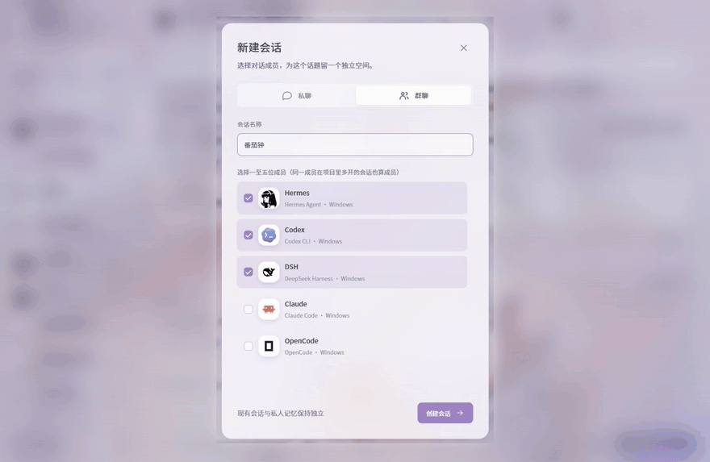
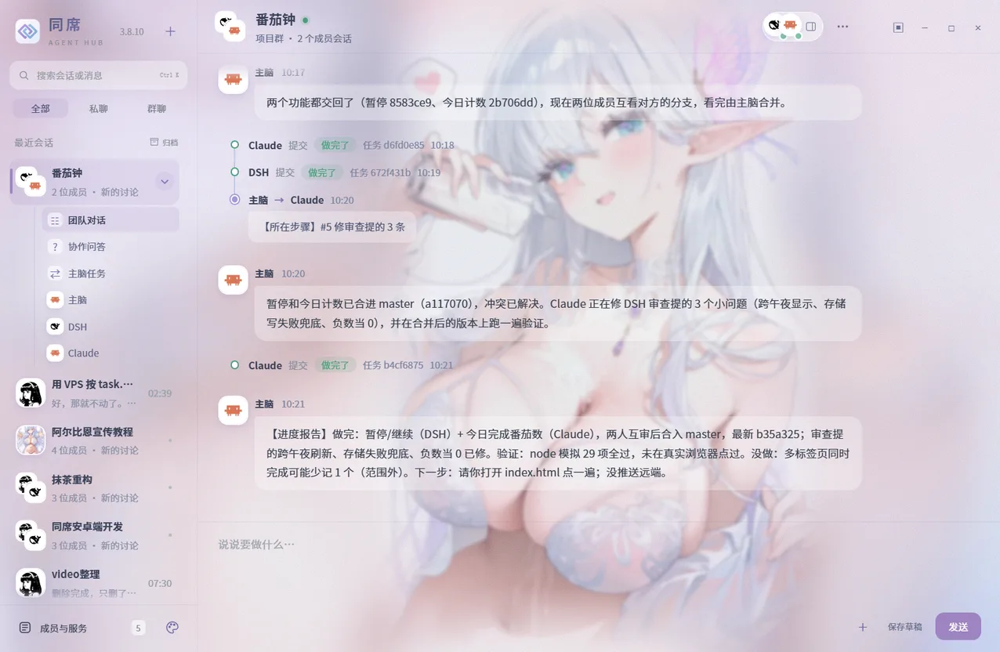
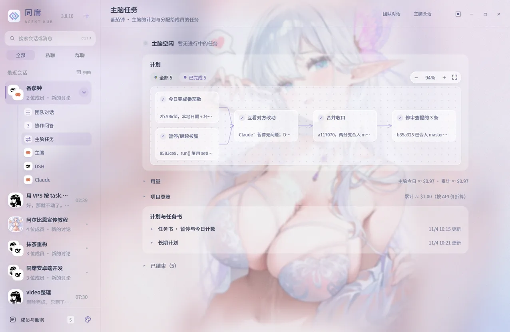
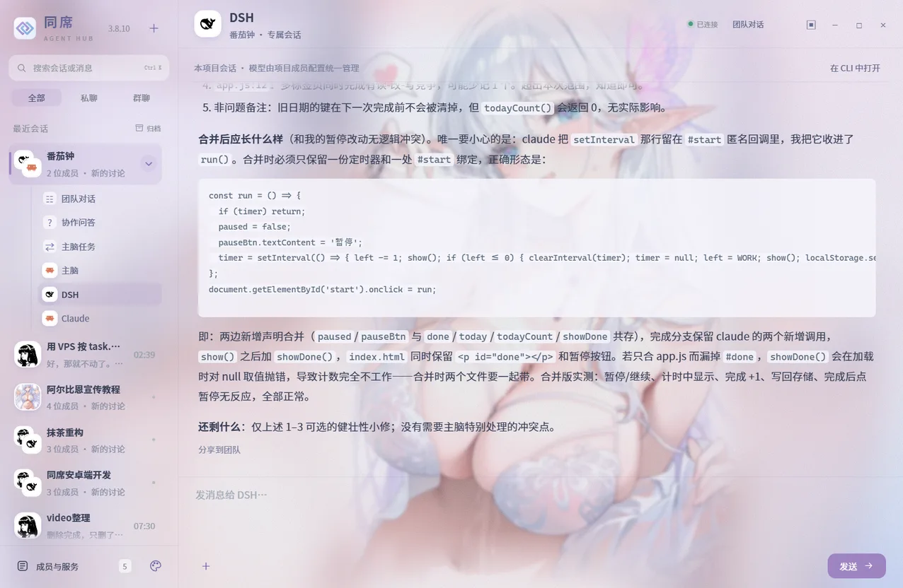
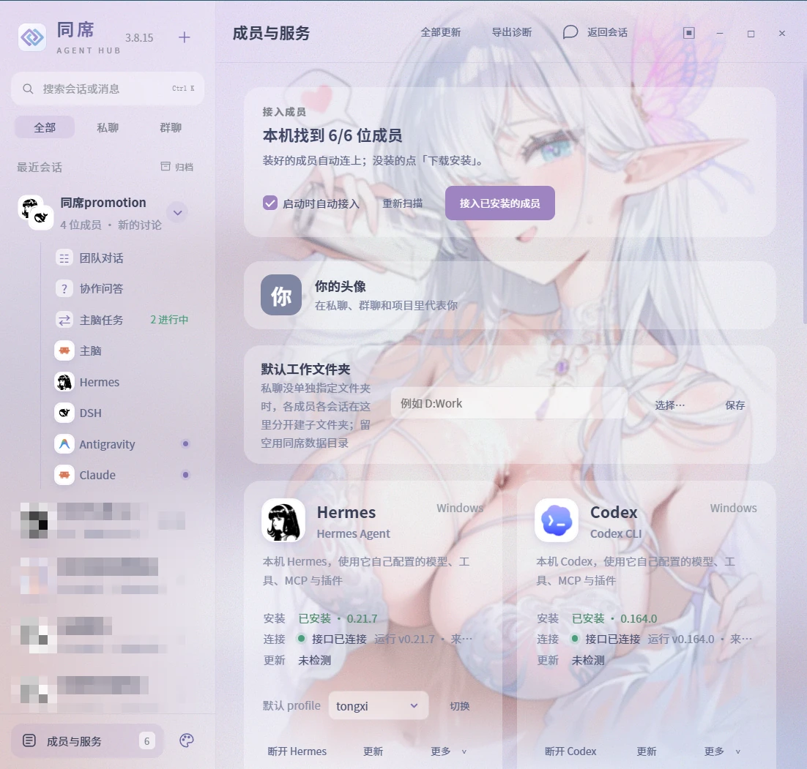
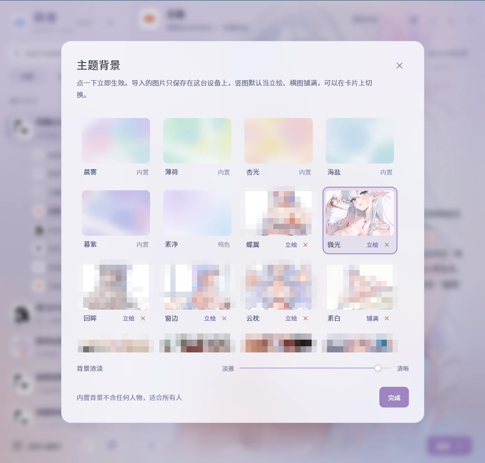
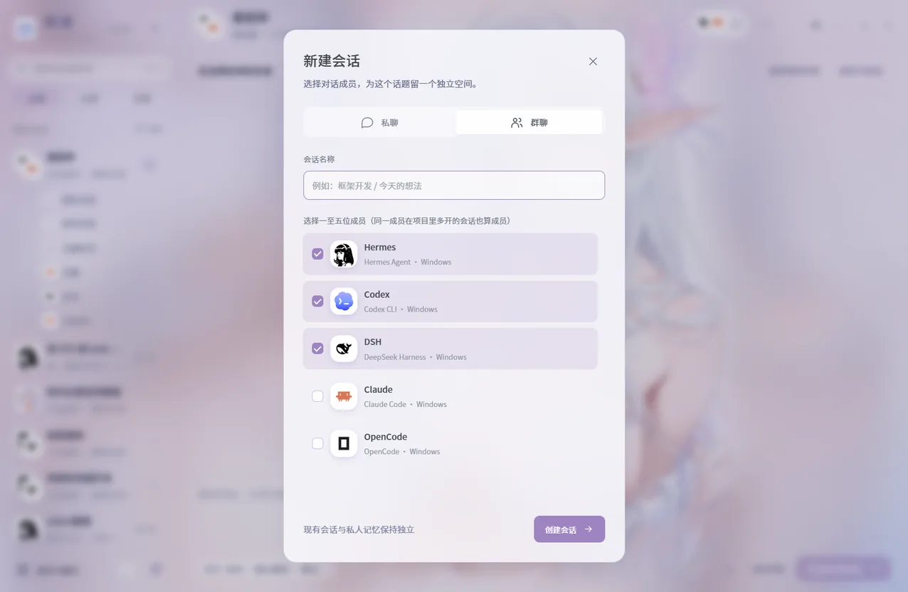
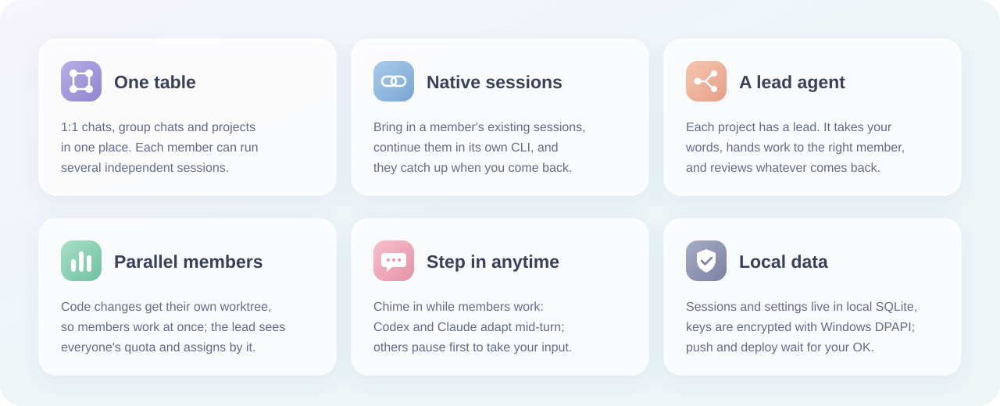

<div align="center">



<br />

[](https://github.com/mydosu/tongxi/releases/latest) [](#quick-start) [](https://v2.tauri.app/) [](LICENSE)

**[Download latest release](https://github.com/mydosu/tongxi/releases/latest)** · **[📖 Quickstart tutorial (Chinese)](docs/上手教程.md)** · [Quick start](#quick-start) · [Supported members](#supported-members) · [Project collaboration](#project-collaboration) · [FAQ](#faq) · [简体中文](README.zh-CN.md)

<br />



<sub>Recording: create project group → bind repo → state requirement → lead plans, members develop in parallel → review and merge. (Waiting sped up; <a href="docs/images/demo.mp4">watch high-res MP4</a>)</sub>

</div>

> **Note**: The UI is in Chinese for now.

<br />

## What is Tongxi?

Tongxi (同席 / Agent Hub) is a Windows desktop application (single exe, portable, ~9 MB). It brings the AI agent command-line interfaces (CLIs) already installed on your PC into a single window:

- **1:1 chat**: Have one-on-one conversations with any member, with full visibility into native reasoning processes and tool calls.
- **Group chat**: Bring together 2–5 members to discuss topics round-robin (1–3 rounds).
- **Project collaboration**: Bind a local code repository to a group, appoint a "lead agent" (主脑) to divide work, let members write code in parallel across isolated Git worktrees, and have the lead review and merge.
- **Companion**: A fifth dedicated seat connecting to any OpenAI-compatible endpoint (self-hosted, local Ollama, or cloud models).

> **Scope & boundaries**: Tongxi is only a desktop interface for these agents. Models, API keys, MCP servers, and plugins are managed entirely by each CLI's own configuration; Tongxi does not modify or take them over. All conversations and data are stored strictly on your local machine.

<br />

## Interface overview

| Team chat（团队对话） | Brain jobs（主脑任务） |
| :---: | :---: |
|  |  |
| Delegations, hand-backs, and progress reports in one stream | Plans drawn as flow charts: see who does what and status at a glance |
| **Member room（成员房间）** | **Members & services（成员与服务）** |
|  |  |
| Members work in their native sessions; jump in any time to inspect or chime in | Scans local CLIs automatically; connect, update, and diagnose here |
| **Themes（主题背景）** | **New session（新建会话）** |
|  |  |
| 6 built-in backgrounds, or import your own image as a figure portrait or full cover | Chat 1:1 with an agent, or pick multiple members for a group chat |

<sub>Screenshot background: Albion fan art by FymriE</sub>

<br />

## Highlights



<br />

## Quick start

For a step-by-step walkthrough with screenshots, see **[📖 Quickstart tutorial (Chinese)](docs/上手教程.md)**.

| Step | Description |
|:---:|---|
| **1. Prerequisites** | Windows 10 / 11, requires [WebView2 Runtime](https://developer.microsoft.com/microsoft-edge/webview2/) (preinstalled on Windows 11). Ensure runtime environments (e.g. Node.js) for desired agent CLIs are installed. |
| **2. Download & Run** | Download the portable `Agent-Hub-vX.Y.Z.exe` from [Releases](https://github.com/mydosu/tongxi/releases/latest), place it in a **folder where you have write permissions** (e.g. `D:\Tools\` or user home directory; do not place in `C:\Program Files` so auto-updates work). Double-click to run. |
| **3. Connect Members** | On launch, Tongxi automatically scans for installed agents. For uninstalled members, click "Install" (下载安装) under "Members & services（成员与服务）", or install manually using the table below. |
| **4. Start Chatting** | Click "＋ New session（新建会话）" at the top of the sidebar to start a 1:1 or group chat; in a group, click "Select project folder（选择项目目录）" to start project collaboration. |

<br />

## Supported members

Open **Members & services（成员与服务）** at the bottom of the sidebar. For uninstalled members, click "Install" (下载安装) to run the official command in a terminal, or install manually in PowerShell.

| Member | Integration | Dependencies | Official Recommended Install | First-time Login / Setup |
|---|---|---|---|---|
| **Codex** | CLI driver | Node.js 18+ | `npm install -g @openai/codex` | `codex login` |
| **Claude Code** | Bridge script | Node.js + Claude CLI | `irm https://claude.ai/install.ps1 \| iex` | Run `claude` once to log in (requires Node.js on machine) |
| **Hermes** | CLI driver | Bundled Python | `iex (irm https://hermes-agent.nousresearch.com/install.ps1)` | Follow setup wizard, or run `hermes setup` |
| **DSH** | CLI driver | Node.js 22.19+ | `npm install -g @deepseek-ai/dsh` | Run `dsh web` to enter DeepSeek API Key |
| **OpenCode** | CLI driver | Node.js | `npm install -g opencode-ai` | `opencode auth login` |
| **Antigravity** | CLI driver | Node.js 18+ | `irm https://antigravity.google/cli/install.ps1 \| iex` | Run `agy` on first launch to sign in |
| **Companion** | Direct API | None | Dedicated seat, no install needed | Enter any OpenAI-compatible Base URL & Key |

> **Note**: For Node.js-based members, Tongxi automatically checks for Node; if missing, it guides installation via `winget` or the official installer. Tongxi's Claude Code bridge relies on Node.js runtime, so ensure Node is installed on your machine.

<br />

## Project collaboration

In a group chat, click **Select project folder（选择项目目录）** to bind a local code repository. If the folder is not yet a Git repository, Tongxi initializes one locally with a safety baseline commit, and never pushes anywhere without authorization.



- **Lead agent coordination**: Each project is driven by one lead agent (主脑, a strong model is recommended) that takes your requirements, writes task briefs and plans, and delegates concrete steps to capable members.
- **Parallel Git worktrees**: Code changes run in parallel across isolated Git worktrees (独立工作树); members do not conflict with each other, and the lead reviews and merges them back once verified.
- **Interjection & steering**: While members work, you can send new messages in their session at any time to adjust direction (Codex and Claude support native mid-turn steering; other agents stop the prior turn and apply your new input).
- **Human-in-the-loop decisions**: For architectural decisions or unauthorized actions, the lead posts a question in the "Inquiries（协作问答）" panel and proceeds only after your decision.

<br />

---

<details>
<summary><b>🛠️ Lead Agent Tools (MCP)</b></summary>

<br />

The lead agent coordinates the team during project collaboration using dedicated MCP tools:

| Tool | Description |
|---|---|
| `hub_delegate` | **Delegate tasks**: Assign specific tasks to designated member sessions, optionally specifying model and reasoning effort. Automatically creates an isolated Git worktree when modifying code. |
| `hub_plan` | **Plans & flowcharts**: Write or update long-term plans and step dependencies, directly driving the flowchart in "Brain jobs（主脑任务）". |
| `hub_finish_worktree` | **Merge / discard**: Inspect code changes in a worktree, merge back into the main branch upon verification, or discard changes. |
| `hub_tell_member` | **Steer / guide**: Send steering input to an active member session mid-flight without restarting. |
| `hub_stop_member` | **Abort task**: Forcibly stop a member's ongoing subtask. |
| `hub_ask_user` | **Inquiries**: Ask the user for critical decisions or sensitive operation permissions in the "Inquiries（协作问答）" panel, avoiding noisy chat spam. |
| `hub_withdraw_question` | **Withdraw inquiry**: Proactively withdraw a pending question if the lead has resolved it through other means. |
| `hub_broadcast` | **Group broadcast**: Send a concise milestone progress summary to the project group chat. |
| `hub_team` / `hub_member` | **Team status**: Query availability, available models, remaining quotas, and recent work history across all member seats. |
| `hub_add_seat` / `hub_rename_seat` / `hub_remove_seat` | **Seat management**: Dynamically add, rename, or remove member seats in a project (up to 4 seats per member type). |
| `hub_memory_read` / `write` / `search` / `list` / `share` | **Project memory**: Read/write shared project notes and private memory. Stored in OpenViking if installed, or as Markdown files under `.tongxi/记忆/`. |

</details>

<details>
<summary><b>⚙️ Environment Variables & Manual Paths</b></summary>

<br />

When a CLI or runtime is not installed in default paths, or to override default behaviors, the following environment variables can be set:

| Variable | Description |
|---|---|
| `AGENT_HUB_DATA_DIR` | Custom data storage directory (defaults to `%LOCALAPPDATA%\local.personal.agenthub\`). |
| `AGENT_HUB_AUTOCONNECT` | Set to `0` to disable automatic detection and silent connection on startup. |
| `AGENT_HUB_CODEX_EXE` | Absolute path to the native `codex.exe` executable. |
| `AGENT_HUB_CODEX_INSTALLATION` | Installation slot directory for managed Codex. |
| `AGENT_HUB_CLAUDE_EXE` | Absolute path to the native Claude Code executable. |
| `AGENT_HUB_CLAUDE_NODE` | Path to `node.exe` used to run the Claude bridge script. |
| `AGENT_HUB_HERMES_PYTHON` | Path to `python.exe` used to run the Hermes ACP bridge. |
| `AGENT_HUB_HERMES_SESSION_DB` | Custom path for Hermes isolated SessionDB. |
| `AGENT_HUB_DSH_INSTALLATION` | Installation directory for DSH (where `@deepseek-ai/dsh` resides). |
| `AGENT_HUB_DSH_NODE` | Path to `node.exe` used to run DSH and its bridge script. |
| `AGENT_HUB_DSH_HOME` | Home configuration directory for DSH. |
| `AGENT_HUB_OPENCODE` | Absolute path to the OpenCode executable. |
| `AGENT_HUB_ANTIGRAVITY` | Absolute path to the Antigravity CLI executable (`agy.exe`). |
| `AGENT_HUB_OPENVIKING_PYTHON` | Path to the Python interpreter used by the OpenViking memory system. |

</details>

<details>
<summary><b>📂 Data Storage & Privacy Security</b></summary>

<br />

- **All data stays local**: All sessions, chat transcripts, and project configs are stored in a local SQLite database (`%LOCALAPPDATA%\local.personal.agenthub\hub.db`). Backups (`hub-schema-v{n}-{uuid}.db`) are generated in `backups/` only prior to database schema migrations.
- **Login credentials untouched**: Tongxi never reads or uploads official authentication tokens or config files created by agent CLIs (`~/.claude`, `~/.codex`, etc. remain completely separate).
- **Companion API keys**: Keys entered directly are encrypted with Windows DPAPI. Environment variables and `.env` references only store their path and are read at runtime. The key is only sent to your specified endpoint.
- **External actions require authorization**: Lead agent actions that affect external environments (such as Git push or deployments) respect the permission tier and standing grants configured in project settings; unauthorized actions will prompt you first in the Inquiries panel.
- **`.tongxi/` ignored in Git**: Project-local `.tongxi/` files generated by the lead (including briefs, plans, handoffs, and local memory) are never committed.

</details>

<details>
<summary><b>🏗️ Architecture & Local Build</b></summary>

<br />

Tongxi is built with **Tauri 2 + Native TypeScript + Rust**:
- **Desktop Shell**: Tauri 2 + system WebView2, providing borderless windowing, system tray, OS-level Job Object (terminating child processes on app exit), and global `Ctrl+Shift+H` HUD mode.
- **Frontend UI**: TypeScript 5 + Vite 6, native DOM and CSS; Markdown and math formulas rendered via custom renderer and KaTeX.
- **Backend Core**: Rust 2021 + SQLite (rusqlite, statically compiled), handling process lifecycle, protocol bridging, and Git worktree management.

**Local development commands**:

```powershell
npm ci --no-audit --no-fund
npm run build                                   # Frontend type-check & bundle
cargo test --manifest-path src-tauri/Cargo.toml # Backend Rust tests
npm run desktop                                 # Start local dev mode
npm run desktop:build                           # Build release single-exe and archive
```

</details>

## FAQ

<br />

<details>
<summary><b>❓ Frequently Asked Questions (FAQ)</b></summary>

<br />

**Q: First launch triggers "Windows protected your PC" (SmartScreen)?**
> Tongxi is an open-source portable application without a commercial code-signing certificate. Click "More info" in the dialog, then click "Run anyway" to start.

**Q: Just installed a member CLI in terminal, but Tongxi shows "Not installed"?**
> The Tongxi process captures a PATH snapshot at launch time. Go to "Members & services（成员与服务）" and click "Rescan" (重新扫描) at the top. If using environment managers activated only inside specific shell sessions (such as `fnm`), restart Tongxi.

**Q: Claude Code is installed, but clicking connect gives "Node runtime not found"?**
> Tongxi connects to Claude Code via a Node-driven bridge script. Using Tongxi requires Node.js (18+ recommended) on your machine. Install Node.js on your computer, then click "Rescan".

**Q: DSH shows connected, but errors on sending a message?**
> DSH uses its own configuration. In "Members & services（成员与服务）", find the DSH card, click "More ⌄" → "Login / Initial Setup", enter your DeepSeek API Key (or add compatible providers) in the opened `dsh web` page, save, and return to Tongxi.

**Q: Why does "Stop & send" interrupt the prior reply for some members?**
> Only Codex and Claude natively support injecting prompts mid-reply (native steering, button shows "Steer" / 插话引导). Hermes, DSH, OpenCode, and Antigravity stop the previous response before sending your new input (button shows "Stop & send" / 停止并发送). To cancel immediately, press `Esc` or click the red "Stop" button.

**Q: Auto-update says "Cannot write new version into app directory"?**
> Tongxi's auto-updater renames the currently running executable and writes the new one in place. If placed in protected system directories like `C:\Program Files`, write permissions may be denied. Move the executable to a user directory (such as `D:\Tools\`) and try again.

**Q: Companion connection test returns 401 or 404?**
> A 404 error usually means the endpoint URL lacks the version suffix; most compatible services require `/v1` (e.g. `http://127.0.0.1:11434/v1`). A 401/403 error means the key is invalid or unset; if using environment variables, restart Tongxi after setting them.

</details>

<details>
<summary><b>📝 Changelog Summary</b></summary>

<br />

- **v3.8.15** (2026-11-05): Empty areas around the main backdrop image no longer use an enlarged copy of the full image; instead, edge colors extend outward with fading gradients, falling back to a full-image color extraction when edges are busy.
- **v3.8.14** (2026-11-05): Added a "Select…" button next to bound project directory, member workspace, and default working folder to open the system folder picker; when background intensity is set to "Clear", the main image becomes more translucent, filler background becomes sharper, and the sidebar retains light frosted glass for readability.
- **v3.8.13** (2026-11-04): Background intensity changed to a continuous slider; dark wallpapers thicken panel backdrops, colorful figure art avoids dark border compression, full-bleed images allow positioning adjustments, imported art preserves up to 4K resolution with alerts for HEIC/GIF; installer upgrades outdated Node first, falls back to official packages when winget is missing, recognizes Node managed by nvm/fnm/Volta and custom Hermes installs, and displays member version numbers; prompts where to install WebView2 when missing.
- **v3.8.12** (2026-11-04): Button hover tooltips updated from default OS black boxes to theme-matched frosted glass tooltips that flip upward when near the window bottom.
- **v3.8.11** (2026-11-04): DSH default model follows DSH's own settings; model changes made in group or project chats are remembered and reused in new sessions; theme cards no longer stack titles vertically in narrow windows; README updated with actual screen recordings and UI region screenshots.
- **v3.8.10**: User messages flattened (removed gradients and white borders, aligned right with subtle button tint; inquiry cards removed thick borders, highlighting pending items with soft background); 1:1 chats span full width; white panel background and frosted glass scale with intensity setting.
- **v3.8.9**: Removed top white accent line and purple handle.

</details>
