<div align="center">


<br />

[](https://github.com/mydosu/tongxi/releases/latest) [](#quick-start) [](https://v2.tauri.app/) [](LICENSE)

**[Download latest release](https://github.com/mydosu/tongxi/releases/latest)** · **[📖 Quickstart tutorial (Chinese)](docs/上手教程.md)** · [Quick start](#quick-start) · [Supported members](#supported-members) · [Project collaboration](#project-collaboration) · [On your phone](#on-your-phone) · [FAQ](#faq) · [简体中文](README.zh-CN.md)

<br />

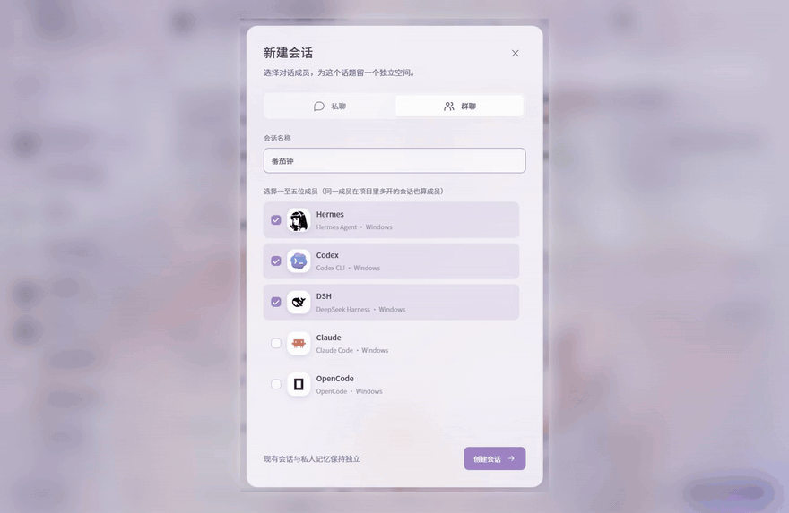

<sub>Recording: create project group → bind repo → state requirement → Leader plans, members develop in parallel → review and merge. (Waiting sped up; <a href="docs/images/demo.mp4">watch high-res MP4</a>)</sub>

</div>

> **Note**: The UI is in Chinese for now.

<br />

## What is Tongxi?

Tongxi (同席 / Agent Hub) is a Windows desktop application (single exe, portable, ~9 MB). It brings the AI agent command-line interfaces (CLIs) already installed on your PC into a single window and lets them work together, each doing what it is good at:

- **Project collaboration**: Bind a local code repository to a group and pick a **Leader**. You say one sentence; the Leader turns it into a plan, hands steps to suitable members who write code in parallel in their own Git worktrees, then reviews and merges what comes back.
- **Watches (待机)**: Reminders, routine checks, or a command run every few minutes; the Leader is woken only when something changes.
- **Project requests (项目往来)**: One project can ask another for help; results and files come back on their own.
- **1:1 and group chat**: Talk to any member with full visibility into native reasoning and tool calls, or bring up to 5 members together to discuss round-robin (1–3 rounds).
- **On your phone**: Over Tailscale, check progress, answer questions and keep chatting with the same features as on the desktop.
- **Companion**: A separate seat for any OpenAI-compatible endpoint (self-hosted, local Ollama, or cloud models).

> **Leader** is the default name of the member in charge; rename it in the project's member panel and it applies everywhere. Earlier versions and some documents call it 主脑 ("lead agent").

> **Scope & boundaries**: Tongxi is only a desktop interface for these agents. Models, API keys, MCP servers, and plugins are managed entirely by each CLI's own configuration; Tongxi does not modify or take them over. All conversations and data are stored strictly on your local machine.

<br />

## Interface overview

| Team chat（团队对话） | Leader tasks（Leader 任务） |
| :---: | :---: |
| 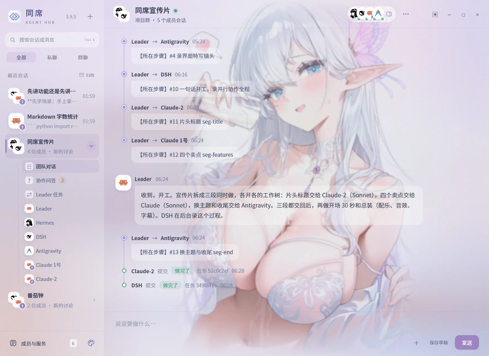 | 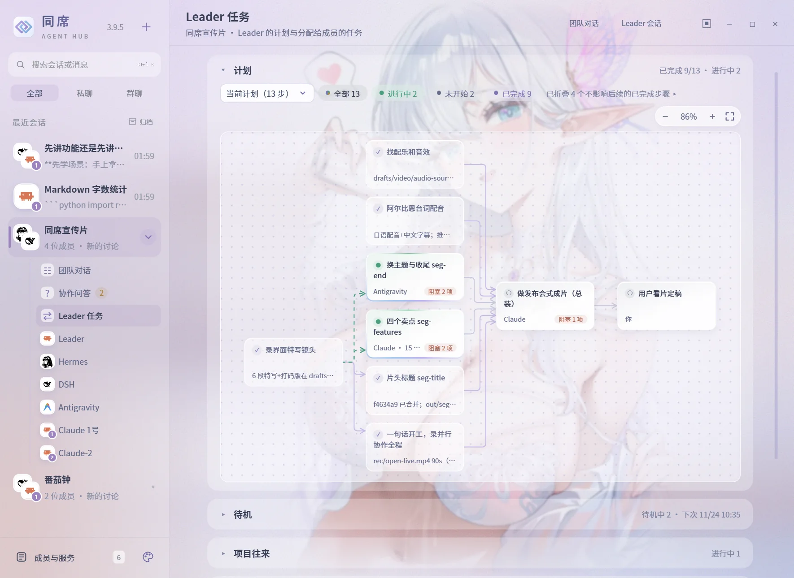 |
| Delegations, hand-backs, and progress reports in one stream | Plans drawn as flow charts: see who does what and status at a glance |
| **Watches & project requests（待机与项目往来）** | **Inquiries（协作问答）** |
| 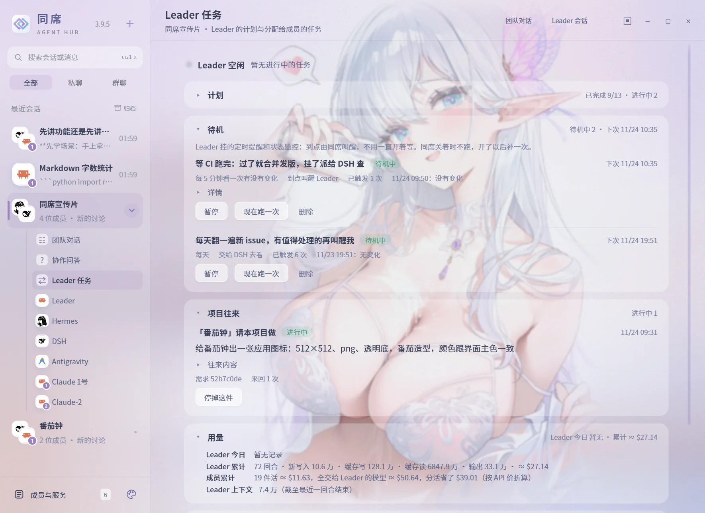 | 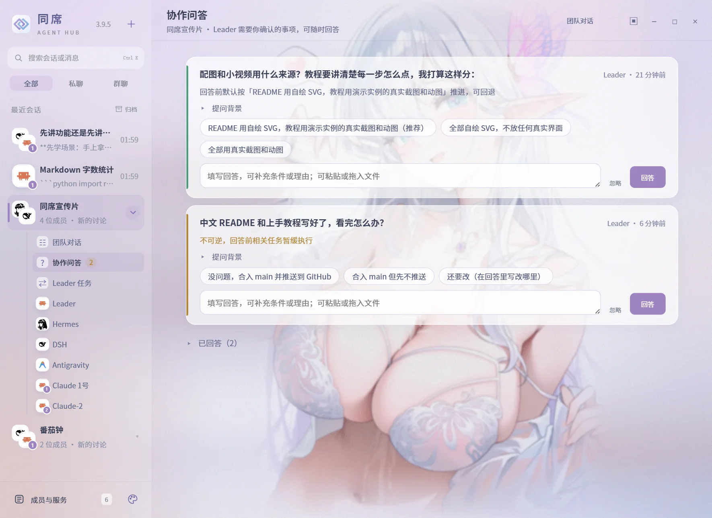 |
| Scheduled checks that wake on change; projects asking each other for work | Everything that needs your call waits here instead of flooding the chat |
| **Member room（成员房间）** | **Group chat（群聊讨论）** |
| 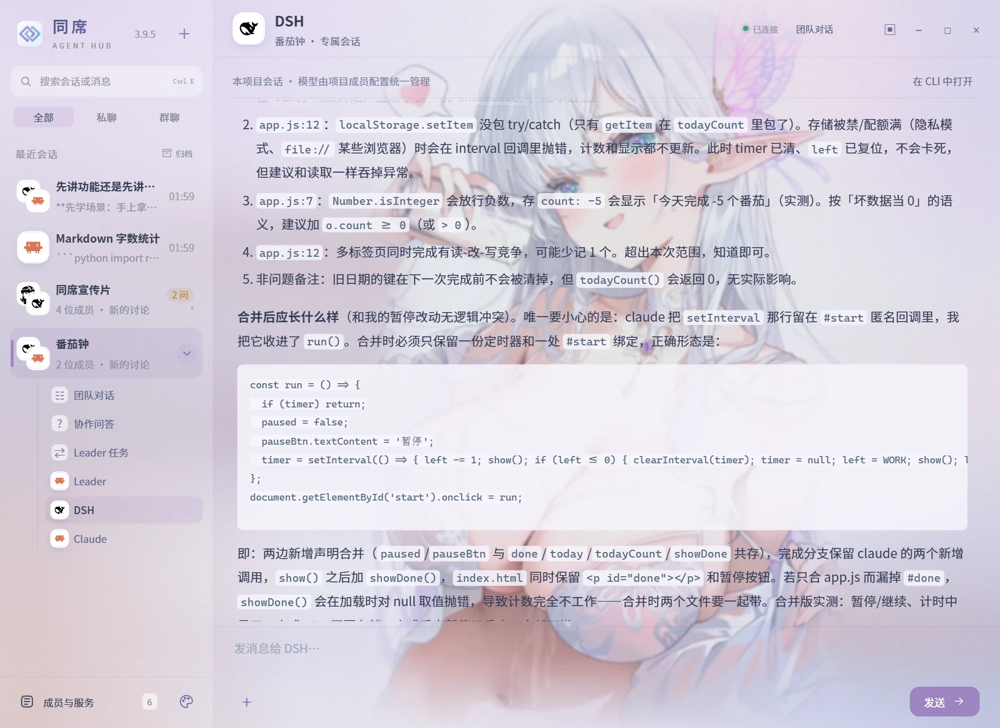 | 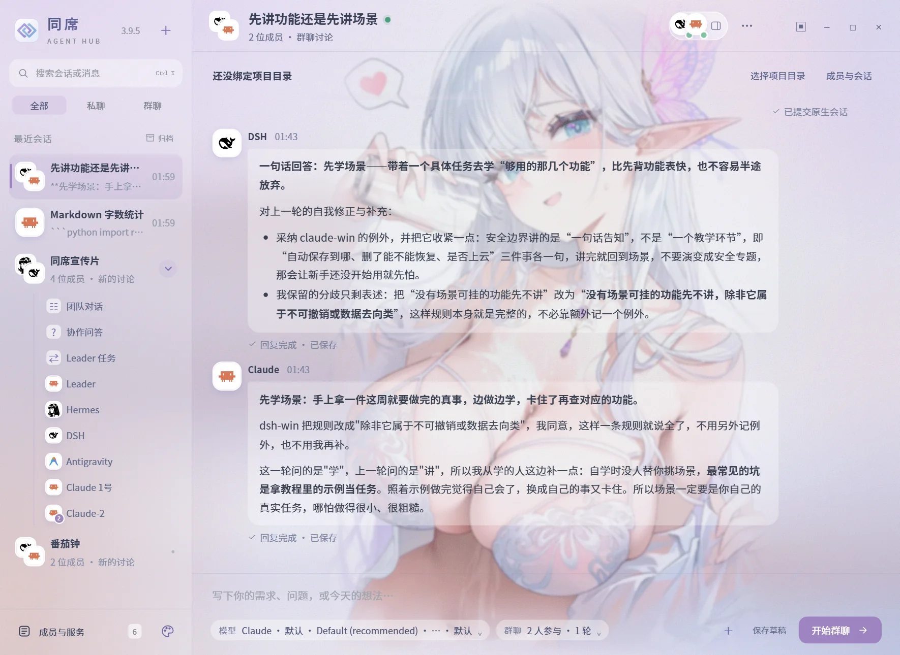 |
| Members work in their native sessions; jump in any time to inspect or chime in | Several members take turns on one question, each with its own view |
| **Project settings（项目设置）** | **Members & services（成员与服务）** |
| 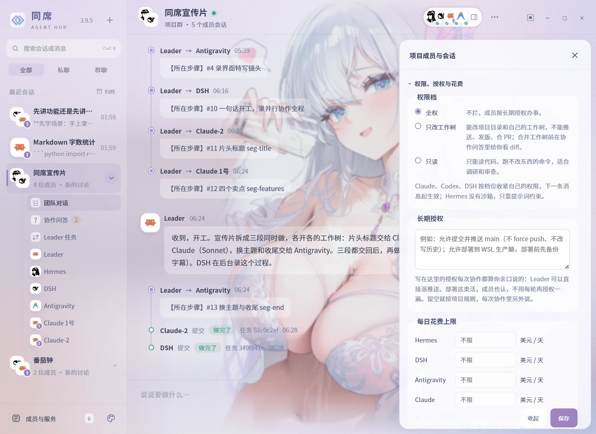 | 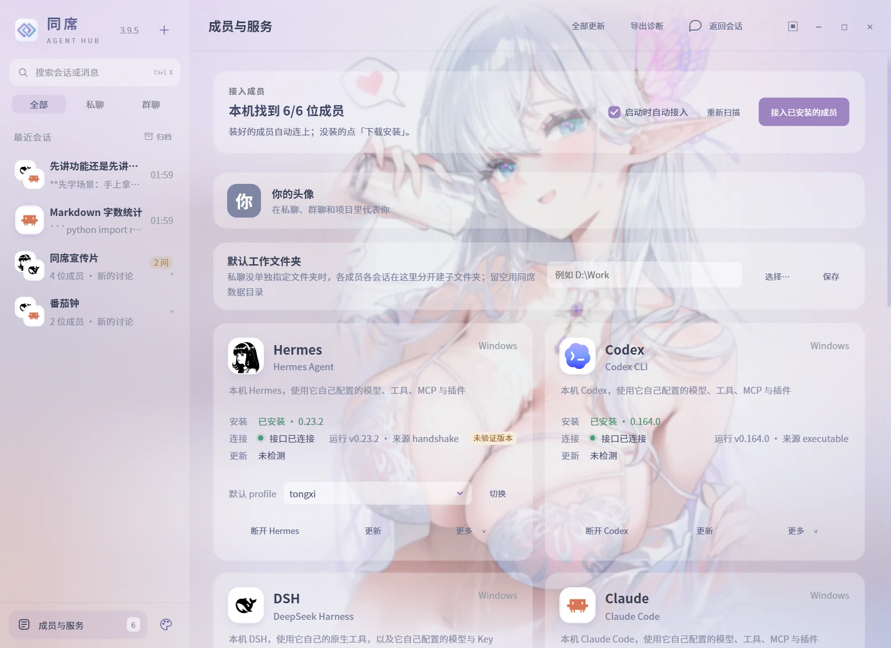 |
| Permission tier, standing grants and daily spend cap, set per project | Scans local CLIs automatically; connect, update, and diagnose here |
| **Themes（主题背景）** | **New session（新建会话）** |
| 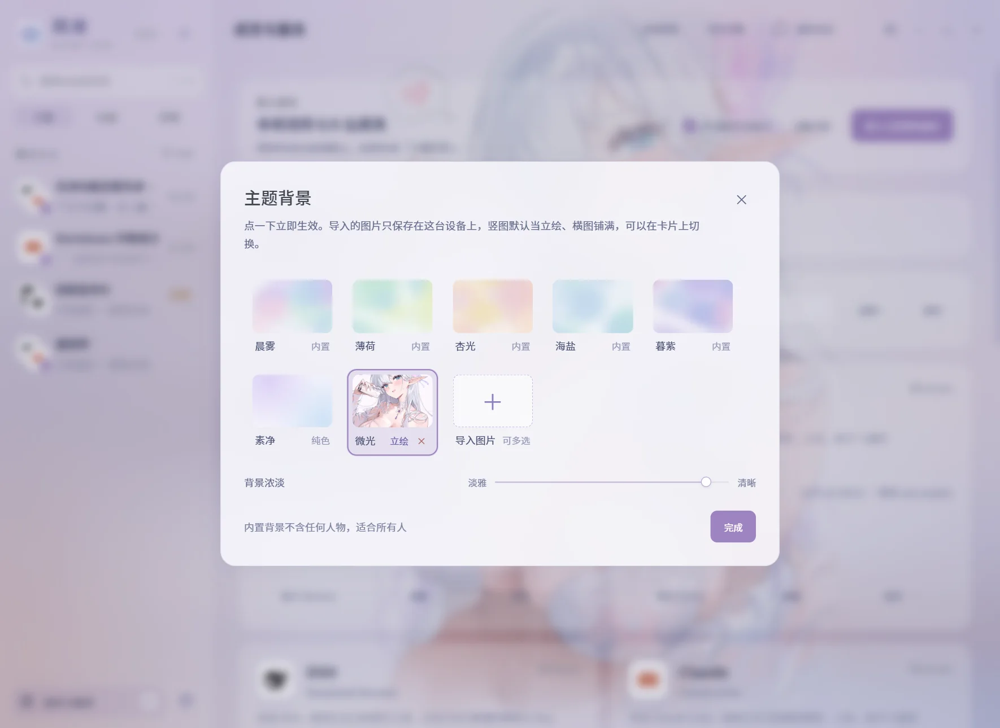 | 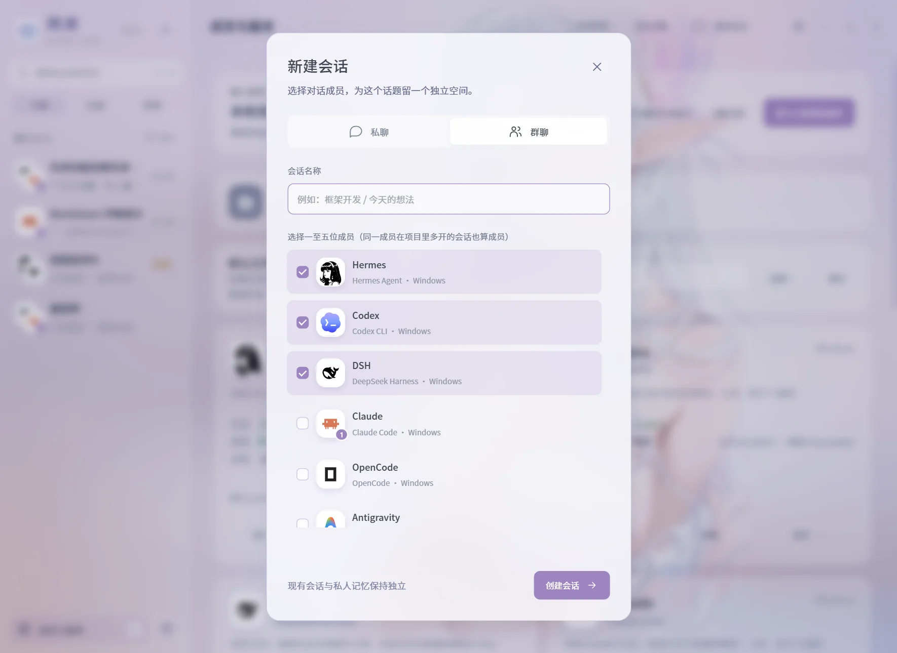 |
| 6 built-in backgrounds, or import your own image as a figure portrait or full cover | Chat 1:1 with an agent, or pick multiple members for a group chat |

<sub>Screenshot background: Albion fan art by FymriE</sub>

<br />

## Highlights

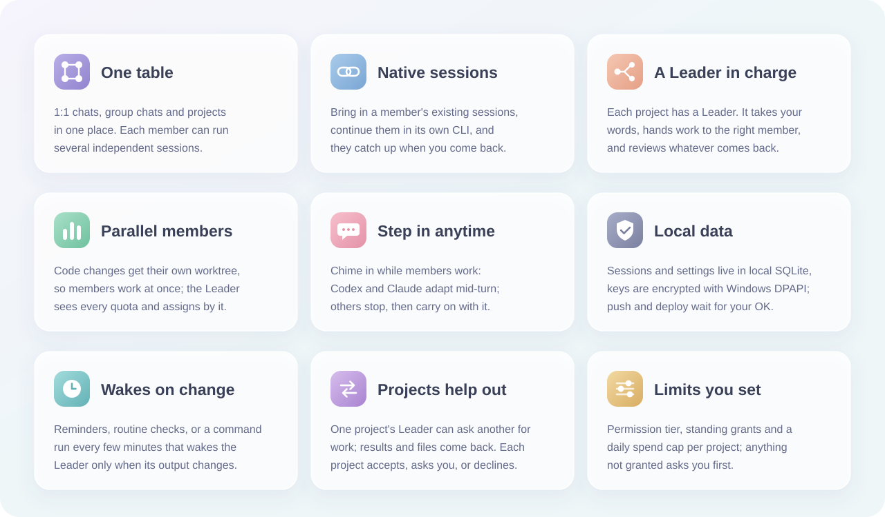

<br />

## Quick start

For a step-by-step walkthrough with screenshots, see **[📖 Quickstart tutorial (Chinese)](docs/上手教程.md)**.

| Step | Description |
|:---:|---|
| **1. Prerequisites** | Windows 10 / 11 with [WebView2 Runtime](https://developer.microsoft.com/microsoft-edge/webview2/) (preinstalled on Windows 11). No Node.js yet? Installing a member from inside Tongxi sets it up first. |
| **2. Download & Run** | Download the portable `Agent-Hub-vX.Y.Z.exe` from [Releases](https://github.com/mydosu/tongxi/releases/latest), place it in a **folder where you have write permissions** (e.g. `D:\Tools\` or your user directory; not `C:\Program Files`, so auto-updates work). Double-click to run; later versions install with one click inside the app. |
| **3. Connect Members** | On launch, Tongxi automatically scans for installed agents. For uninstalled members, click "Install" (下载安装) under "Members & services（成员与服务）", or install manually using the table below. |
| **4. Start Chatting** | Click "＋ New session（新建会话）" at the top of the sidebar to start a 1:1 or group chat; in a group, click "Select project folder（选择项目目录）" to start project collaboration. |

<br />

## Supported members

Tongxi seats **6 mainstream CLIs + 1 companion**. Use whichever you have; even a single member can collaborate by opening several sessions.

| Member | Integration | Install command | Requires | First-time login / setup |
|---|---|---|---|---|
| **Codex** | Official app-server (JSON-RPC) | `npm install -g @openai/codex` | Node.js 18+ | Run `codex login` |
| **Claude Code** | Bridge over CLI stream-json | `irm https://claude.ai/install.ps1 \| iex` | Node.js 18+ (for the bridge; installing inside Tongxi sets it up first) | Run `claude` once to log in |
| **Hermes** | Extended ACP service | `iex (irm https://hermes-agent.nousresearch.com/install.ps1)` | Python (the installer brings its own venv) | Run `hermes setup` |
| **DSH** | Bridge over the DeepSeek harness | `npm install -g @deepseek-ai/dsh` | Node.js 22.19+ | Run `dsh web` to enter a key |
| **OpenCode** | Built-in ACP (optional) | `npm install -g opencode-ai` | Node.js | `opencode auth login` |
| **Antigravity** | Bridge over agy stream-json (optional) | `irm https://antigravity.google/cli/install.ps1 \| iex` | Node.js 18+ | Run `agy` once to sign in |
| **Companion** | Any OpenAI-compatible API | Nothing to install; click "Configure companion" (配置陪伴) | A `/v1` chat endpoint | Endpoint, key and persona |

> [!NOTE]
> - **Node.js**: Missing or outdated Node is installed or upgraded when you install a member (official package if `winget` is missing); nvm, fnm and Volta are recognized. No restart needed, just click "Connect" (连接).
> - **Auto-connect**: Codex, Claude, Hermes and DSH connect automatically. OpenCode and Antigravity are optional: connect them once by hand and they reconnect from then on. A member you disconnect stays disconnected. Set `AGENT_HUB_AUTOCONNECT=0` to turn it all off.
> - **Interjecting**: Send a message at any time while a member replies. Codex and Claude take it mid-turn (button shows 插话引导); Hermes, DSH, OpenCode and Antigravity stop the current turn first (button shows 停止并发送). `Esc` or the red stop button cancels the current output.
> - **New models**: "Refresh models" (刷新模型) under "More" (更多) on a member card picks them up without restarting the member or interrupting a conversation.

<br />

## Project collaboration

In a group chat, click **Select project folder（选择项目目录）** to bind a local code repository; the group becomes a project group:


- **You talk to the Leader**: Requirements posted in the group go straight to the Leader; the group only shows progress summaries.
- **Briefs and plan charts**: Longer work is written as briefs in `.tongxi/任务书/` and drawn as a flow chart on the "Leader tasks（Leader 任务）" page, with dependencies, blockers and usage.
- **Assigned by quota and track record**: The Leader sees each account's remaining quota and how each member × model did on each kind of work over the last 30 days, and picks member, model and reasoning effort accordingly.
- **Parallel Git worktrees**: Code changes run in isolated `git worktree` branches in `<folder>-worktrees` next to the project; the Leader reviews, then merges or discards them.
- **Several sessions per member**: Up to 4 sessions each, with different models if you like; the Leader treats them as separate members.
- **Inquiries**: Key decisions and unauthorized outward actions wait for you in "Inquiries（协作问答）"; for reversible matters the Leader goes ahead with a default meanwhile.
- **Progress survives new sessions**: The Leader writes a handoff every turn and moves to a fresh session when the context grows too long or the cache goes cold, saving tokens without losing the thread.

### Watches（待机）: wake only on change

Tell the Leader "look at the production log every morning" or "watch this CI run and tell me the result", and it sets a watch:

| Kind | When the Leader wakes |
|---|---|
| **Reminder** | Once at a given time, or repeating (every 30 minutes at the shortest). |
| **Check command** | A command runs in the project folder every few minutes (5 at the shortest); the Leader wakes only when its output or exit code changes, so nothing is spent while nothing happens. Needs the 全权 (full) tier; it runs once when set so the Leader can verify the output. |
| **Handed to a member** | Routine looks go to a cheaper member, which leaves the Leader alone unless there is news. |

Anything missed while Tongxi is closed runs once at startup; watches are postponed when quota runs low. They are listed on the Leader tasks page, where you can pause, resume, run now or delete them without waking the Leader.

### Project requests（项目往来）

One project's Leader can ask another project for work, such as a code project asking a promo project for artwork. The other side queues it in its own plan, then hands back a conclusion and files, which are copied into the requester's `.tongxi/收件`. Each project chooses to **accept** (直接接), **ask me first** (先问我) or **decline** (不接).

### Permissions, grants and spending

Set per project, effective from the next message:

| Setting | Effect |
|---|---|
| **Full（全权）** | Nothing blocked; members follow your standing grants. |
| **Worktrees only（只改工作树）** | May edit the project folder and their worktrees, but not push, release or merge PRs; you get a diff in Inquiries before a worktree is merged. |
| **Read-only（只读）** | Read code and run commands that change nothing; good for research and review. |
| **Standing grants（长期授权）** | Write "pushing main is allowed" once and it counts as your word in every round. |
| **Daily spend cap（每日花费上限）** | Per member, at API prices. When reached, no new work is handed out until you decide in Inquiries. Subscription accounts are not charged per token and are not capped. |

Claude, Codex and DSH enforce the tier with their own permission systems; Hermes has no sandbox and relies on prompts.

### The Leader tasks page

Plan, tasks, watches, project requests, usage and ledger live on one page. Every block folds and remembers it; finished items take one line each, older ones collapse into one, and you can delete them singly or all at once. Deleting a task only unlists it: usage, track record and worktrees stay.

<br />

## On your phone

Tick "Allow phone access" (允许手机访问) at the bottom of "Members & services（成员与服务）". With PC and phone on the same Tailscale network, open the URL with its token in the phone browser. Everything on the desktop is there except actions tied to the PC itself (folder pickers, Explorer), and it reconnects automatically.

On Android you can also install an app: download [`Agent-Hub-v3.8.25-android-arm64.apk`](https://github.com/mydosu/tongxi/releases/tag/v3.8.25) and paste the URL once. The app shows the interface served by your PC, so it updates along with the desktop version and the package is not reissued with every release. There is no iPhone app; use the same URL in the browser. See [section 10 of the tutorial (Chinese)](docs/上手教程.md#10-进阶用手机远程访问电脑上的同席).

<br />

## And also

- **Native sessions**: Bring in sessions a member already has in its own CLI, hand them back to the CLI, and they catch up when you return.
- **Images and files**: Local images in replies show inline; files become buttons that open in Explorer.
- **Themes**: Import your own image as a figure or full cover, tune its strength with a slider, and button colors follow it.
- **HUD mode**: `Ctrl+Shift+H` shrinks Tongxi to a floating input bar that unfolds the reply below.
- **Project memory**: Notes members share are visible to the whole project; stored in OpenViking if installed, otherwise as Markdown.

<br />

---

<details>
<summary><b>🛠️ Leader tools (MCP)</b></summary>

<br />

The Leader coordinates the team during project collaboration using dedicated MCP tools:

| Tool | Description |
|---|---|
| `hub_team` / `hub_member` | **Team status**: Availability, models, remaining quota, 30-day track record, recent tasks and replies of every seat. |
| `hub_delegate` | **Delegate tasks**: Assign specific tasks to designated member sessions, optionally specifying model and reasoning effort. Automatically creates an isolated Git worktree when modifying code. |
| `hub_plan` | **Plans & flowcharts**: Write or update long-term plans and step dependencies, directly driving the flowchart in "Leader tasks". |
| `hub_finish_worktree` | **Merge / discard**: Inspect code changes in a worktree, merge back into the main branch upon verification, or discard changes. |
| `hub_tell_member` | **Steer**: Add guidance while a member works. Works for every member: those without native steering are stopped and continue in the same session with a warm cache. |
| `hub_stop_member` | **Stop**: Stop a member's subtask and close it on the spot; it can be delegated again right away. |
| `hub_schedule` | **Watches**: Set, change or remove reminders and check commands; removed ones can be restored within 7 days. |
| `hub_ask_project` / `hub_reply_project` | **Project requests**: Ask another project for work, and hand back results and files. |
| `hub_ask_user` / `hub_withdraw_question` | **Inquiries**: Ask for key decisions or permissions in "Inquiries（协作问答）", and withdraw a question that no longer matters. |
| `hub_broadcast` | **Group broadcast**: Send a concise milestone progress summary to the project group chat. |
| `hub_add_seat` / `hub_rename_seat` / `hub_remove_seat` | **Seat management**: Dynamically add, rename, or remove member seats in a project (up to 4 seats per member type). |
| `hub_memory_read` / `write` / `search` / `list` / `share` | **Project memory**: Read/write shared project notes and private memory. Stored in OpenViking if installed, or as Markdown files under `.tongxi/记忆/`. |

</details>

<details>
<summary><b>⚙️ Environment Variables & Manual Paths</b></summary>

<br />

When a CLI or runtime is not installed in default paths, or to override default behaviors, the following environment variables can be set:

| Variable | Description |
|---|---|
| `AGENT_HUB_DATA_DIR` | Custom data storage directory (defaults to `%LOCALAPPDATA%\local.personal.agenthub\`). |
| `AGENT_HUB_AUTOCONNECT` | Set to `0` to disable automatic detection and silent connection on startup. |
| `AGENT_HUB_CODEX_EXE` | Absolute path to the native `codex.exe` executable. |
| `AGENT_HUB_CODEX_INSTALLATION` | Installation slot directory for managed Codex. |
| `AGENT_HUB_CLAUDE_EXE` | Absolute path to the native Claude Code executable. |
| `AGENT_HUB_CLAUDE_NODE` | Path to `node.exe` used to run the Claude bridge script. |
| `AGENT_HUB_HERMES_PYTHON` | Path to `python.exe` used to run the Hermes ACP bridge. |
| `AGENT_HUB_HERMES_SESSION_DB` | Custom path for Hermes isolated SessionDB. |
| `AGENT_HUB_DSH_INSTALLATION` | Installation directory for DSH (where `@deepseek-ai/dsh` resides). |
| `AGENT_HUB_DSH_NODE` | Path to `node.exe` used to run DSH and its bridge script. |
| `AGENT_HUB_DSH_HOME` | Home configuration directory for DSH. |
| `AGENT_HUB_OPENCODE` | Absolute path to the OpenCode executable. |
| `AGENT_HUB_ANTIGRAVITY` | Absolute path to the Antigravity CLI executable (`agy.exe`). |
| `AGENT_HUB_OPENVIKING_PYTHON` | Path to the Python interpreter used by the OpenViking memory system. |
| `AGENT_HUB_GIT_EXE` | Absolute path to `git.exe` (found on PATH by default). |
| `AGENT_HUB_GATEWAY_PORT` | Port for phone access (default `47680`). |

</details>

<details>
<summary><b>📂 Data Storage & Privacy Security</b></summary>

<br />

- **All data stays local**: All sessions, chat transcripts, and project configs are stored in a local SQLite database (`%LOCALAPPDATA%\local.personal.agenthub\hub.db`). Backups (`hub-schema-v{n}-{uuid}.db`) are generated in `backups/` only prior to database schema migrations.
- **Login credentials untouched**: Tongxi never reads or uploads official authentication tokens or config files created by agent CLIs (`~/.claude`, `~/.codex`, etc. remain completely separate).
- **Companion API keys**: Keys entered directly are encrypted with Windows DPAPI. Environment variables and `.env` references only store their path and are read at runtime. The key is only sent to your specified endpoint.
- **External actions require authorization**: Actions that affect external environments (such as Git push or deployments) respect the permission tier and standing grants configured in project settings; unauthorized actions will prompt you first in the Inquiries panel.
- **`.tongxi/` ignored in Git**: Project-local `.tongxi/` files generated by the Leader (including briefs, plans, handoffs, received files, and local memory) are never committed.

</details>

<details>
<summary><b>🏗️ Architecture & Local Build</b></summary>

<br />

Tongxi is built with **Tauri 2 + Native TypeScript + Rust**:
- **Desktop Shell**: Tauri 2 + system WebView2, providing borderless windowing, system tray, OS-level Job Object (terminating child processes on app exit), and global `Ctrl+Shift+H` HUD mode.
- **Frontend UI**: TypeScript 5 + Vite 6, native DOM and CSS; Markdown and math formulas rendered via custom renderer and KaTeX.
- **Backend Core**: Rust 2021 + SQLite (rusqlite, statically compiled), handling process lifecycle, protocol bridging, and Git worktree management.

**Local development commands**:

```powershell
npm ci --no-audit --no-fund
npm run build                                   # Frontend type-check & bundle
cargo test --manifest-path src-tauri/Cargo.toml # Backend Rust tests
npm run desktop                                 # Start local dev mode
npm run desktop:build                           # Build release single-exe and archive
```

</details>

## FAQ

<br />

<details>
<summary><b>❓ Frequently Asked Questions (FAQ)</b></summary>

<br />

**Q: First launch triggers "Windows protected your PC" (SmartScreen)?**
> Tongxi is an open-source portable application without a commercial code-signing certificate. Click "More info" in the dialog, then click "Run anyway" to start.

**Q: Just installed a member CLI in terminal, but Tongxi shows "Not installed"?**
> The Tongxi process captures a PATH snapshot at launch time. Go to "Members & services（成员与服务）" and click "Rescan" (重新扫描) at the top. Node managed by nvm, fnm or Volta is recognized too. If it still isn't found, restart Tongxi or set the path with the environment variables above.

**Q: Claude Code is installed, but clicking connect gives "Node runtime not found"?**
> Tongxi connects to Claude Code via a Node-driven bridge script. Installing it from "Members & services" sets up Node first; if you installed Claude yourself, install [Node.js](https://nodejs.org/) (18+) once and click "Connect" again. No restart needed.

**Q: DSH shows connected, but errors on sending a message?**
> DSH uses its own configuration. In "Members & services（成员与服务）", find the DSH card, click "More ⌄" → "Login / Initial Setup", enter your DeepSeek API Key (or add compatible providers) in the opened `dsh web` page, save, and return to Tongxi.

**Q: Why does "Stop & send" interrupt the prior reply for some members?**
> Only Codex and Claude natively support injecting prompts mid-reply (native steering, button shows "Steer" / 插话引导). Hermes, DSH, OpenCode, and Antigravity stop the previous response before sending your new input (button shows "Stop & send" / 停止并发送). To cancel immediately, press `Esc` or click the red "Stop" button.

**Q: Auto-update says "Cannot write new version into app directory"?**
> Tongxi's auto-updater renames the currently running executable and writes the new one in place. If placed in protected system directories like `C:\Program Files`, write permissions may be denied. Move the executable to a user directory (such as `D:\Tools\`) and try again.

**Q: Companion connection test returns 401 or 404?**
> A 404 error usually means the endpoint URL lacks the version suffix; most compatible services require `/v1` (e.g. `http://127.0.0.1:11434/v1`). A 401/403 error means the key is invalid or unset; if using environment variables, restart Tongxi after setting them.

**Q: Do several members working together burn a lot of quota?**
> Tongxi calls no models itself; everything runs on your members' own accounts. To save: give routine work to cheaper members, watch for results with check commands (no wake-up while nothing changes), and set a daily spend cap per member. The Leader also sees each account's remaining quota when it assigns work.

**Q: Will members touch my code directly or push it somewhere?**
> Code changes happen in isolated worktrees and are merged only after the Leader reviews them. Pushes, deployments and other outward actions ask you first unless granted; for more caution, set the project's tier to "Worktrees only" or "Read-only".

</details>

## Changelog

See [Releases](https://github.com/mydosu/tongxi/releases) and the [full changelog (Chinese)](docs/更新日志.md).
