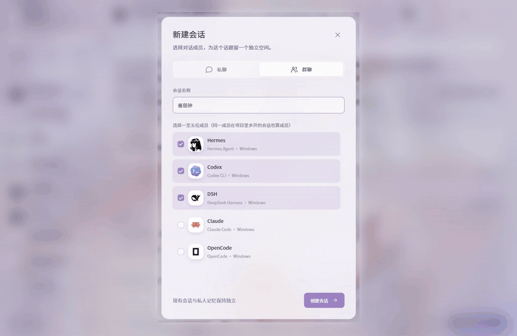
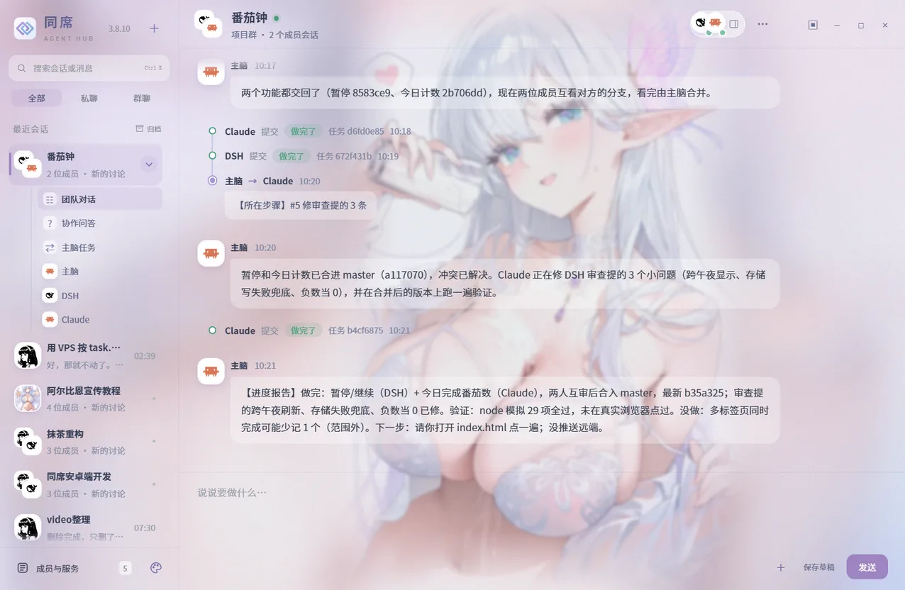
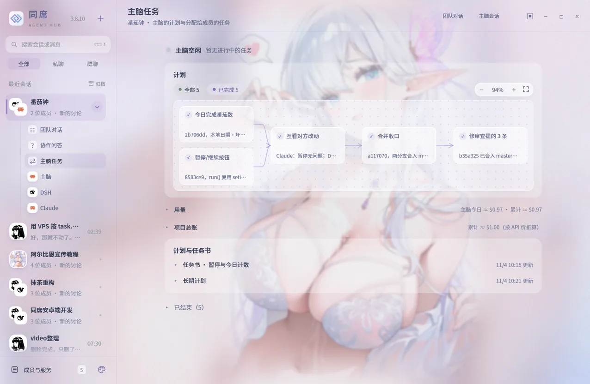
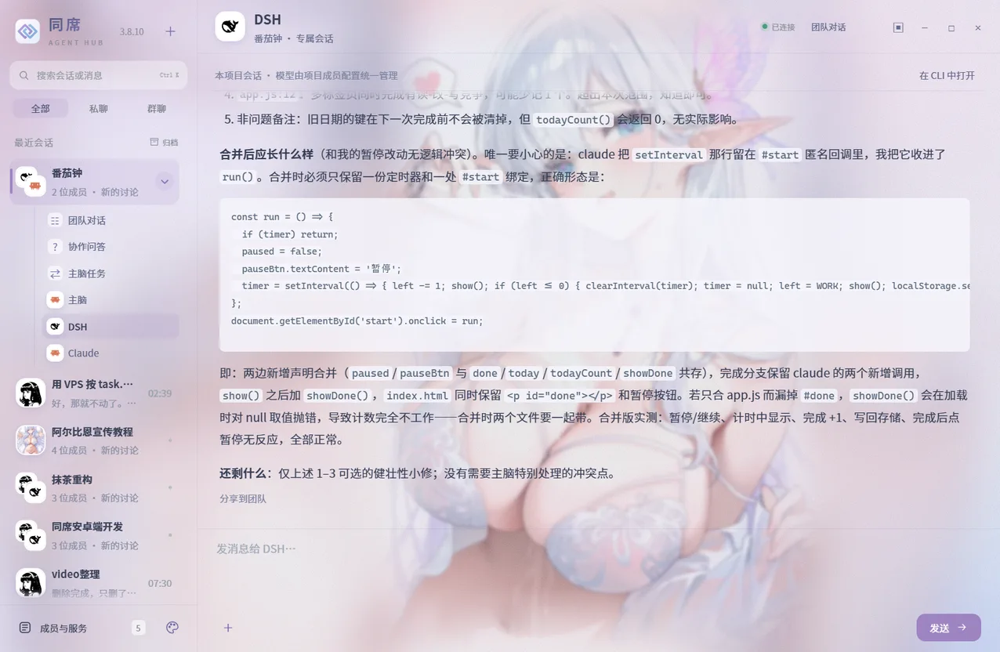
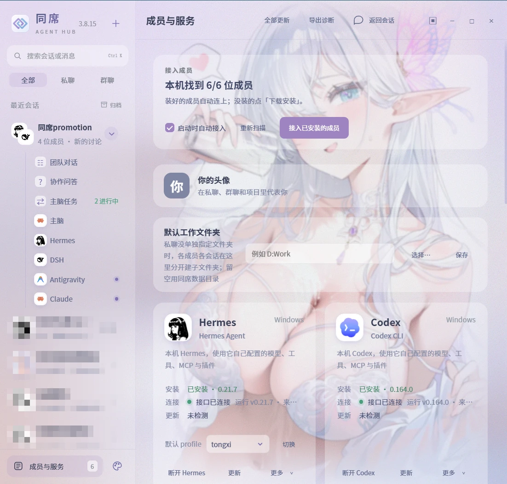
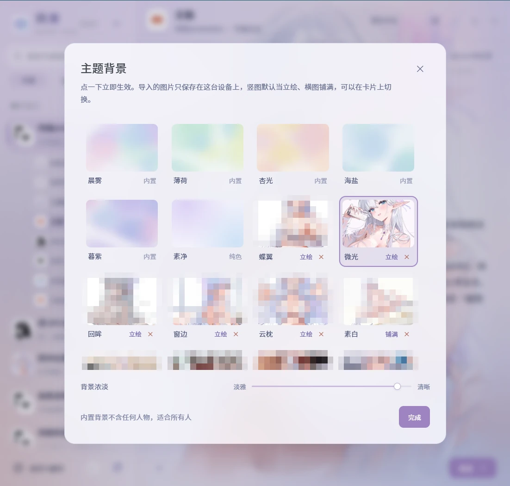
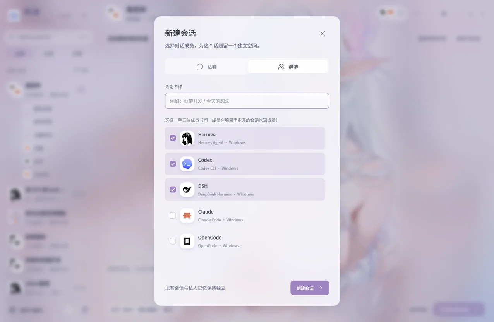
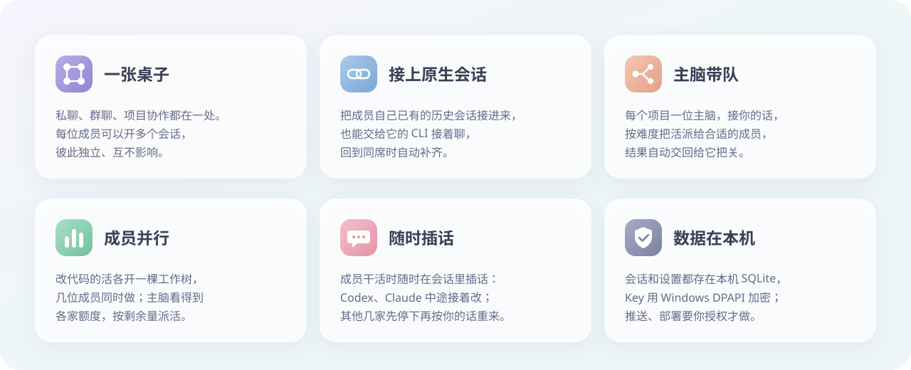

<div align="center">



<br />

[](https://github.com/mydosu/tongxi/releases/latest) [](#快速开始) [](https://v2.tauri.app/) [](LICENSE)

**[下载最新版](https://github.com/mydosu/tongxi/releases/latest)** · **[新手上手教程](docs/上手教程.md)** · [快速开始](#快速开始) · [支持成员](#支持的成员) · [项目协作](#项目协作) · [常见问题](#常见问题) · [English](README.md)

<br />



<sub>实录：新建项目群 → 绑定仓库 → 提出需求 → 主脑拆解计划、成员并行开发 → 审核合并。（等待部分已加速；<a href="docs/images/demo.mp4">看高清 MP4</a>）</sub>

</div>

<br />

## 什么是同席？

同席（Tongxi / Agent Hub）是一个 Windows 桌面应用（单 exe，免安装，约 9 MB）。它把你电脑上已经装好的多个 AI agent 命令行（CLI）接进同一个窗口：

- **私聊**：与任一成员一对一对话，查看原生的思考过程与工具调用。
- **群聊讨论**：拉进 2～5 位成员，按轮次（1～3 轮）轮流发言讨论。
- **项目协作**：把本地代码仓库绑进群聊，选定一位「主脑」带队分工，各成员在独立的 Git 工作树里并行写代码，主脑把关合并。
- **情感陪伴**：第五个专属座位，接你自己的任意 OpenAI 兼容接口（自建、本地 Ollama、云端模型均可）。

> **定位边界**：同席只是这些助手的桌面界面。各成员的模型、API Key、MCP、插件全部沿用其自身 CLI 配置，同席不接管也不修改。所有对话和数据只保存在你的本地。

<br />

## 界面一览

| 团队对话 | 主脑任务 |
| :---: | :---: |
|  |  |
| 主脑派活、成员交回、进度报告一处汇总 | 计划画成流程图，每步谁做、做到哪一目了然 |
| **成员房间** | **成员与服务** |
|  |  |
| 成员在自己的原生独立会话里干活，随时能进去看、插话 | 自动扫描本机 CLI，连接、更新、诊断都在这里 |
| **主题背景** | **新建会话** |
|  |  |
| 内置 6 款背景，也可导入自己的图，选立绘或铺满 | 私聊单独交流，或自选多位成员建群讨论 |

<sub>截图背景：阿尔比恩同人图，画师 FymriE</sub>

<br />

## 亮点



<br />

## 快速开始

图文步骤请查看 **[📖 新手上手教程](docs/上手教程.md)**。

| 步骤 | 说明 |
|:---:|---|
| **1. 准备环境** | Windows 10 / 11，需安装 [WebView2 Runtime](https://developer.microsoft.com/microsoft-edge/webview2/)（Win11 自带）。需使用相关 CLI 时请提前装好对应环境（如 Node.js）。 |
| **2. 下载运行** | 从 [Releases](https://github.com/mydosu/tongxi/releases/latest) 下载单文件 `Agent-Hub-vX.Y.Z.exe`，放入你**有写权限的目录**（如 `D:\Tools\` 或用户个人目录，请勿放 `C:\Program Files` 以免影响自动更新）。双击即可运行。 |
| **3. 接入成员** | 启动后自动扫描本机已安装的 agent。未安装的成员可在「成员与服务」里点击「下载安装」，或根据下方表格手动安装。 |
| **4. 开始使用** | 侧栏已有默认会话；也可点「＋ 新建会话」开新会话；在群聊中绑定本地文件夹即可开启主脑带队协作。 |

<br />

## 支持的成员

同席支持接纳 **6 家主流 CLI + 1 个独立陪伴座位**：

| 成员 | 角色与接法 | 安装命令 | 前置要求 | 初始配置 / 登录 |
|---|---|---|---|---|
| **Codex** | 官方 app-server (JSON-RPC) | `npm install -g @openai/codex` | Node.js 18+ | 终端执行 `codex login` |
| **Claude Code** | 桥接驱动 CLI stream-json | `irm https://claude.ai/install.ps1 \| iex` | **Node.js**（桥接必须，一键安装不带） | 终端首次运行 `claude` 授权 |
| **Hermes** | 扩展内部 ACP 服务 | `iex (irm https://hermes-agent.nousresearch.com/install.ps1)` | 自备 Python（安装器自带 venv） | 终端执行 `hermes setup` |
| **DSH** | 桥接加载 DeepSeek harness | `npm install -g @deepseek-ai/dsh` | Node.js 22.19+ | 终端执行 `dsh web` 配置 Key |
| **OpenCode** | 走自带 ACP（可选） | `npm install -g opencode-ai` | Node.js | 终端执行 `opencode auth login` |
| **Antigravity** | 桥接驱动 agy stream-json（可选） | `irm https://antigravity.google/cli/install.ps1 \| iex` | Node.js 18+ | 终端首次运行 `agy` 授权 |
| **陪伴** | 接任意 OpenAI 兼容接口 | 无需安装，点击卡片「配置陪伴」 | 支持 `/v1` 的聊天接口 | 填写端点、Key 与自定义人设 |

> [!NOTE]
> - **自动连接规则**：Codex、Claude、Hermes、DSH 默认自动接入；OpenCode 与 Antigravity 为可选成员，首次需手动点击「连接」，之后才会自动连；被手动断开的成员不再自动连。可用 `AGENT_HUB_AUTOCONNECT=0` 完全关闭。
> - **插话与打断**：成员回复中途可随时插话。Codex 和 Claude 原生支持直接追加（按钮显示为「插话引导」）；Hermes、DSH、OpenCode、Antigravity 会先停止当前轮次再发送新消息（按钮显示为「停止并发送」）。按 `Esc` 或点红色的「停止」可随时中止当前输出。
> - **手机远程访问**：在「成员与服务」底部勾选「允许手机访问」，在同个 Tailscale 内网下即可用手机浏览器打开带令牌的网址使用同席。安卓手机也可以从 [Releases](https://github.com/mydosu/tongxi/releases/latest) 下载 `Agent-Hub-vX.Y.Z-android-arm64.apk` 装成 App（粘贴一次地址，以后直接打开），iPhone 没有 App，用手机浏览器打开同一条网址即可。详见[上手教程第 10 节](docs/上手教程.md#10-进阶用手机远程访问电脑上的同席)。

<br />

## 项目协作

在群聊中点击顶部 **「选择项目目录」** 绑定代码文件夹，群聊即升级为项目群：



- **群聊话发给主脑**：在群里发布需求直接由主脑接收，群内只同步阶段进展摘要。
- **任务书与计划流程图**：长任务由主脑拆解为 `.tongxi/任务书/`，并在「主脑任务」界面绘制流程图，展示依赖关系、阻塞项与用量。
- **独立 Git 工作树**：需要改代码的子任务由成员在独立的 `git worktree` 分支中并行编写，彼此互不干扰，完成由主脑审核后合并或丢弃。
- **协作问答**：关键业务决断或未授权对外操作，主脑会挂在「协作问答」面板等待你处理。

<br />

---

<details>
<summary><b>🛠️ 主脑手里的工具清单（MCP）</b></summary>

<br />

主脑在项目协作中通过一组专属 MCP 工具调度整个团队：

| 工具名 | 用途说明 |
|---|---|
| `hub_delegate` | **派活**：把具体任务分配给指定成员会话，可指定模型和思考强度。修改代码时自动建立独立的 Git 工作树。 |
| `hub_plan` | **计划与流程图**：写入或更新长期计划与步骤依赖，直接驱动「主脑任务」页的计划流程图展示。 |
| `hub_finish_worktree` | **合并/清理**：检查成员在工作树中完成的代码，验证无误后合并回主分支，或直接放弃改动。 |
| `hub_tell_member` | **插话纠偏**：向正在干活的成员会话发送追加指导信息，无需打断重来。 |
| `hub_stop_member` | **中止任务**：强制停止成员当前正在推进的子任务。 |
| `hub_ask_user` | **协作问答**：向用户提出关键决策或申请敏感操作授权，挂载在「协作问答」面板中，不刷屏打扰群聊。 |
| `hub_withdraw_question` | **撤回提问**：若主脑通过其他方式已解决问题，可主动撤回挂起的问题。 |
| `hub_broadcast` | **群内广播**：向项目群聊发送一条精简的阶段进展摘要。 |
| `hub_team` / `hub_member` | **查看团队**：查询各成员席位忙闲、可用模型、当前配额余额以及最近的工作历史与回复。 |
| `hub_add_seat` / `hub_rename_seat` / `hub_remove_seat` | **席位管理**：动态在项目中增减或重命名成员席位（同一成员最多 4 个席位）。 |
| `hub_memory_read` / `write` / `search` / `list` / `share` | **项目记忆**：读写项目共享笔记与私有记忆。若本机安装了 OpenViking 则存入 OpenViking，否则保存在 `.tongxi/记忆/` 下的 Markdown 文件中。 |

</details>

<details>
<summary><b>⚙️ 环境变量与手动路径配置</b></summary>

<br />

当 CLI 或运行时未安装在默认路径，或者需要覆盖默认行为时，可使用以下环境变量：

| 环境变量 | 说明 |
|---|---|
| `AGENT_HUB_DATA_DIR` | 自定义同席的数据存放目录（默认在 `%LOCALAPPDATA%\local.personal.agenthub\`）。 |
| `AGENT_HUB_AUTOCONNECT` | 设为 `0` 时完全禁用启动时的自动探测与静默连接。 |
| `AGENT_HUB_CODEX_EXE` | 手动指定 Codex CLI 原生 `codex.exe` 的绝对路径。 |
| `AGENT_HUB_CODEX_INSTALLATION` | 手动指定受管 Codex 的安装槽目录。 |
| `AGENT_HUB_CLAUDE_EXE` | 手动指定 Claude Code 原生可执行文件的绝对路径。 |
| `AGENT_HUB_CLAUDE_NODE` | 手动指定运行 Claude 桥接脚本的 `node.exe` 路径。 |
| `AGENT_HUB_HERMES_PYTHON` | 手动指定运行 Hermes ACP 桥接脚本的 `python.exe` 路径。 |
| `AGENT_HUB_HERMES_SESSION_DB` | 手动指定 Hermes 存放独立 SessionDB 的路径。 |
| `AGENT_HUB_DSH_INSTALLATION` | 手动指定 DSH 的安装目录（`@deepseek-ai/dsh` 所在位置）。 |
| `AGENT_HUB_DSH_NODE` | 手动指定运行 DSH 及其桥接脚本的 `node.exe` 路径。 |
| `AGENT_HUB_DSH_HOME` | 手动指定 DSH 的主数据配置主目录。 |
| `AGENT_HUB_OPENCODE` | 手动指定 OpenCode 可执行文件的绝对路径。 |
| `AGENT_HUB_ANTIGRAVITY` | 手动指定 Antigravity CLI（`agy.exe`）的绝对路径。 |
| `AGENT_HUB_OPENVIKING_PYTHON` | 手动指定 OpenViking 记忆系统所用的 Python 解释器路径。 |

</details>

<details>
<summary><b>📂 数据存储与隐私安全</b></summary>

<br />

- **数据全部留在本地**：所有会话、聊天记录、项目配置均保存在本地 SQLite 数据库中（路径：%LOCALAPPDATA%\local.personal.agenthub\hub.db）。仅在**数据库 schema 迁移前**会在 `backups/` 目录下生成 `hub-schema-v{n}-{uuid}.db` 备份。
- **不碰各成员的登录凭据**：同席不读取、不上传各 CLI 官方生成的认证 Token 与配置文件（`~/.claude`、`~/.codex` 等保持独立）。
- **陪伴的 Key**：直接填写的用 Windows DPAPI 加密保存；环境变量和 .env 只记位置，用的时候现读。Key 只发给你配置的那个接口。
- **对外操作需授权**：主脑推送、部署这类对外操作按你在项目设置里给的权限档和长期授权来，没授权的会先在协作问答里问你。
- **`.tongxi/` 不进提交**：主脑在项目目录中生成的 `.tongxi/`（包含任务书、计划、交接与本地记忆）不进提交。

</details>

<details>
<summary><b>🏗️ 技术架构与本地构建</b></summary>

<br />

同席采用 **Tauri 2 + 原生 TypeScript + Rust** 构建：
- **桌面外壳**：Tauri 2 + 系统 WebView2，提供无边框窗口、托盘、系统级 Job Object（退出时一并结束子进程）与全局 `Ctrl+Shift+H` HUD 模式。
- **前端界面**：TypeScript 5 + Vite 6，原生 DOM 与 CSS，Markdown 与数学公式通过定制渲染器与 KaTeX 解析。
- **后端核心**：Rust 2021 + SQLite（rusqlite，内置静态编译），负责进程调度、协议转接与 Git 工作树管理。

**本地开发与编译命令**：

```powershell
npm ci --no-audit --no-fund
npm run build                                   # 前端类型检查与打包
cargo test --manifest-path src-tauri/Cargo.toml # 后端 Rust 测试
npm run desktop                                 # 本地开发模式启动
npm run desktop:build                           # 编译发布版单 exe 并留档
```

</details>

## 常见问题

<br />

<details>
<summary><b>❓ 常见问题（FAQ）</b></summary>

<br />

**Q: 首次打开提示「Windows 已保护你的电脑」（SmartScreen 拦截）？**
> 同席是开源单文件应用，未做商业代码签名。点击弹窗上的「更多信息」，再点击出现的「仍要运行」即可正常启动。

**Q: 刚在终端里装好了某个成员 CLI，但同席里显示「未安装」？**
> 同席进程启动时抓取的是当时的系统 PATH 快照。进入「成员与服务」，点击顶部的「重新扫描」即可刷新；若使用某些仅在终端激活的环境（如特定 shell 的 fnm），建议重启同席。

**Q: 装了 Claude Code，点击连接却报错「未找到 Node 运行时」？**
> 同席是通过 Node 驱动桥接脚本接驳 Claude Code 的。使用同席必须确保电脑已安装 Node.js（建议 18+）。请先在电脑上安装 Node.js，然后点击「重新扫描」。

**Q: DSH 显示已连接，但一发消息就报错？**
> DSH 采用其自身配置。请在「成员与服务」中找到 DSH 卡片，点击「更多⌄」→「登录 / 初次配置」，在打开的 `dsh web` 网页中填入 DeepSeek API Key 或添加兼容服务商，保存后再回同席使用。

**Q: 为什么按「停止并发送」时，有的成员会中断上一轮回复？**
> 仅 Codex 和 Claude 原生支持在模型回复中途追加 prompt（原生插话，按钮显示为「插话引导」）；Hermes、DSH、OpenCode 和 Antigravity 收到插话时会先停止上一轮回复，再发出你的新消息（按钮显示为「停止并发送」）。若需直接打断，按 `Esc` 或点击红色的「停止」即可。

**Q: 点击自动更新提示「新版写不进程序目录」？**
> 同席的自动更新机制需要对当前运行的 exe 进行重命名并写入新版 exe。如果将同席放在了 `C:\Program Files` 等系统受保护目录，会因写权限受阻而失败。请将同席 exe 移至个人用户目录（如 `D:\Tools\`）后再试。

**Q: 陪伴卡片测试连接报错 401 或 404？**
> 404 通常是端点地址缺少版本后缀，大部分兼容服务需写到 `/v1`（如 `http://127.0.0.1:11434/v1`）；401/403 为 Key 无效或未生效，若配置的是环境变量，请配置后重启同席。

</details>

<details>
<summary><b>📝 版本记录（Changelog 摘要）</b></summary>

<br />

- **v3.8.21**（2026-11-09）：「主脑」的称呼可以改了，默认叫 Leader：在项目群成员面板「Leader」一栏的「称呼」里改，所有项目通用，清空恢复默认（给成员的提示词和派活消息格式不变）；README 演示视频给无关会话打了码。
- **v3.8.22**（2026-11-10）：修项目设置里主脑「称呼」输入框样式简陋、与旁边下拉框对不齐。
- **v3.8.24**（2026-11-11）：修 Claude 的回复时不时断在半截：回复快写完时你插话（或成员交回刚好到达），Claude 会另起一轮接着处理，同席却按前一轮收尾、20 秒后结束进程，后面的内容丢失，界面还显示成已完成。Leader 最容易遇到。
- **v3.8.23**（2026-11-10）：修项目群换绑到另一个项目（比如项目目录改名后重新登记）之后，Leader 派活和成员交回仍落到旧项目那套会话：派活直接失败或界面上看不到输出，Leader 也收不到交回。
- **v3.8.20**（2026-11-09）：启动时窗口不再无响应几秒（扫描本机成员挪出主线程），并加了和手机版同款的启动加载页；「成员与服务」每张成员卡的「更多」里新增「刷新模型」，出了新模型不用重启成员、不打断正在进行的对话就能读到；修复手机上拉翻历史时在回复流式输出期间被整段甩走。
- **v3.8.19**（2026-11-07）：手机上能用桌面版的全部功能（删除、改名、归档、项目设置、主题导入、成员接入与更新等不再提示没有权限），只在电脑上有意义的操作（选文件夹、资源管理器定位、读电脑剪贴板、导出诊断、远程访问设置）手机上不显示；手机窄屏收起说明小字、圆角加大；手机薄壳存过地址时打开先显示加载页，换新图标。
- **v3.8.18**（2026-11-07）：成员回复里写 `` 直接显示图片、`[文件名](本机路径)` 显示成文件按钮，点开在资源管理器里定位；HUD 模式下任务栏不再多出一个图标。
- **v3.8.17**（2026-11-05）：一键安装 Claude 会先装 Node.js（同席接 Claude 的桥要 Node），连接时现查 Node，装完不用重启同席；回复进行中输入框顶上的流光改成跟随主题色的细渐变，不再是两段细线交替闪。
- **v3.8.16**（2026-11-05）：Claude 成员的入口标签改报 `tongxi`，不再是 `claude -p` 默认的 `sdk-cli`；同样的活扣的 5 小时额度大约减半（见 anthropics/claude-code#97074）。
- **v3.8.15**（2026-11-05）：主图四周空出来的地方不再拿整张图放大垫底，改成把主图边缘的颜色往外延伸、越远越淡，边缘太杂时用整张图的取色渐变。
- **v3.8.14**（2026-11-05）：绑定项目目录、成员工作文件夹、默认工作文件夹旁加「选择…」，点开是系统的选文件夹窗口；背景浓淡拉到「清晰」时主图更通透，四周补位的放大图也变清楚，侧栏留一层轻磨砂保证小字好读。
- **v3.8.13**（2026-11-04）：背景浓淡改成滑条；暗图加厚面板，彩底立绘不压成暗框，铺满的图能调画面位置，导入保留到 4K，HEIC 和动图会提示；安装成员时 Node 太旧先升级、无 winget 用官方包，能识别 nvm / fnm / Volta 的 Node 和装在别处的 Hermes，各成员显示版本号；缺 WebView2 提示去哪里装。
- **v3.8.12**（2026-11-04）：按钮悬停提示从系统黑字方框换成跟主题一致的玻璃提示框，靠窗口底部时自动翻到上方。
- **v3.8.11**（2026-11-04）：DSH 默认模型跟随 DSH 自己的设置；在群聊、项目成员会话里改的模型也会记住，新会话沿用；主题卡片窄窗口下名字不再竖排；README 换成真实录屏和各区域截图。
- **v3.8.10**：你的消息扁平（去掉渐变和白描边，靠右铺按钮色淡底；问答卡片去掉描边卡，待回答的标出淡底）；私聊铺满整行；面板白底与磨砂跟随浓淡档位。
- **v3.8.9**：去掉顶边白线和紫色把手。

</details>
