<div align="center">


<br />

[](https://github.com/mydosu/tongxi/releases/latest) [](#快速开始) [](https://v2.tauri.app/) [](LICENSE)

**[下载最新版](https://github.com/mydosu/tongxi/releases/latest)** · **[新手上手教程](docs/上手教程.md)** · [快速开始](#快速开始) · [支持成员](#支持的成员) · [项目协作](#项目协作) · [手机上用](#手机上用) · [常见问题](#常见问题) · [更新日志](docs/更新日志.md) · [English](README.md)

<br />

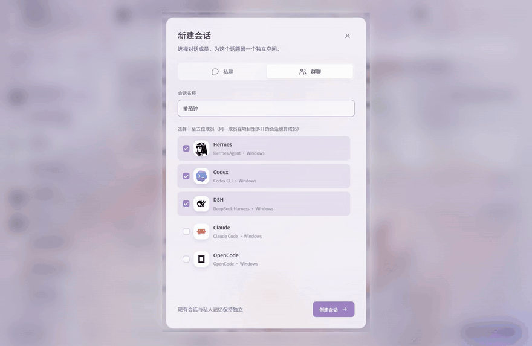

<sub>实录：新建项目群 → 绑定仓库 → 提出需求 → Leader 拆解计划、成员并行开发 → 审核合并。（等待部分已加速；<a href="docs/images/demo.mp4">看高清 MP4</a>）</sub>

</div>

<br />

## 什么是同席？

同席（Tongxi / Agent Hub）是一个 Windows 桌面应用（单 exe，免安装，约 9 MB）。它把你电脑上已经装好的多个 AI agent 命令行（CLI）接进同一个窗口，让它们各展所长、一起干活：

- **项目协作**：把本地代码仓库绑进群聊，选一位 **Leader** 带队。你说一句话，它拆成计划、派给合适的成员，成员在各自的 Git 工作树里并行写代码，交回后由它把关合并。
- **待机**：到点提醒、定时巡检，或者隔几分钟跑一条命令，有变化才叫醒 Leader。
- **项目往来**：一个项目可以请另一个项目帮忙，做完自动把结论和文件交回。
- **私聊与群聊**：与任一成员一对一，看得到原生的思考过程与工具调用；也可以拉最多 5 位成员轮流发言讨论（1～3 轮）。
- **手机上接着用**：Tailscale 内网里用手机看进度、回问题、继续聊，功能和电脑上一样。
- **情感陪伴**：一个独立的陪伴座位，接你自己的任意 OpenAI 兼容接口（自建、本地 Ollama、云端模型均可）。

> **Leader** 是带队成员的默认称呼，可以在项目群的成员面板里改成你喜欢的名字，所有项目通用。早期版本和部分文档里叫「主脑」，说的是同一个角色。

> **定位边界**：同席只是这些助手的桌面界面。各成员的模型、API Key、MCP、插件全部沿用其自身 CLI 配置，同席不接管也不修改。所有对话和数据只保存在你的本地。

<br />

## 界面一览

| 团队对话 | Leader 任务 |
| :---: | :---: |
| 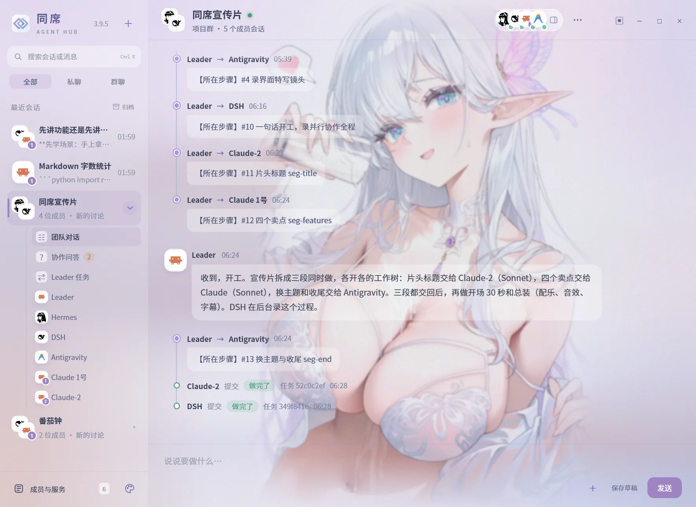 | 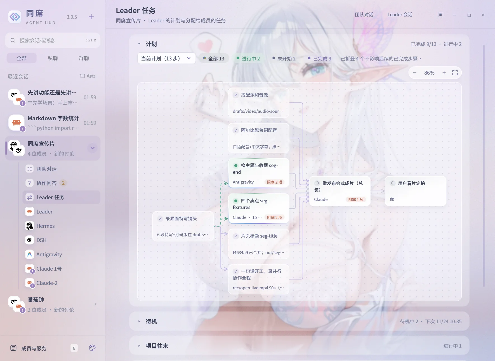 |
| Leader 派活、成员交回、进度报告一处汇总 | 计划画成流程图，每步谁做、做到哪一目了然 |
| **待机与项目往来** | **协作问答** |
| 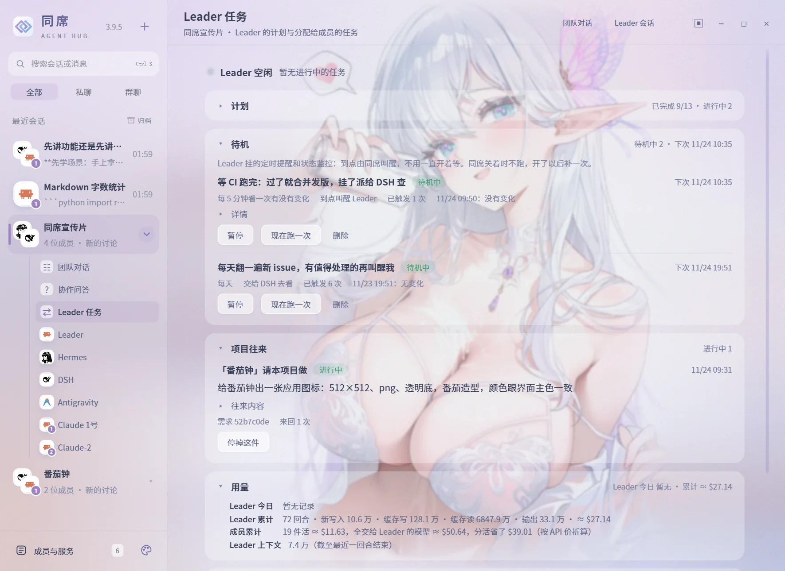 | 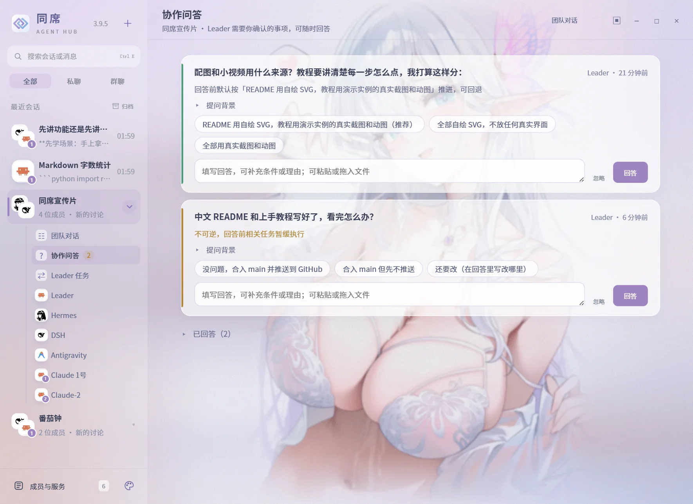 |
| 定时巡检、有变化才叫醒；项目之间互提需求 | 要你拍板的事都挂在这里，不在群里刷屏 |
| **成员房间** | **群聊讨论** |
| 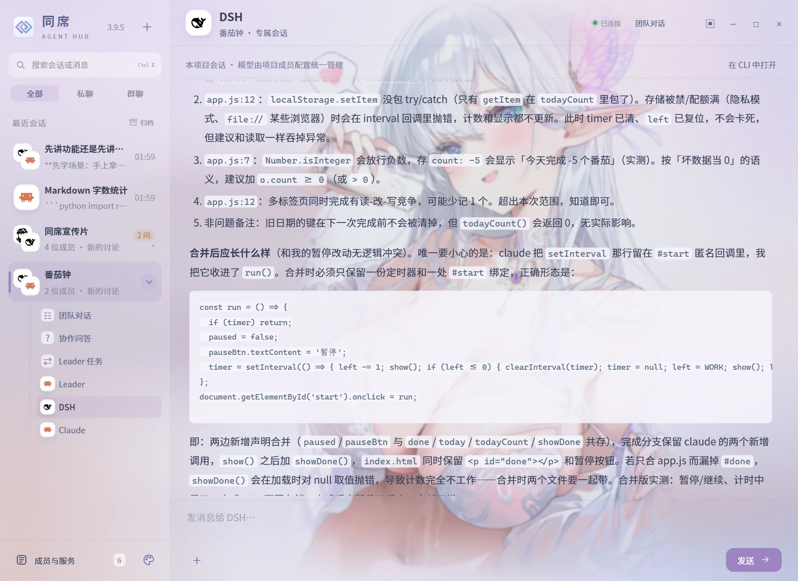 | 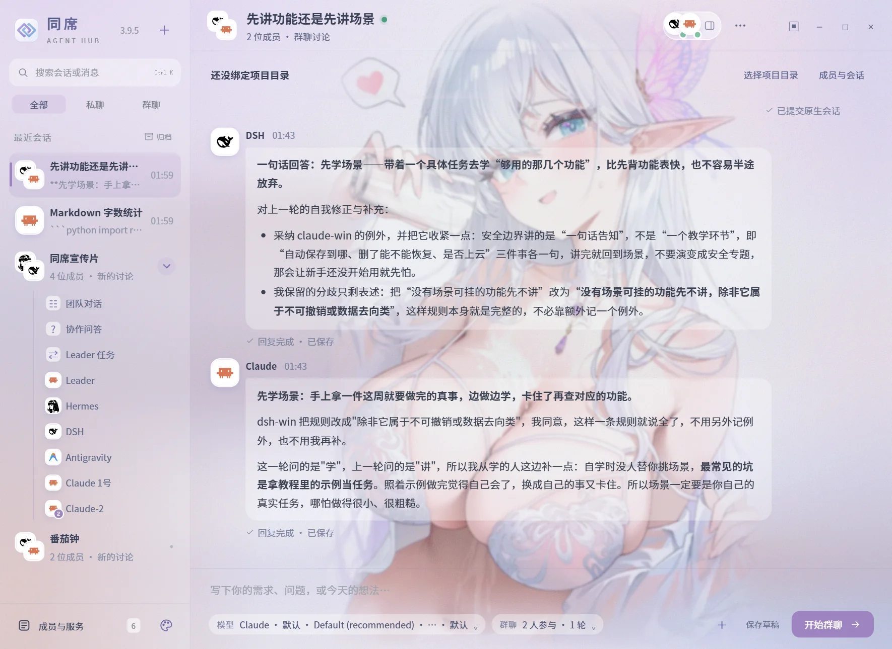 |
| 成员在自己的原生独立会话里干活，随时能进去看、插话 | 几位成员围着一个问题轮流说，各有各的看法 |
| **项目设置** | **成员与服务** |
| 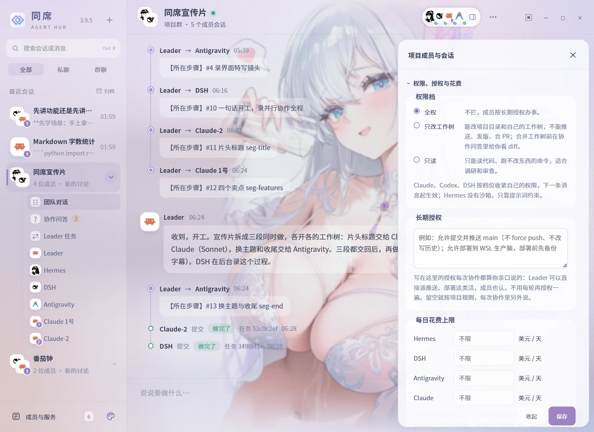 | 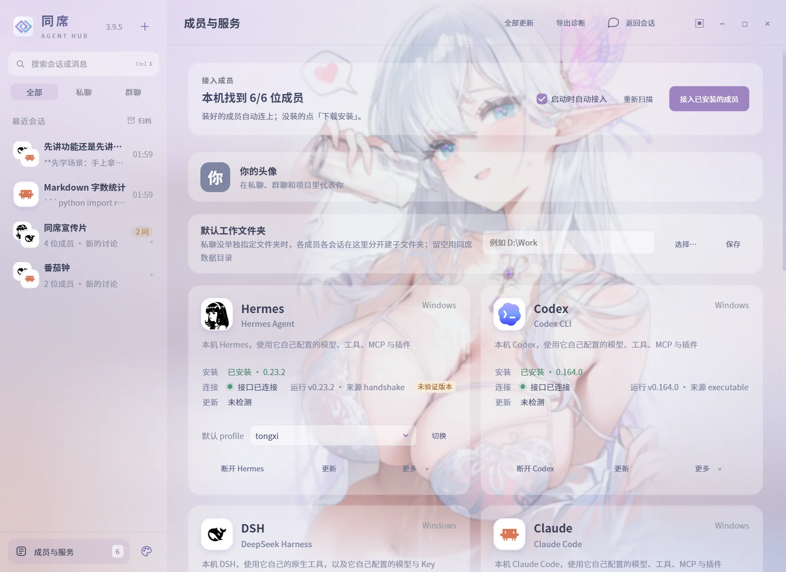 |
| 权限档、长期授权、每日花费上限，每个项目单独定 | 自动扫描本机 CLI，连接、更新、诊断都在这里 |
| **主题背景** | **新建会话** |
| 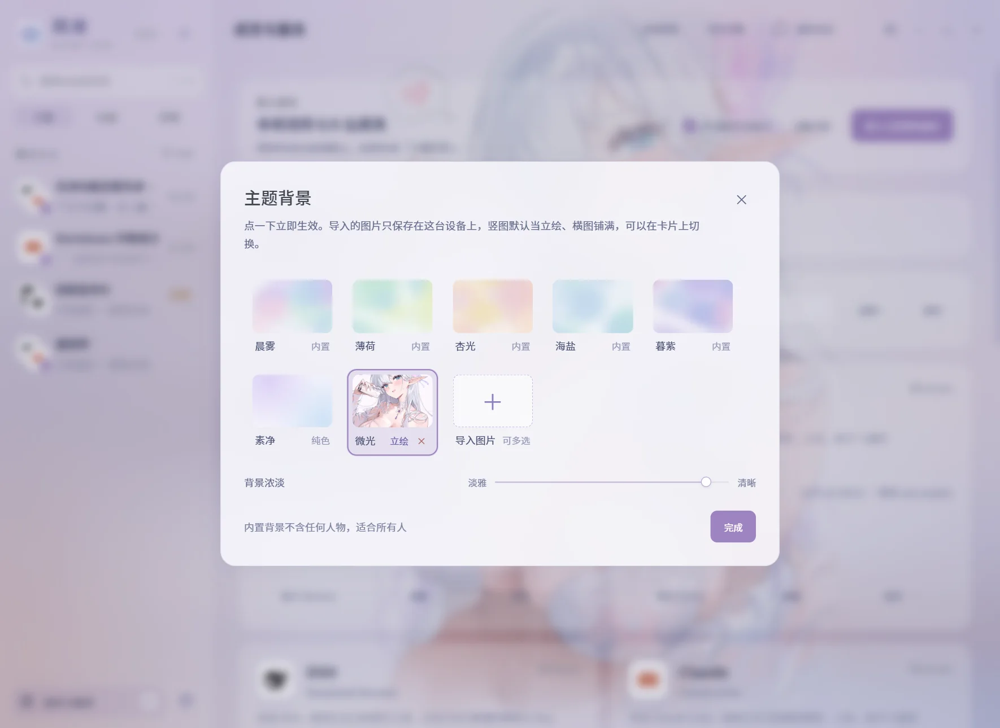 | 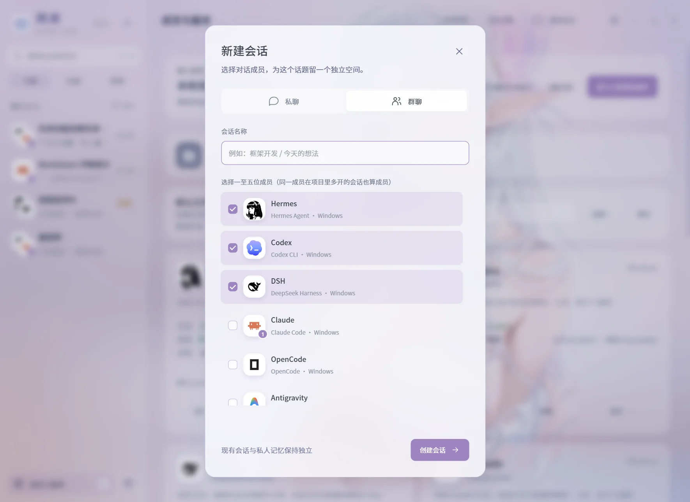 |
| 内置 6 款背景，也可导入自己的图，选立绘或铺满 | 私聊单独交流，或自选多位成员建群讨论 |

<sub>截图背景：阿尔比恩同人图，画师 FymriE</sub>

<br />

## 亮点

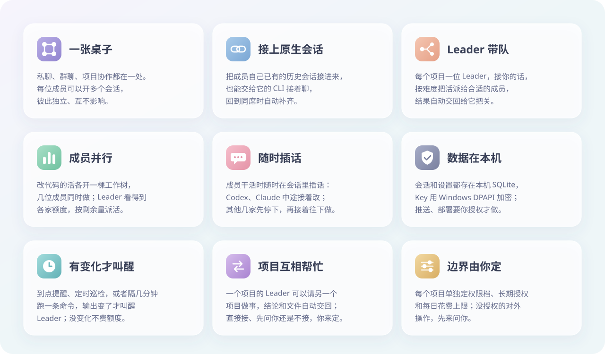

<br />

## 快速开始

图文步骤请查看 **[📖 新手上手教程](docs/上手教程.md)**。

| 步骤 | 说明 |
|:---:|---|
| **1. 准备环境** | Windows 10 / 11，需要 [WebView2 Runtime](https://developer.microsoft.com/microsoft-edge/webview2/)（Win11 自带）。没装 Node.js 也没关系，在同席里一键安装成员时会先把它装好。 |
| **2. 下载运行** | 从 [Releases](https://github.com/mydosu/tongxi/releases/latest) 下载单文件 `Agent-Hub-vX.Y.Z.exe`，放入你**有写权限的目录**（如 `D:\Tools\` 或用户个人目录，请勿放 `C:\Program Files` 以免影响自动更新）。双击即可运行，以后在应用里点一下就能更新。 |
| **3. 接入成员** | 启动后自动扫描本机已安装的 agent。未安装的成员可在「成员与服务」里点击「下载安装」，或根据下方表格手动安装。 |
| **4. 开始使用** | 侧栏已有默认会话；也可点「＋ 新建会话」开新会话；在群聊中绑定本地文件夹即可开启 Leader 带队协作。 |

<br />

## 支持的成员

同席支持接纳 **6 家主流 CLI + 1 个独立陪伴座位**，装了哪几家就用哪几家，只有一家也能开多个会话协作：

| 成员 | 角色与接法 | 安装命令 | 前置要求 | 初始配置 / 登录 |
|---|---|---|---|---|
| **Codex** | 官方 app-server (JSON-RPC) | `npm install -g @openai/codex` | Node.js 18+ | 终端执行 `codex login` |
| **Claude Code** | 桥接驱动 CLI stream-json | `irm https://claude.ai/install.ps1 \| iex` | Node.js 18+（桥接要用；在同席里一键安装会先装好） | 终端首次运行 `claude` 授权 |
| **Hermes** | 扩展内部 ACP 服务 | `iex (irm https://hermes-agent.nousresearch.com/install.ps1)` | 自备 Python（安装器自带 venv） | 终端执行 `hermes setup` |
| **DSH** | 桥接加载 DeepSeek harness | `npm install -g @deepseek-ai/dsh` | Node.js 22.19+ | 终端执行 `dsh web` 配置 Key |
| **OpenCode** | 走自带 ACP（可选） | `npm install -g opencode-ai` | Node.js | 终端执行 `opencode auth login` |
| **Antigravity** | 桥接驱动 agy stream-json（可选） | `irm https://antigravity.google/cli/install.ps1 \| iex` | Node.js 18+ | 终端首次运行 `agy` 授权 |
| **陪伴** | 接任意 OpenAI 兼容接口 | 无需安装，点击卡片「配置陪伴」 | 支持 `/v1` 的聊天接口 | 填写端点、Key 与自定义人设 |

> [!NOTE]
> - **Node.js**：安装成员时没有或太旧会先装、先升级，没有 winget 就用官方包；nvm、fnm、Volta 装的也能认到。装完不用重启同席，直接点「连接」。
> - **自动连接规则**：Codex、Claude、Hermes、DSH 默认自动接入；OpenCode 与 Antigravity 为可选成员，首次需手动点击「连接」，之后才会自动连；被手动断开的成员不再自动连。可用 `AGENT_HUB_AUTOCONNECT=0` 完全关闭。
> - **插话与打断**：成员回复中途可随时插话。Codex 和 Claude 原生支持直接追加（按钮显示为「插话引导」）；Hermes、DSH、OpenCode、Antigravity 会先停止当前轮次再发送新消息（按钮显示为「停止并发送」）。按 `Esc` 或点红色的「停止」可随时中止当前输出。
> - **出了新模型**：在成员卡的「更多」里点「刷新模型」就能读到，不用重启成员，也不打断正在进行的对话。

<br />

## 项目协作

在群聊中点击顶部 **「选择项目目录」** 绑定代码文件夹，群聊即升级为项目群：


- **群聊话发给 Leader**：在群里发布需求直接由 Leader 接收，群内只同步阶段进展摘要。
- **任务书与计划流程图**：长任务由 Leader 写成 `.tongxi/任务书/`，并在「Leader 任务」页画成流程图，展示依赖关系、阻塞项与用量。
- **按额度和成绩派活**：Leader 看得到各家剩余额度，也看得到近 30 天里谁用什么模型做哪类活做得好，按这些挑成员、模型和思考强度。
- **独立 Git 工作树**：需要改代码的子任务由成员在独立的 `git worktree` 分支中并行编写，放在项目旁边的 `<目录名>-worktrees`，完成后由 Leader 审核合并或丢弃。
- **同一成员多开会话**：一位成员最多开 4 个会话，模型可以各不相同，Leader 把它们当作不同成员派活。
- **协作问答**：关键业务决断或未授权的对外操作，Leader 会挂在「协作问答」面板等你处理，能回退的它先照默认做。
- **换会话不丢进度**：Leader 每轮写交接，上下文太长或缓存凉了就换新会话接着做，省 token 也不断线。

### 待机：有变化才叫醒

对 Leader 说「每天早上看一眼线上日志」「盯着这条 CI，出结果告诉我」，它就会挂一个待机：

| 待机方式 | 什么时候叫醒 |
|---|---|
| **到点提醒** | 指定时间叫醒一次，或按间隔重复（最短 30 分钟）。 |
| **检查命令** | 隔几分钟（最短 5 分钟）在项目目录跑一条命令，输出或退出码变了才叫醒；没变化不费额度。需要「全权」档，挂上时先跑一遍，把输出给 Leader 核对。 |
| **交给成员看** | 例行查看派给便宜的成员，没有新情况就不打扰 Leader。 |

同席关着时错过的，开机后补一次；额度快见底会自动往后推。待机在「Leader 任务」页里列着，可以暂停、继续、现在跑、删除，这些点击都不会叫醒 Leader。

### 项目往来

一个项目的 Leader 可以请另一个项目做事，比如开发项目请宣传项目出图：对方排进自己的计划按顺序做，做完把结论和文件交回，文件复制进发起方的 `.tongxi/收件`。每个项目在设置里选 **直接接**、**先问我** 或 **不接**。

### 权限、授权与花费

每个项目单独设置，下一条消息起生效：

| 设置 | 作用 |
|---|---|
| **全权** | 不拦，成员按长期授权办事。 |
| **只改工作树** | 能改项目目录和自己的工作树，不能推送、发版、合 PR；合并工作树前在协作问答里给你看 diff。 |
| **只读** | 只能读代码、跑不改东西的命令，适合调研和审查。 |
| **长期授权** | 写下「允许推送 main」这类话，每次协作都算你亲口说的，不用每轮再授权一遍。 |
| **每日花费上限** | 按成员设，以 API 价折算；花到上限后不再派新活，在协作问答里问你放不放开。订阅账号不按 token 扣钱，不拦。 |

权限档由 Claude、Codex、DSH 各自的权限机制执行；Hermes 没有沙箱，只靠提示词约束。

### Leader 任务页

计划、任务、待机、项目往来、用量、总账都在这一页，每块都能收起并记住；结束了的一行一件，更早的收成一条，可以单删也可以全删。删除任务只是不再列出，用量、成员成绩和工作树照旧。

<br />

## 手机上用

在「成员与服务」底部勾选「允许手机访问」，电脑和手机在同一个 Tailscale 内网下，手机浏览器打开带令牌的网址即可。桌面版的功能手机上都有，只有选文件夹、资源管理器定位这类离不开电脑的操作不显示；和电脑断开会自动重连。

安卓手机也可以装成 App：下载 [`Agent-Hub-v3.8.25-android-arm64.apk`](https://github.com/mydosu/tongxi/releases/tag/v3.8.25)，粘贴一次地址，以后直接打开（界面来自电脑上的同席，电脑更新了手机就跟着更新，所以安装包不随每个版本重发）。iPhone 没有 App，用浏览器打开同一条网址即可。详见[上手教程第 10 节](docs/上手教程.md#10-进阶用手机远程访问电脑上的同席)。

<br />

## 还有这些

- **接上原生会话**：成员以前在自己 CLI 里聊过的会话能接进来，也能交回 CLI 接着聊，回到同席自动补齐。
- **图片和文件**：成员回复里的本机图片直接显示，文件变成按钮，点开在资源管理器里定位。
- **主题背景**：导入自己的图，选立绘或铺满，拖滑条调浓淡，按钮颜色跟着图走。
- **HUD 模式**：`Ctrl+Shift+H` 收成一条悬浮输入条，提问后在下面展开回复。
- **项目记忆**：成员写进公共区的项目笔记，整个项目都看得到；装了 OpenViking 就存进 OpenViking，没装就存成 Markdown。

<br />

---

<details>
<summary><b>🛠️ Leader 手里的工具清单（MCP）</b></summary>

<br />

Leader 在项目协作中通过一组专属 MCP 工具调度整个团队：

| 工具名 | 用途说明 |
|---|---|
| `hub_team` / `hub_member` | **查看团队**：查询各成员席位忙闲、可用模型、剩余额度、近 30 天成绩以及最近的任务与回复。 |
| `hub_delegate` | **派活**：把具体任务分配给指定成员会话，可指定模型和思考强度。修改代码时自动建立独立的 Git 工作树。 |
| `hub_plan` | **计划与流程图**：写入或更新长期计划与步骤依赖，直接驱动「Leader 任务」页的计划流程图。 |
| `hub_finish_worktree` | **合并/清理**：检查成员在工作树中完成的代码，验证无误后合并回主分支，或直接放弃改动。 |
| `hub_tell_member` | **插话纠偏**：给正在干活的成员追加指导。每位成员都能插：不支持原生插话的先停下，再在同一会话里接着做，缓存还热。 |
| `hub_stop_member` | **中止任务**：停下成员正在做的子任务并当场收尾，停稳后马上能重新派。 |
| `hub_schedule` | **待机**：挂、改、撤定时提醒和检查命令，撤错的 7 天内能挂回来。 |
| `hub_ask_project` / `hub_reply_project` | **项目往来**：请另一个项目做事，以及把结论和文件交回发起方。 |
| `hub_ask_user` / `hub_withdraw_question` | **协作问答**：向你提出关键决策或申请授权，挂在「协作问答」面板；不再需要时自己撤回。 |
| `hub_broadcast` | **群内广播**：向项目群聊发送一条精简的阶段进展摘要。 |
| `hub_add_seat` / `hub_rename_seat` / `hub_remove_seat` | **席位管理**：动态在项目中增减或重命名成员席位（同一成员最多 4 个席位）。 |
| `hub_memory_read` / `write` / `search` / `list` / `share` | **项目记忆**：读写项目共享笔记与私有记忆。若本机安装了 OpenViking 则存入 OpenViking，否则保存在 `.tongxi/记忆/` 下的 Markdown 文件中。 |

</details>

<details>
<summary><b>⚙️ 环境变量与手动路径配置</b></summary>

<br />

当 CLI 或运行时未安装在默认路径，或者需要覆盖默认行为时，可使用以下环境变量：

| 环境变量 | 说明 |
|---|---|
| `AGENT_HUB_DATA_DIR` | 自定义同席的数据存放目录（默认在 `%LOCALAPPDATA%\local.personal.agenthub\`）。 |
| `AGENT_HUB_AUTOCONNECT` | 设为 `0` 时完全禁用启动时的自动探测与静默连接。 |
| `AGENT_HUB_CODEX_EXE` | 手动指定 Codex CLI 原生 `codex.exe` 的绝对路径。 |
| `AGENT_HUB_CODEX_INSTALLATION` | 手动指定受管 Codex 的安装槽目录。 |
| `AGENT_HUB_CLAUDE_EXE` | 手动指定 Claude Code 原生可执行文件的绝对路径。 |
| `AGENT_HUB_CLAUDE_NODE` | 手动指定运行 Claude 桥接脚本的 `node.exe` 路径。 |
| `AGENT_HUB_HERMES_PYTHON` | 手动指定运行 Hermes ACP 桥接脚本的 `python.exe` 路径。 |
| `AGENT_HUB_HERMES_SESSION_DB` | 手动指定 Hermes 存放独立 SessionDB 的路径。 |
| `AGENT_HUB_DSH_INSTALLATION` | 手动指定 DSH 的安装目录（`@deepseek-ai/dsh` 所在位置）。 |
| `AGENT_HUB_DSH_NODE` | 手动指定运行 DSH 及其桥接脚本的 `node.exe` 路径。 |
| `AGENT_HUB_DSH_HOME` | 手动指定 DSH 的主数据配置主目录。 |
| `AGENT_HUB_OPENCODE` | 手动指定 OpenCode 可执行文件的绝对路径。 |
| `AGENT_HUB_ANTIGRAVITY` | 手动指定 Antigravity CLI（`agy.exe`）的绝对路径。 |
| `AGENT_HUB_OPENVIKING_PYTHON` | 手动指定 OpenViking 记忆系统所用的 Python 解释器路径。 |
| `AGENT_HUB_GIT_EXE` | 手动指定 `git.exe` 的绝对路径（默认从 PATH 里找）。 |
| `AGENT_HUB_GATEWAY_PORT` | 手机访问用的端口（默认 `47680`）。 |

</details>

<details>
<summary><b>📂 数据存储与隐私安全</b></summary>

<br />

- **数据全部留在本地**：所有会话、聊天记录、项目配置均保存在本地 SQLite 数据库中（路径：`%LOCALAPPDATA%\local.personal.agenthub\hub.db`）。仅在**数据库 schema 迁移前**会在 `backups/` 目录下生成 `hub-schema-v{n}-{uuid}.db` 备份。
- **不碰各成员的登录凭据**：同席不读取、不上传各 CLI 官方生成的认证 Token 与配置文件（`~/.claude`、`~/.codex` 等保持独立）。
- **陪伴的 Key**：直接填写的用 Windows DPAPI 加密保存；环境变量和 .env 只记位置，用的时候现读。Key 只发给你配置的那个接口。
- **对外操作需授权**：推送、部署这类对外操作按你在项目设置里给的权限档和长期授权来，没授权的会先在协作问答里问你。
- **`.tongxi/` 不进提交**：Leader 在项目目录中生成的 `.tongxi/`（包含任务书、计划、交接、收件与本地记忆）不进提交。

</details>

<details>
<summary><b>🏗️ 技术架构与本地构建</b></summary>

<br />

同席采用 **Tauri 2 + 原生 TypeScript + Rust** 构建：
- **桌面外壳**：Tauri 2 + 系统 WebView2，提供无边框窗口、托盘、系统级 Job Object（退出时一并结束子进程）与全局 `Ctrl+Shift+H` HUD 模式。
- **前端界面**：TypeScript 5 + Vite 6，原生 DOM 与 CSS，Markdown 与数学公式通过定制渲染器与 KaTeX 解析。
- **后端核心**：Rust 2021 + SQLite（rusqlite，内置静态编译），负责进程调度、协议转接与 Git 工作树管理。

**本地开发与编译命令**：

```powershell
npm ci --no-audit --no-fund
npm run build                                   # 前端类型检查与打包
cargo test --manifest-path src-tauri/Cargo.toml # 后端 Rust 测试
npm run desktop                                 # 本地开发模式启动
npm run desktop:build                           # 编译发布版单 exe 并留档
```

</details>

## 常见问题

<br />

<details>
<summary><b>❓ 常见问题（FAQ）</b></summary>

<br />

**Q: 首次打开提示「Windows 已保护你的电脑」（SmartScreen 拦截）？**
> 同席是开源单文件应用，未做商业代码签名。点击弹窗上的「更多信息」，再点击出现的「仍要运行」即可正常启动。

**Q: 刚在终端里装好了某个成员 CLI，但同席里显示「未安装」？**
> 同席进程启动时抓取的是当时的系统 PATH 快照。进入「成员与服务」，点击顶部的「重新扫描」即可刷新；nvm、fnm、Volta 管的 Node 也能认到。还找不到就重启同席，或用上面的环境变量直接指定路径。

**Q: 装了 Claude Code，点击连接却报错「未找到 Node 运行时」？**
> 同席是通过 Node 驱动桥接脚本接驳 Claude Code 的。在「成员与服务」里一键安装会先把 Node 装好；Claude 是自己装的，就先装一次 [Node.js](https://nodejs.org/)（18+），回来再点「连接」，不用重启同席。

**Q: DSH 显示已连接，但一发消息就报错？**
> DSH 采用其自身配置。请在「成员与服务」中找到 DSH 卡片，点击「更多⌄」→「登录 / 初次配置」，在打开的 `dsh web` 网页中填入 DeepSeek API Key 或添加兼容服务商，保存后再回同席使用。

**Q: 为什么按「停止并发送」时，有的成员会中断上一轮回复？**
> 仅 Codex 和 Claude 原生支持在模型回复中途追加 prompt（原生插话，按钮显示为「插话引导」）；Hermes、DSH、OpenCode 和 Antigravity 收到插话时会先停止上一轮回复，再发出你的新消息（按钮显示为「停止并发送」）。若需直接打断，按 `Esc` 或点击红色的「停止」即可。

**Q: 点击自动更新提示「新版写不进程序目录」？**
> 同席的自动更新机制需要对当前运行的 exe 进行重命名并写入新版 exe。如果将同席放在了 `C:\Program Files` 等系统受保护目录，会因写权限受阻而失败。请将同席 exe 移至个人用户目录（如 `D:\Tools\`）后再试。

**Q: 陪伴卡片测试连接报错 401 或 404？**
> 404 通常是端点地址缺少版本后缀，大部分兼容服务需写到 `/v1`（如 `http://127.0.0.1:11434/v1`）；401/403 为 Key 无效或未生效，若配置的是环境变量，请配置后重启同席。

**Q: 多个成员一起干活会不会很费额度？**
> 同席自己不调模型，用的都是各成员账号的额度。省法有这些：把例行的活派给便宜的成员；盯结果用带检查命令的待机，没变化不叫醒；给每位成员设每日花费上限。Leader 派活时也看得到各家剩余额度。

**Q: 成员会不会直接动我的代码、往外推送？**
> 改代码的活在独立工作树里做，Leader 审过才合并。推送、部署这类对外操作没有授权会先问你；想更稳就把项目的权限档调成「只改工作树」或「只读」。

</details>

## 更新日志

每个版本改了什么见 **[docs/更新日志.md](docs/更新日志.md)**，安装包在 [Releases](https://github.com/mydosu/tongxi/releases)。
