# 同席（Agent Hub）新手上手教程

同席是一个 Windows 桌面应用（单 exe，免安装，约 9 MB）。它把你电脑上已经装好的多个 AI agent 命令行（Codex、Claude Code、Hermes、DSH、OpenCode、Antigravity）接进同一个窗口。可以一对一私聊，拉群讨论，或者绑定本地代码仓库让「主脑」带队分工协作；另有一个座位接你的「陪伴」服务。

<sub>截图背景：阿尔比恩同人图，画师 FymriE</sub>

这份教程带你从下载开始，配置并跑通多 agent 协作。

---

## 快速导航

1. [准备与下载](#1-准备与下载)
2. [首次启动：绕过 SmartScreen 拦截](#2-首次启动绕过-smartscreen-拦截)
3. [接入你的第一个 AI 助手（以 Claude 为例，含 Node 依赖避坑）](#3-接入你的第一个-ai-助手以-claude-为例含-node-依赖避坑)
4. [第一次私聊：原生体验与思考流](#4-第一次私聊原生体验与思考流)
5. [多成员群聊：让几家 agent 坐在一起头脑风暴](#5-多成员群聊让几家-agent-坐在一起头脑风暴)
6. [绑定项目：让「主脑」带队干活（群聊 vs 项目群）](#6-绑定项目让主脑带队干活群聊-vs-项目群)
7. [掌控进度：看懂「主脑任务」流程图与「协作问答」](#7-掌控进度看懂主脑任务流程图与协作问答)
8. [随时插话纠偏与停止](#8-随时插话纠偏与停止)
9. [打造你的专属桌面：换主题背景与 HUD 悬浮模式](#9-打造你的专属桌面换主题背景与-hud-悬浮模式)
10. [进阶：用手机远程访问电脑上的同席](#10-进阶用手机远程访问电脑上的同席)
11. [遇到问题 / 排错指引](#遇到问题--排错指引)

---

## 1. 准备与下载

### 1.1 系统环境
- 操作系统：Windows 10 或 Windows 11。
- 运行时依赖：需要安装微软的 [Edge WebView2 Runtime](https://developer.microsoft.com/microsoft-edge/webview2/)（Windows 11 系统自带；Windows 10 若缺失，首次打开同席时会弹出中文提示，点「是」可直达微软下载页）。

### 1.2 下载与存放位置
1. 打开官方仓库的 [Releases 发布页](https://github.com/mydosu/tongxi/releases/latest)，下载单文件 `Agent-Hub-vX.Y.Z.exe`（约 8.9 MB）。
2. **存放位置提醒**：同席支持在界面内点击版本号一键检查并自动更新。自动更新需要向程序自身所在的目录重命名并写入新文件。因此，**请将 exe 放在当前用户拥有读写权限的普通目录**（例如 `D:\Tools\Tongxi\` 或 `C:\Users\你的用户名\AppData\Local\Programs\Tongxi\`）。**请勿放在 `C:\Program Files` 等系统保护目录**，否则后续点击自动更新会因权限不足而失败。

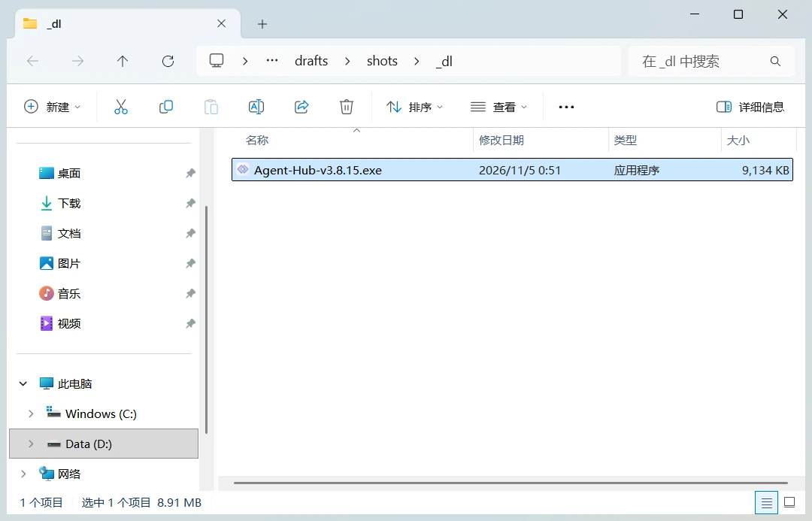 <!-- 截图：Windows 文件资源管理器，展示放在 D:\Tools\ 下的 Agent-Hub-v3.8.15.exe，标注单文件大小约 9MB，无需解压安装 -->

---

## 2. 首次启动：绕过 SmartScreen 拦截

同席是免安装的单文件可执行程序，双击即可运行。

### 2.1 绕过 Windows SmartScreen 提示
因为同席是本地开源单文件工具，未做商业代码签名，首次双击运行时 Windows 可能会弹出蓝色窗口：「Windows 已保护你的电脑」。

**怎么操作**：
1. 点击弹窗文字中的「更多信息」链接；
2. 弹窗下方会展开显示程序发布者并出现按钮，点击右下角的「仍要运行」按钮。

### 2.2 启动后看到什么
点击「仍要运行」后，同席的主窗口就会展开：
- 顶部标题栏显示「同席 · AGENT HUB」，整条标题栏可以按住拖动；
- 左侧侧栏会列出你的会话列表。首次启动时同席会预置一批默认会话卡片（「与 Claude 私聊」「与 Hermes 私聊」「与 Codex 私聊」「与 DSH 私聊」「与 陪伴 私聊」，以及群聊「开发协作」），后续你创建的项目群与私聊也会在此陈列；
- 侧栏最下方是「成员与服务」和「主题背景」（调色板图标）。

 <!-- 截图：同席主界面，展示左侧栏会话列表、底部「成员与服务」、右上角自绘窗口控制按钮 -->

---

## 3. 接入你的第一个 AI 助手（以 Claude 为例，含 Node 依赖避坑）

刚启动时，各成员卡片大多处于未接入状态。我们需要把本地已安装的 AI agent CLI 接进来。这里以使用广泛的 **Claude Code** 为主例。

### 3.1 关键避坑提醒：请先安装 Node.js！
> [!IMPORTANT]
> Claude Code 官方安装器虽然是一个 PowerShell 脚本，但是**同席接管并驱动 Claude Code，使用的是一段 Node.js 桥接脚本（`claude_bridge.mjs`）**。
> 同席内置的一键安装命令只负责安装 Claude 本身，**不会自动替你安装 Node.js**。
> 如果你的电脑上没有安装 Node.js，在同席里点「连接」时会弹出报错：`未找到 Node 运行时，请检查 PATH 或 AGENT_HUB_CLAUDE_NODE`。
> 
> **应对办法**：在接入 Claude 前，请先安装 LTS 版 Node.js（推荐 18+ 或 20+），可去 [nodejs.org](https://nodejs.org/) 下载，或在 PowerShell 中执行 `winget install OpenJS.NodeJS.LTS`。

### 3.2 在「成员与服务」中安装 Claude
1. 点击左侧栏最下方的「成员与服务」（图标右上角有角标，显示当前已连接数）。
2. 页面顶部是「接入成员」横条，显示「本机找到 x/6 位成员」（如已全部安装则显示 6/6 位）。横条下方依次是「你的头像」与「默认工作文件夹」设置项，再往下是两列成员卡片（Codex、Claude、Hermes、DSH、OpenCode、Antigravity 和陪伴）。

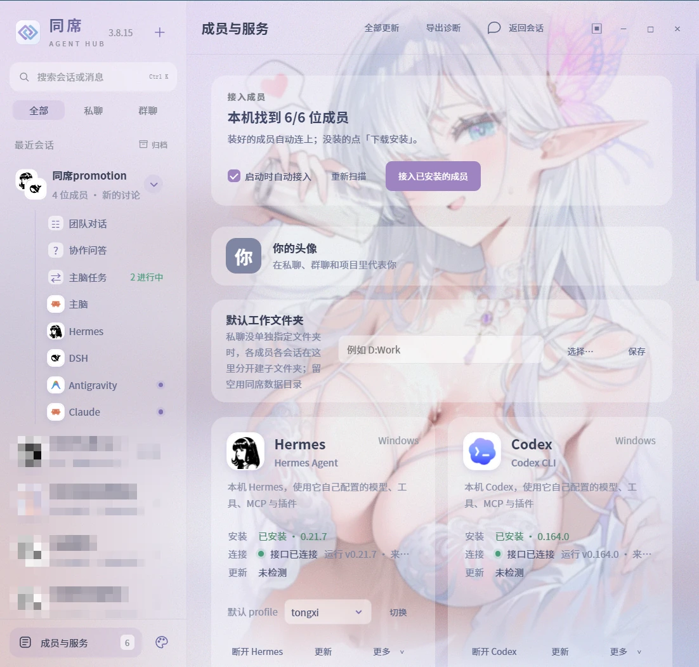 <!-- 截图：点击「成员与服务」后的页面，展示顶部「本机找到 6/6 位成员」横条、你的头像与默认工作文件夹设置项，以及下方的两列成员卡片 -->

3. 找到「Claude」卡片。若本机尚未安装该成员，卡片状态会显示为「未安装」，卡片上会出现「下载安装」主按钮（若已安装则该按钮隐藏并显示「连接」或「断开」）。
4. 没装的成员点击「下载安装」，界面会弹出安装确认弹窗，展示将执行的官方命令（如 `irm https://claude.ai/install.ps1 | iex`）以及装好后执行的配置命令（`claude`）。
5. 点击弹窗右下角的「打开终端安装」。

### 3.3 在弹出的终端中登录授权
点击「打开终端安装」后，同席会自动弹出一个新的 PowerShell 终端窗口并开始跑安装脚本：
1. 脚本安装完毕后，终端会自动调用 `claude` 并拉起官方登录向导。
2. 终端会输出授权链接，在浏览器中打开链接，登录你的 Anthropic / Claude 账号完成授权。
3. 授权完成后，终端显示登录成功提示。此时可以直接关闭这个 PowerShell 终端窗口。

### 3.4 回到同席重新扫描并连接
关掉终端回到同席主界面：
1. 点击顶部操作栏的「重新扫描」按钮。
   > **为什么需要点「重新扫描」？**
   > 因为刚在终端里装完，同席作为一个已经运行的进程，抓取的是启动时的旧 PATH 快照。点击「重新扫描」能让同席重新读取系统与用户环境变量。
2. 扫描完成后，Claude 卡片的状态会变为「安装：已安装 · 版本号」，点击「连接」按钮。
3. 连接成功后，卡片显示「已安装 · 2.1.318」与「接口已连接 · 运行中」，主按钮变为「断开 Claude」，侧栏底部的「成员与服务」数字也同步更新。

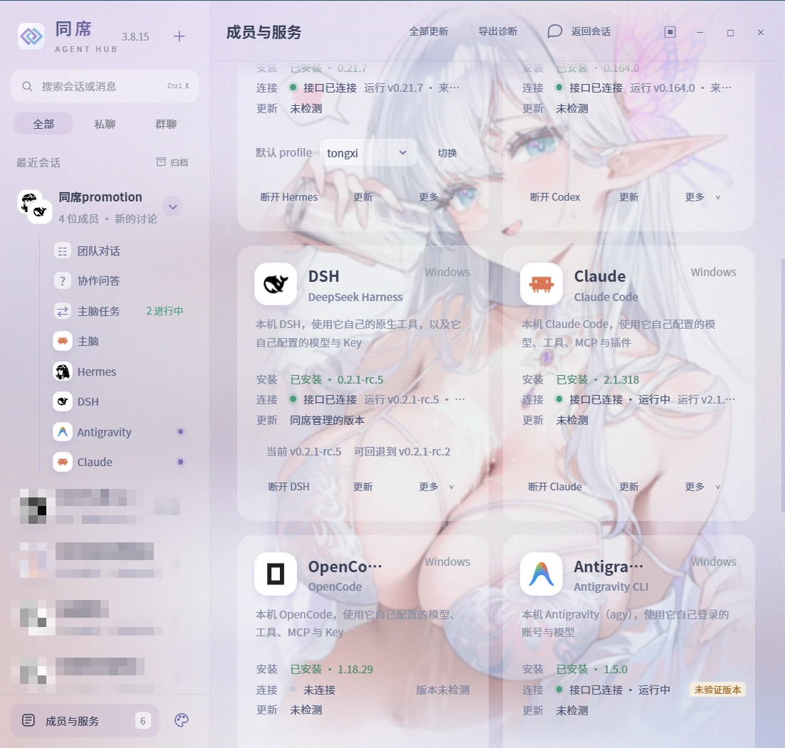 <!-- 截图：Claude 卡片显示「已安装 · 2.1.318」与「接口已连接 · 运行中」，主按钮为「断开 Claude」 -->

### 3.5 快速接入其他成员与「陪伴」
- **Codex**：前置需要 Node.js 18+。若未安装点击卡片「下载安装」，装好后在终端运行 `codex login` 完成登录。
- **Hermes**：自备 Python（安装器自带独立的 Python 虚拟环境）。若未安装点击「下载安装」，完成后在卡片「更多⌄」里点「登录 / 初次配置」运行 `hermes setup`。
- **DSH**：前置需要 Node.js 22.19+。装好后点击卡片「更多⌄」→「登录 / 初次配置」，在打开的 `dsh web` 网页中填好你的 DeepSeek API Key（同席不存 Key，只读 DSH 自己的配置）。
- **OpenCode / Antigravity**：为可选成员，安装好后首次需手动点一次卡片上的「连接」，之后启动才会自动连。Antigravity 的桥接同样依赖 Node.js 18+。
- **陪伴**：第五个专属座位留给情感陪伴。不需要安装任何 CLI，直接点击卡片上的「配置陪伴」，填入任意 OpenAI 兼容地址（如本地 Ollama 或其他兼容接口）、填入 Key 并设定人设，点「测试连接」，通过后点保存即可。

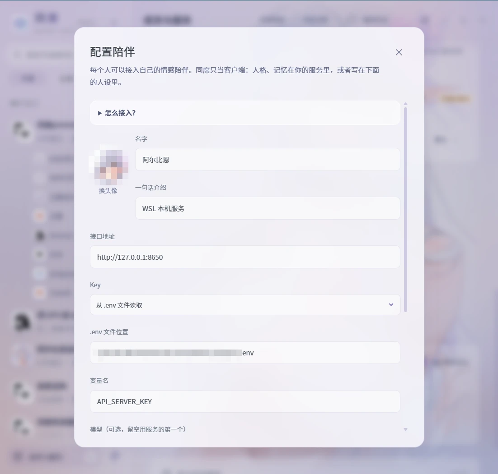 <!-- 截图：点击陪伴卡片「配置陪伴」弹出的设置弹窗，展示接口地址（如本地 8650 端口）、Key 选择（从 .env 读取）、模型名与自定义人设输入框 -->

---

## 4. 第一次私聊：原生体验与思考流

装好 Claude 后，我们先来试一次一对一私聊。

### 4.1 发送第一条消息
1. 在左侧栏点击「返回会话」，选择预置的「与 Claude 私聊」（或者点击顶部「＋ 新建会话」→ 选「私聊」→ 勾选 Claude →「创建会话」）。
2. 右侧对话区展开，底部输入框的占位文案显示为「写下你的需求、问题，或今天的想法…」。
3. 在输入框输入一段测试需求，例如：
   ```text
   请帮我写一个 Python 脚本，递归扫描当前目录下的所有 Markdown 文件，统计每个文件的字数并输出一个排好序的汇总表。
   ```
4. 按 `Enter` 发送；如需在输入框内换行，请按 `Shift+Enter`（项目群和普通私聊均支持）。

### 4.2 观察回复过程
发送后，你会看到：
- 输入框右下角的主按钮变成红色的「停止」（可随时按 `Esc` 中止）；
- 状态行先显示「正在等待回复…」，随后开始流式打字输出；
- 若使用的是开启了深度思考的模型，正文上方会出现「思考中…」卡片并在结束后折叠为「已思考」；若成员调用了本地工具，界面也会按时间线穿插折叠卡片记录工具活动。

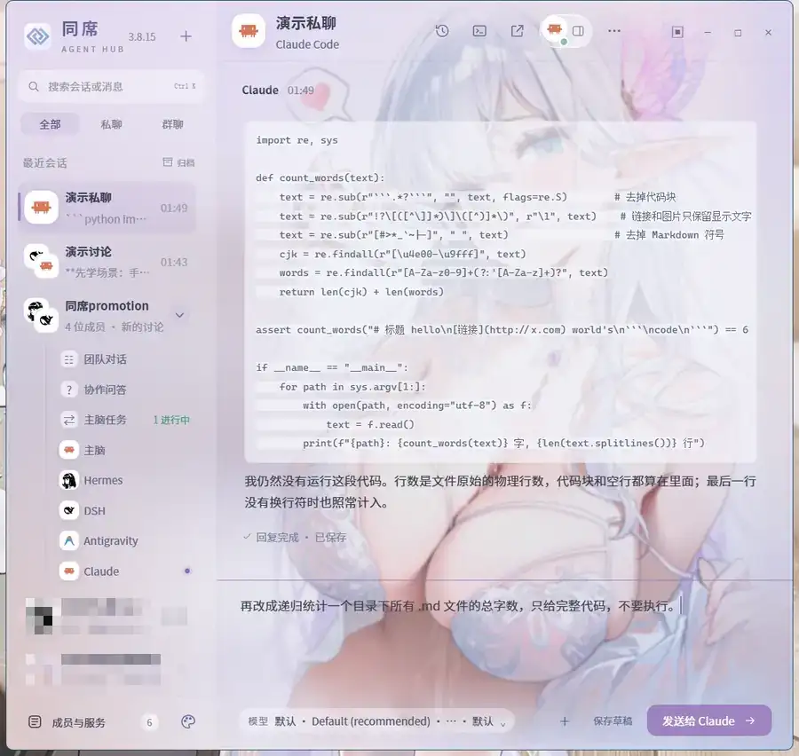 <!-- 动图：在「与 Claude 私聊」会话中发送问题，展示状态行提示「正在等待回复…」，随后流式打字输出正文的全过程 -->

---

## 5. 多成员群聊：让几家 agent 坐在一起头脑风暴

### 5.1 概念区分：什么是「普通群聊」？
> [!NOTE]
> 在同席里，「普通群聊」与后面的「绑定项目的项目群」是两种不同的工作模式：
> - **普通群聊**是一个多成员讨论室。你可以把 2～5 位已连接的 agent 选进同一个群，设定轮次，让它们轮流发言讨论。
> - 在普通群聊里，**成员不会去修改你的本地代码文件**。

### 5.2 创建群聊并开始讨论
1. 点击左侧栏顶部的「＋ 新建会话」。
2. 弹窗默认打开在「群聊」标签下，并预先勾选了部分成员。
3. 输入「会话名称」，例如「状态管理选型讨论」。
4. 勾选你想邀请的成员（例如勾选 Claude 和 DSH 两位成员）。
5. 点击「创建会话」。

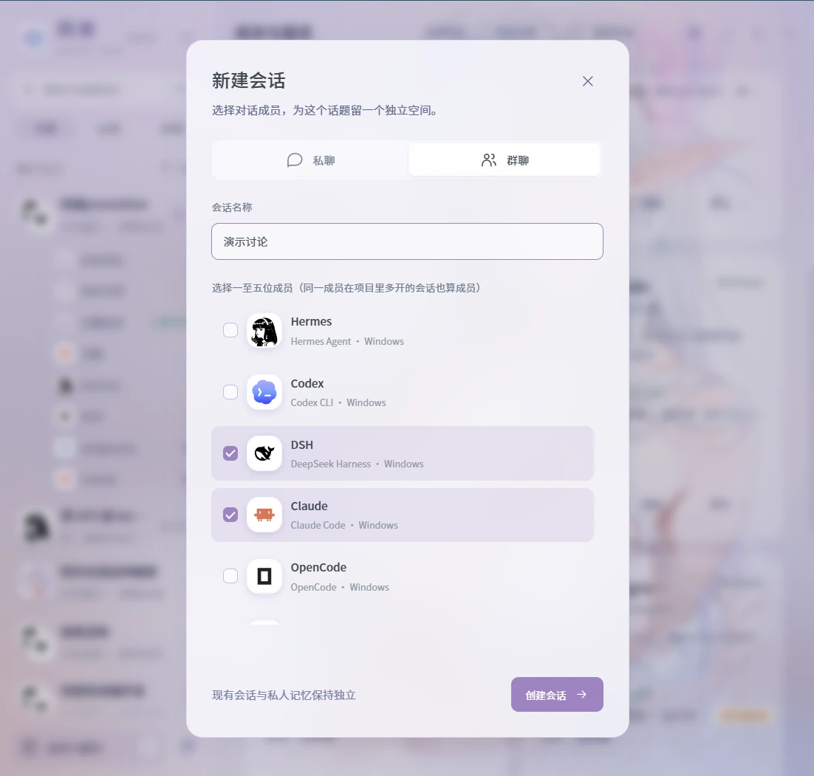 <!-- 截图：「新建会话」弹窗默认停留在「群聊」标签，填入会话名称，勾选 Claude 和 DSH 两位成员 -->

6. 进入新建的群聊后，输入框上方会出现讨论设置项：「参与讨论」列表和「轮次」下拉选项（支持 1 轮、2 轮、3 轮）。
7. 输入讨论议题，例如：
   ```text
   我们要为一个中大型 React 桌面项目选型状态管理库。请针对 Zustand 和 Redux Toolkit 对比优缺点，并分别给出你们最推荐哪一个。
   ```
8. 底部按钮显示为「开始群聊」。点击「开始群聊」。
9. 上方状态行会显示讨论进度。成员按顺序依次根据群内上下文展开回答。你可以随时点击「停止讨论」提前结束讨论。

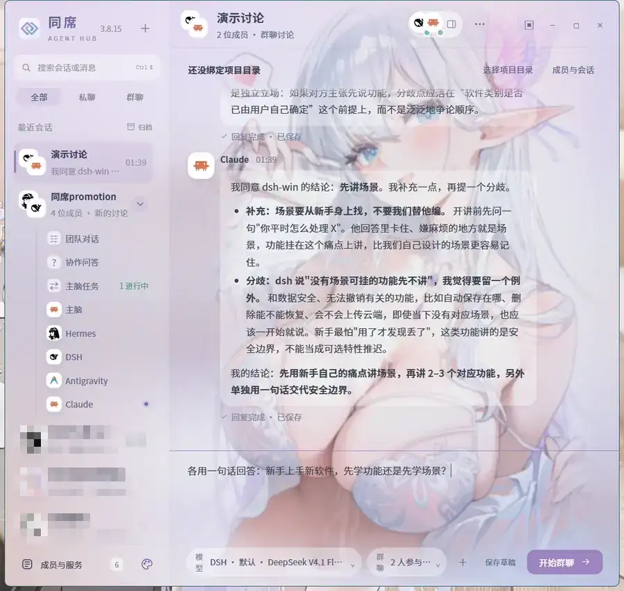 <!-- 动图：群聊中设置 1 轮讨论后点击「开始群聊」，DSH 开始接收上下文并流式输出回复 -->

---

## 6. 绑定项目：让「主脑」带队干活（群聊 vs 项目群）

这是项目协作功能：**把本地代码仓库绑定给群聊，任命一位「主脑」，带领其他成员分工写代码、改文件、跑测试**。

### 6.1 准备本地代码目录
在你的本地硬盘准备一个文件夹（比如新建一个空目录 `D:\Code\pomodoro-timer`，或者你现有的任何前端、Python、Rust 代码工程）。

### 6.2 绑定项目目录
1. 侧栏点击「＋ 新建会话」新建一个群聊，命名为「番茄钟开发团队」，勾选 Claude、Codex、DSH 等你需要的成员。
2. 进入群聊，看聊天窗口顶部横条，此时提示：`还没绑定项目目录`。
3. 点击横条上的「选择项目目录」按钮。

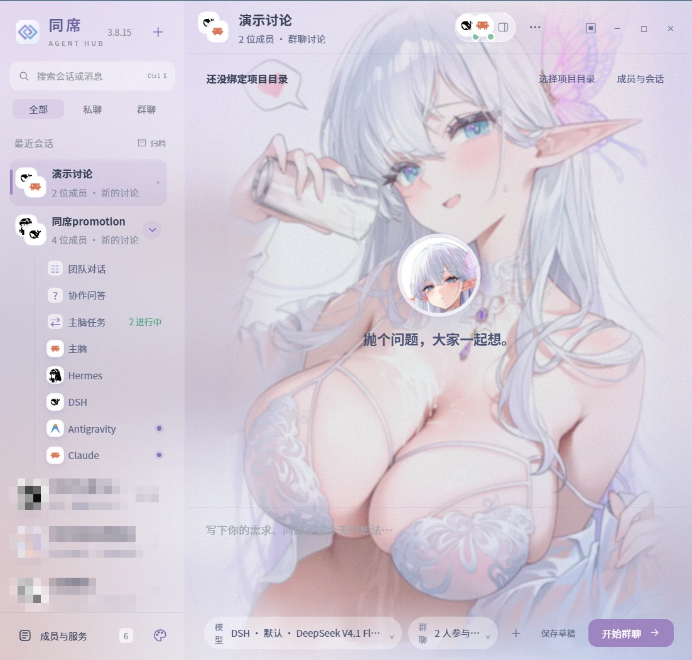 <!-- 截图：群聊顶部操作栏，展示「还没绑定项目目录」提示文字以及其右侧的「选择项目目录」按钮 -->

4. 在弹出的系统文件夹选择窗口中，选中你准备好的本地代码目录 `D:\Code\pomodoro-timer`。
5. 紧接着弹出「绑定项目」配置弹窗：
   - 「项目名称」：同席会自动提取文件夹名，你也可以修改；
   - 如果该目录还不是 Git 仓库，同席提示将自动在本地执行 `git init` 并提交基线安全快照（**不会向 GitHub 或任何远端推送**，完全本地运行）；
   - 「主脑由谁当」：从参与成员中选一位作为负责人。建议选择推理能力强的成员（如 Claude 或配置了强模型的 Codex）；
   - 「各成员的会话」：可以给每位成员配置 1～4 个独立席位（如「Claude 1号」「Codex 1号」）；
   - 确认无误后，点击右下角「绑定项目」。

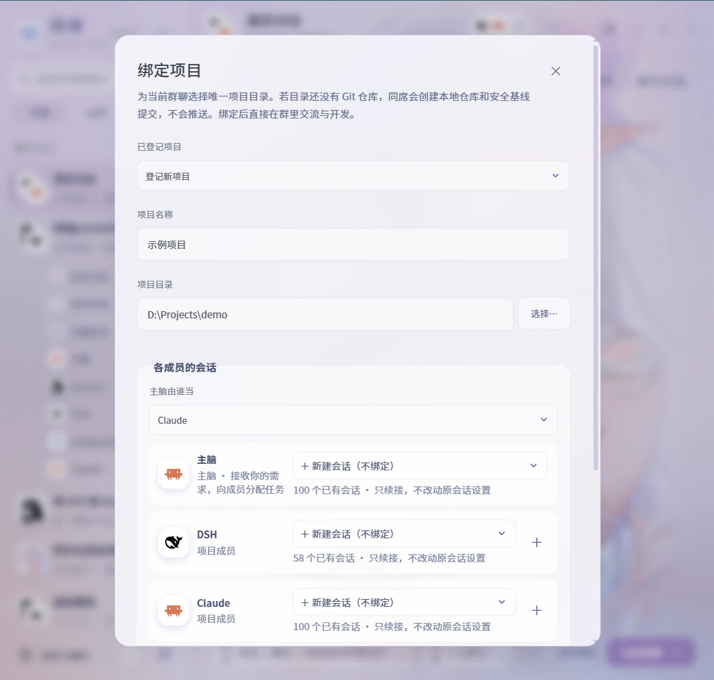 <!-- 截图：「绑定项目」弹窗，展示项目名称与路径输入框、「主脑由谁当」下拉框以及各成员会话席位配置（展示三行） -->

### 6.3 项目群的结构
点击绑定后，普通群聊升级为**项目群**，左侧栏会展开项目树：
- **「团队对话」**：项目的主交流窗口，输入框文字变为「描述目标、讨论方案，或让项目组推进实现…」，按钮显示为「发送给项目组」；
- **「协作问答」**：主脑需要你拍板或授权的问题集中面板；
- **「主脑任务」**：计划流程图与各成员任务总览；
- **各成员房间**（包括主脑自身和各成员的独立房间，如「Claude 1号」「Codex 1号」「DSH 1号」）：每位成员在独立的原生会话里工作，随时能切进去旁观或插话。

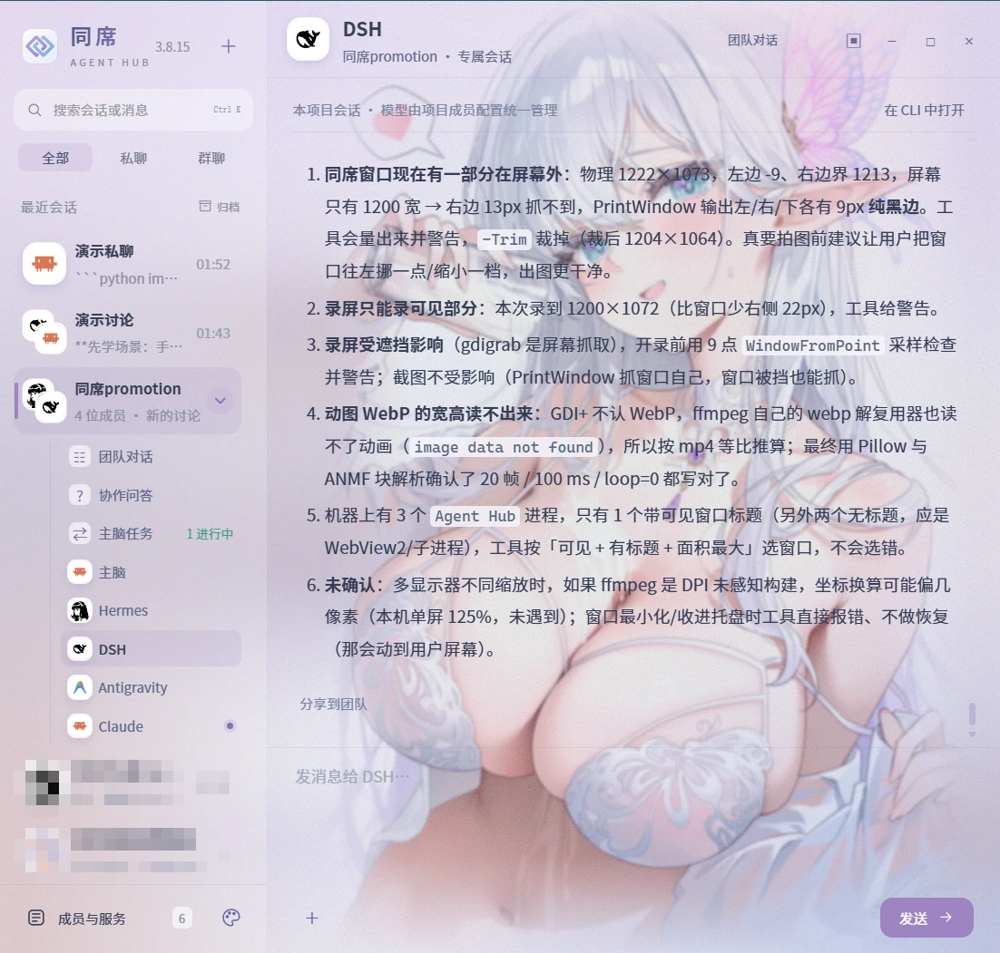 <!-- 截图：绑定项目后左侧栏的项目树，展示「团队对话」「协作问答」「主脑任务」以及包含主脑在内的各成员房间 -->

### 6.4 发起第一道项目任务
在左侧点击「团队对话」，输入你的项目目标：
```text
请为我开发一个简约的单页面番茄钟应用（HTML/CSS/JS）：
1. 包含 25 分钟工作倒计时、5 分钟休息倒计时；
2. 包含开始、暂停、重置按钮；
3. 倒计时归零时弹出网页提示音；
4. 界面清晰易读。请拆解任务并带队完成。
```
点击「发送给项目组」。

> [!IMPORTANT]
> **关键心智模型**：
> 在项目群（团队对话）里说的话，**是直接对「主脑」说的**。
> 主脑不会把整段对话直接丢给所有成员；它会先自己规划，写出任务书，然后再把具体的子任务分派给具体的成员。团队对话群里只会同步主脑发出的阶段进展摘要。

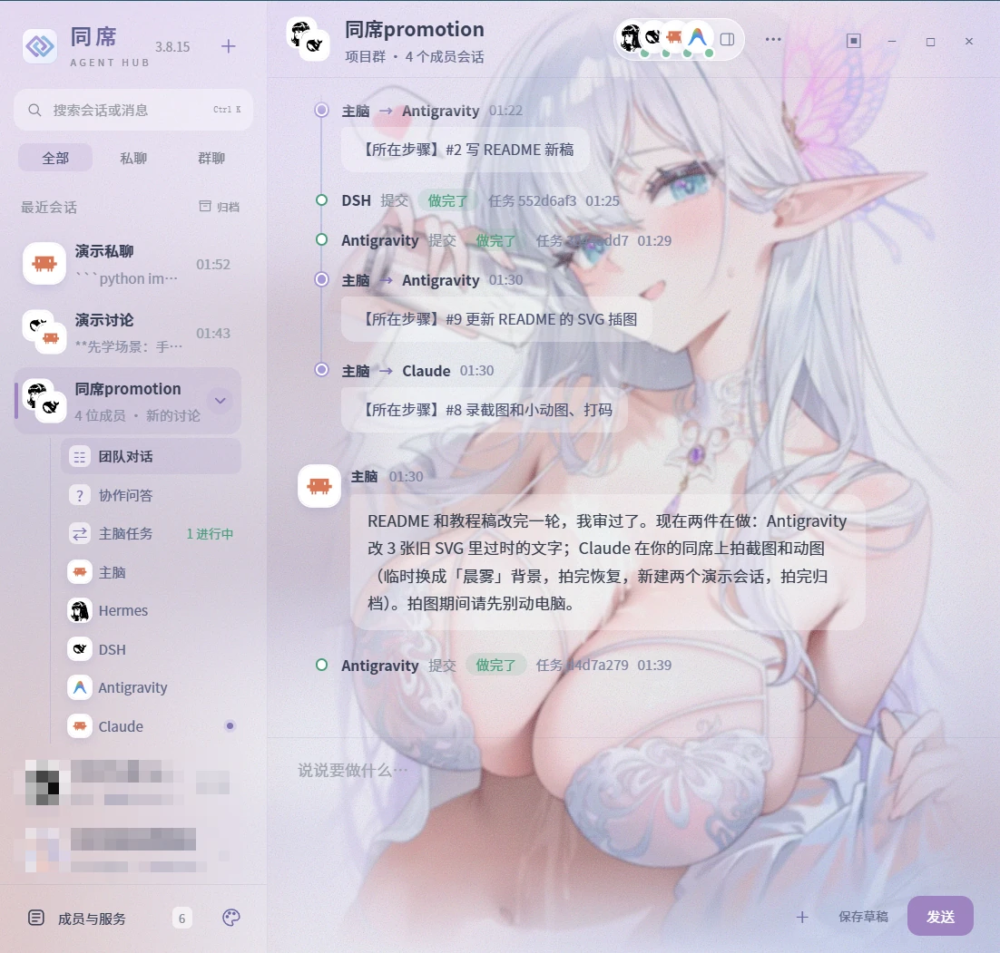 <!-- 截图：在「团队对话」中发送需求，展示主脑回复拆解目标，并广播分派子任务的简要卡片 -->

---

## 7. 掌控进度：看懂「主脑任务」流程图与「协作问答」

### 7.1 查看「主脑任务」与流程图
点击项目侧栏里的「主脑任务」：
1. **计划流程图**：页面顶部呈现长期计划流程图。方块代表每个步骤，卡片颜色对应状态（进行中、待审核、待你处理、等待中、未开始、已完成）。
   - 阻塞后续步骤的步骤会标有「阻塞 N 项」；
   - 鼠标滚轮可以缩放流程图，按住可以拖动画布；点击任一步骤能查看详细的任务要求和负责人。
2. **主脑用量与上下文**：流程图下方实时更新主脑当天的 token 写入、缓存读写命中情况以及当前上下文长度。
3. **任务列表**：展示主脑分发给各成员的具体活。改代码的任务，同席会自动为该成员建立独立的 `git worktree`（独立的目录与分支）。几位成员可以同时并发写代码，互不干扰；成员写完后交回给主脑，主脑审查代码确认没问题后再合回项目代码。

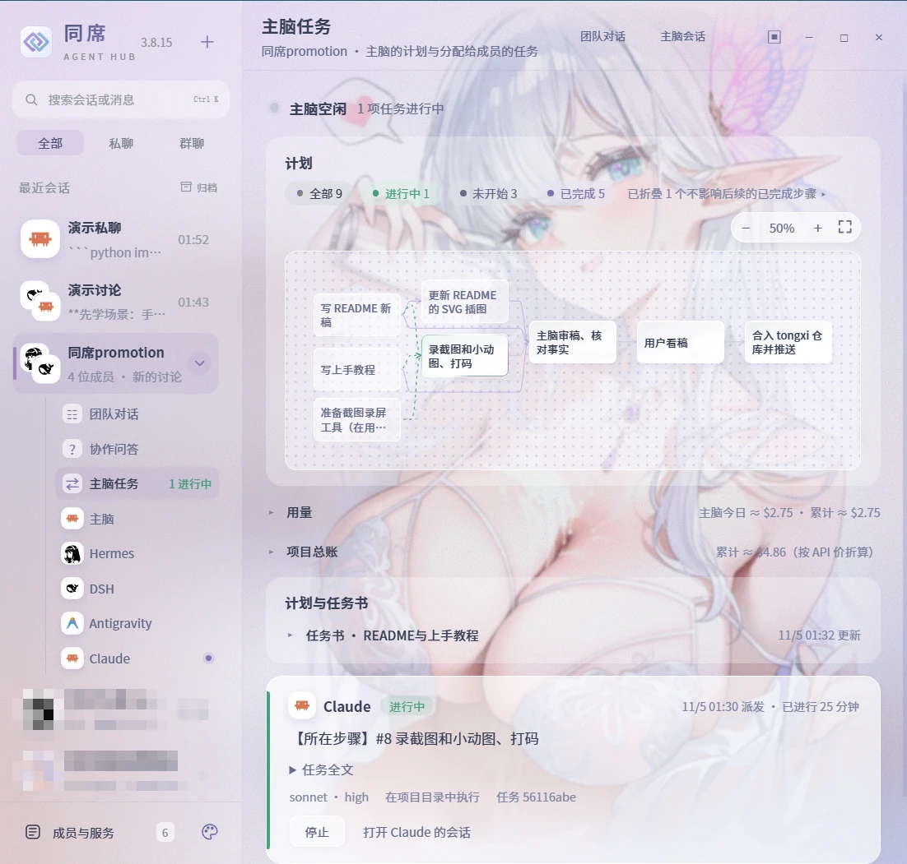 <!-- 截图：「主脑任务」界面全貌，展示顶部色彩区分状态的计划流程图节点、缩放操作条，以及下方的任务列表与 token 用量面板 -->

### 7.2 在「协作问答」里回答主脑
当主脑遇到需要你决断的事项，或者成员想要执行没有预先授权的对外操作时，主脑会通过 MCP 工具挂起一个提问：
1. 侧栏「协作问答」旁会亮起红色角标（例如「1 问」）。
2. 点击「协作问答」，看到问题卡片。输入框占位为「填写回答，可补充条件或理由；可粘贴或拖入文件」。卡片下方提供「忽略」与「回答」两个按钮。
3. 如果你想按主脑列出的方案选择，点对应选项或在输入框中填写说明，点击「回答」；
4. 如果你觉得这件事主脑自己决定即可，可以点击「忽略」，同席会弹出提示「已忽略，主脑会按自己的判断处理」。
5. 当前没有待回答问题时，面板会展示「已回答」历史记录列表。

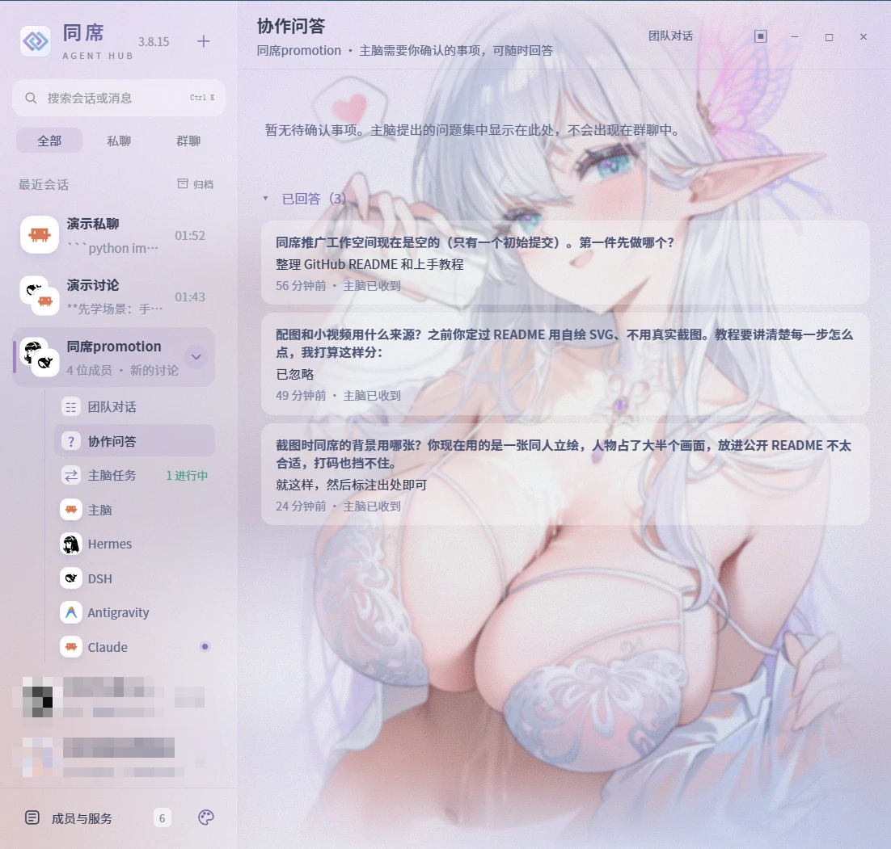 <!-- 截图：「协作问答」面板，展示「已回答（3）」历史问答列表与已采纳的回答卡片 -->

---

## 8. 随时插话纠偏与停止

如果成员在写代码时跑偏了，或者你想中途补充要求，不需要干等着或者直接杀进程。

### 8.1 怎么插话（Steer）
1. 在左侧栏进入正在干活的成员房间。
2. 成员正在输出时，直接在输入框里打字并发送，例如：「等等，样式不要写在 inline style 里，提取到 style.css 中」。
3. **不同成员的按钮与插话机制差异**（源码 `src/main.ts:1302-1306`）：
   - **Codex、Claude Code**：原生支持中途插话。回复进行时，发送按钮显示为**「插话引导」**，右侧显示红色的**「停止」**按钮。发送后你的消息直接作为追加提示送入当前轮次，不打断模型输出；
   - **Hermes、DSH、OpenCode、Antigravity**：不支持原生中途插话。回复进行时，发送按钮显示为**「停止并发送」**，右侧同样显示红色的**「停止」**按钮。点击后同席会先安全停掉它当前的回合，再自动发出你的新消息。

### 8.2 怎么停止
- **停止单次普通回复**：按键盘上的 `Esc` 键，或点击输入框右侧红色的「停止」按钮。
- **停止主脑自己的回复**：在主脑会话（团队对话）中点「停止」（或按 `Esc`），主脑会先写一份交接文档（`.tongxi/交接.md`）再停下。
- **停掉主脑派给成员的活**：在「主脑任务」页面找到正在执行的任务，点击「停止」。界面会提示「确认停止？（点两下）」，再次点击停下该任务。

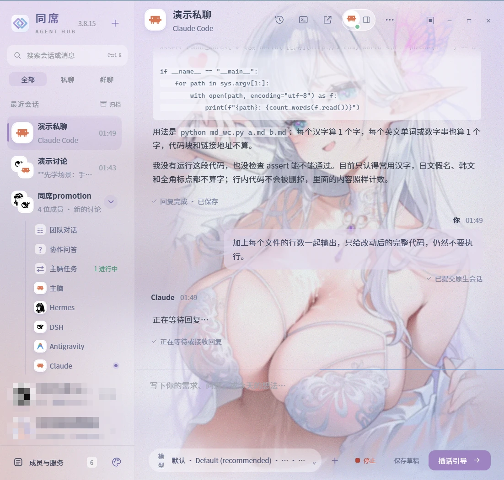 <!-- 截图：成员正在回复时，输入框右侧显示「插话引导」主按钮以及红色的「停止」按钮 -->

---

## 9. 打造你的专属桌面：换主题背景与 HUD 悬浮模式

### 9.1 主题背景换肤
点击侧栏最底部的调色板图标打开「主题背景」：
- **内置背景**：预置了 6 套背景（晨雾、薄荷、杏光、海盐、暮紫、素净），即点即换。
- **导入图片**：点击「导入图片」，支持本地任意 JPG/PNG 高清壁纸。
- **立绘 / 铺满**：导入图片后，同席按横竖自动选一个默认（竖图默认当立绘靠右展示，横图默认铺满），也可以在卡片上手动切换。
- **背景浓淡滑条**：拖动「淡雅 ↔ 清晰」滑条可以调整面板磨砂玻璃厚度。铺满的图片还可通过「画面位置」滑条调整上下显示区域。

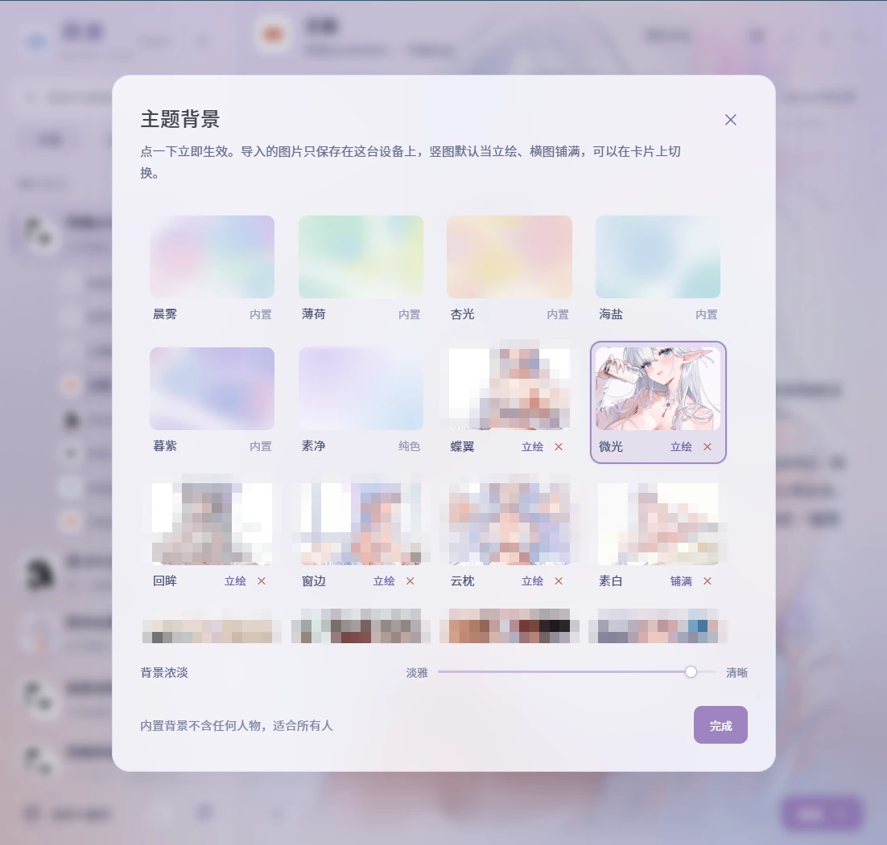 <!-- 截图：点击侧栏调色板弹出的「主题背景」窗口，展示内置背景卡片、导入图片区域、立绘/铺满切换以及「背景浓淡」滑条 -->

### 9.2 HUD 模式
- 点击窗口右上角自绘控制栏的 `▣ HUD 模式`，或者在系统任意窗口下按下全局快捷键 `Ctrl+Shift+H`。
- 同席会收拢为 HUD 悬浮模式。顶部是一条悬浮输入条，左侧带有「⠿」拖动点（提示「按住拖动 HUD」）与选择附件的「＋」按钮，中间为模型与思考强度切换，右侧带有「退出 HUD」按钮（×，点击切回主窗口）。输入提问后，下方会跟随展开文字输出区域。

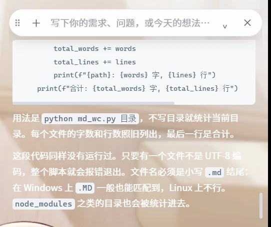 <!-- 截图：同席切换为 HUD 模式，顶部为悬浮输入条（包含「⠿」拖动点、「＋」、「模型与思考强度」和「退出 HUD」× 按钮），下方展开文字输出区域 -->

---

## 10. 进阶：用手机远程访问电脑上的同席

离开电脑时，用手机接着看主脑进度、回消息。安卓手机推荐装 App，iPhone 或不想装 App 的用手机浏览器，两种方式连的是同一台电脑。

### 10.1 前提：让电脑和手机在同一个 Tailscale 网络里

1. 确保电脑与手机都安装并登录了同一个 [Tailscale](https://tailscale.com/) 虚拟局域网账号。
2. 打开同席的「成员与服务」，向下滑动到底部的「远程访问」区域。
3. 勾选「允许手机访问」。开启后，界面显示状态「运行中 · IP:端口」，并生成带令牌的访问地址。
4. 点击「复制访问地址」，先把这条地址发到手机上（微信文件传输助手、备忘录都行），下面两种方式都要用它。

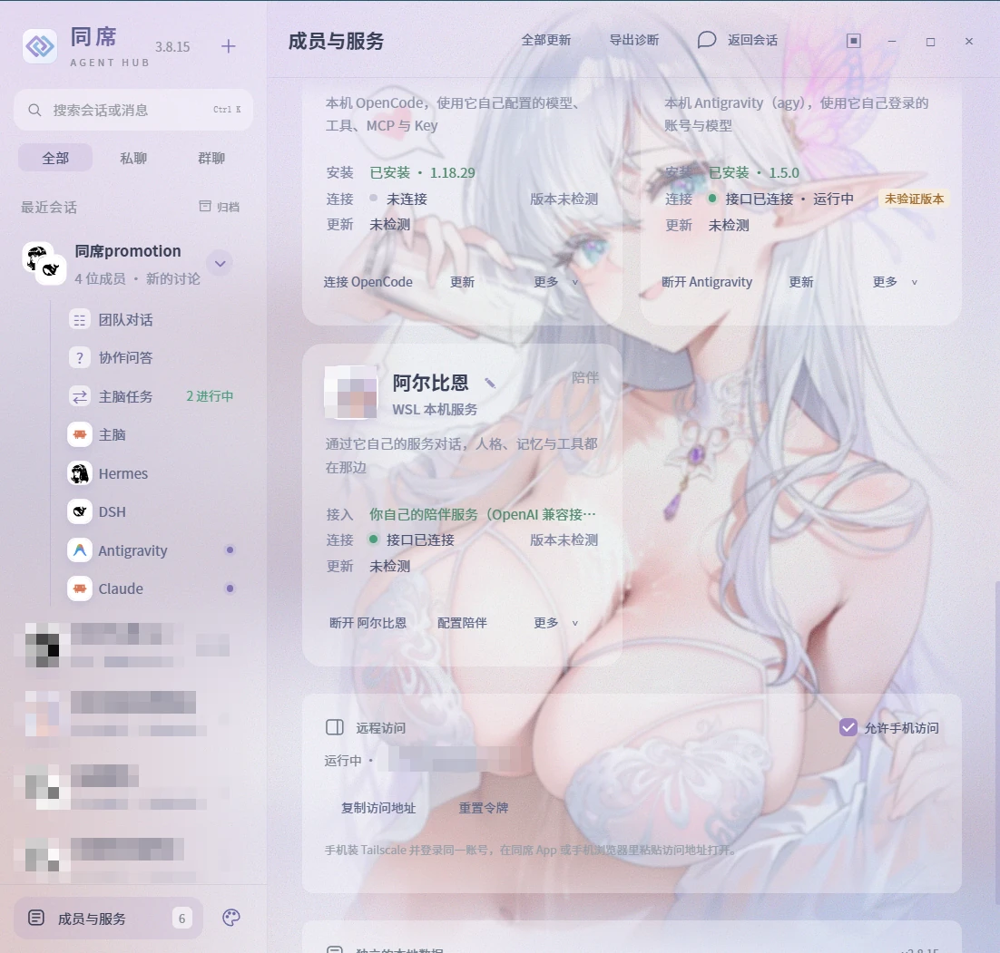 <!-- 截图：「成员与服务」中的远程访问区域，展示状态「运行中 · IP:端口」，以及「复制访问地址」和「重置令牌」按钮 -->

### 10.2 方式一：安卓 App（推荐）

1. 在手机上打开同席的 [Releases 发布页](https://github.com/mydosu/tongxi/releases/latest)，下载名字形如 `Agent-Hub-vX.Y.Z-android-arm64.apk` 的安装包（`X.Y.Z` 是版本号，比如 v3.8.19）。
2. 点开下载好的安装包。手机第一次安装从浏览器或文件管理器下载的应用，会提示「未知来源」或「安装未知应用」，按提示允许浏览器 / 文件管理器安装，再点「安装」。
3. 打开 App。第一屏是配对页，把 10.1 里复制的访问地址粘进输入框（形如 `http://100.x.y.z:47680/?token=…`），点「连接」。
4. 连上后看到的就是同席的完整界面。以后直接打开 App 会先停在加载页（显示「正在连接…」），连上自动进主界面，不用再粘地址。

几个会遇到的情况：

- **粘错了地址**：App 只认 Tailscale 的地址（`100.x` 开头或 `*.ts.net` 域名），而且要带 `token=`，不符合会提示「这不是同席的访问地址」。回电脑上重新点一次「复制访问地址」再粘即可。
- **电脑上重置了令牌**：旧地址立刻失效，App 会自动退回配对页；在电脑上复制新地址，粘进去就好。加载页一直停着时，也可以点「换一台电脑 / 重新配对」回配对页。
- **只支持 arm64**：近几年的安卓手机都是 arm64；很老的 32 位机型装不上，用下面的方式二。
- **iPhone 暂时没有 App**：用下面的方式二。
- **安装时提示签名冲突 / 与已安装应用冲突**：先卸载手机上旧的同席再装。卸载会清掉 App 里存的访问地址，重装后重新粘一次就好。

### 10.3 方式二：手机浏览器（iPhone 或不想装 App）

1. 在手机自带浏览器（如 Safari / Chrome）里打开 10.1 里复制的那条访问地址。
2. 手机上会呈现完整适配的同席 Web 界面，可以查看主脑任务、回复协作问答。

这种方式不用装东西，换手机、临时借用别人的手机都方便；代价是每次都要从聊天记录里翻出那条地址。地址里带着令牌，别随手转发给别人。

### 10.4 手机上能做什么

- 和电脑版功能一样：看主脑任务、回复协作问答、私聊、群聊、删除 / 改名 / 归档会话、项目设置等。
- 只在电脑上才有意义的操作，手机上不显示：选文件夹、在资源管理器里定位、读电脑剪贴板、导出诊断、远程访问设置。

### 10.5 安全：让旧地址尽快失效

1. 如果更换了网络或怀疑地址泄露，在电脑上点「重置令牌」即可让旧地址立刻失效，或取消勾选「允许手机访问」。
2. 重置之后，手机上的 App 和浏览器都要用新地址重新连接。完全不用手机访问时，直接取消勾选「允许手机访问」最省心。

---

## 遇到问题 / 排错指引

<details>
<summary><b>点击展开常见故障排查清单</b></summary>

<br />

### 1. Claude Code 提示「未找到 Node 运行时，请检查 PATH 或 AGENT_HUB_CLAUDE_NODE」
- **原因**：Claude Code 官方安装脚本是用 PowerShell 装的原生可执行文件，但同席底层驱动 Claude 使用的是 Node 脚本转接（`claude_bridge.mjs`）。如果系统里没有安装 Node.js，就会出现该错误。
- **解决办法**：请前往 [nodejs.org](https://nodejs.org/) 下载安装 LTS 版 Node.js。安装完成后，在同席「成员与服务」顶部点击「重新扫描」即可。

### 2. 在外部终端运行命令装好了某个成员，但在同席里显示「未安装」？
- **原因**：同席进程启动时抓取的是当时的系统 PATH 快照，外部新装软件带来的 PATH 变化无法自动感知。
- **解决办法**：进入「成员与服务」，点击顶部的「重新扫描」，同席会重新读取系统 PATH 并追加 nvm/fnm/Volta 路径。如果使用的环境变量工具仅在特定终端生效，请重启同席应用。若安装在特殊非标准路径，可在系统中配置对应的环境变量（如 `AGENT_HUB_CLAUDE_EXE`、`AGENT_HUB_CODEX_EXE` 等）。

### 3. DSH 连上了，但是发消息立刻报错失败？
- **原因**：DSH 采用的是它自己独立保存的模型和 API Key 配置。同席能够连接上 DSH 桥接，不代表 DSH 已经配好了 Key。
- **解决办法**：在「成员与服务」中找到 DSH 卡片，点击「更多⌄」→「登录 / 初次配置」，在弹出的 `dsh web` 网页中的 Models 设置里填入你的 DeepSeek API Key 或其他兼容服务商，保存后再回同席重新连接。

### 4. 首次打开同席弹出 SmartScreen「Windows 已保护你的电脑」或杀毒软件拦截？
- **原因**：同席是单文件免安装开源工具，未做商业代码签名，属于未签名小众程序的常规提示。
- **解决办法**：点击弹窗中的「更多信息」，再点击「仍要运行」即可。同席完全在本地运行，不会上传你的任何隐私与代码。

### 5. 为什么在普通群聊里说话，成员只互相讨论，不帮我修改代码？
- **原因**：普通群聊和「绑定项目的项目群」是两种不同模式。普通群聊是多人讨论室，成员没有被赋予工作树与代码写入权限。
- **解决办法**：在群聊窗口顶部点击「选择项目目录」绑定本地文件夹，升级为项目群后，再向主脑发布需求，主脑才会为成员开设独立工作树真实修改代码。

### 6. 为什么在项目群里发了一句话，其他成员没有立刻理我？
- **原因**：在项目群中，你发出的所有话全部由「主脑」统一接收与拆解。主脑同一时间只专注推进一件事。成员只接收主脑分配的具体任务，不会直接在群里闲聊接话。
- **解决办法**：在「团队对话」中查看主脑回复的进展简报，或者点击左侧栏的「主脑任务」查看当前的拆解计划与派活状态。

### 7. 成员回复时我发了一条新消息，为什么它突然停下了？
- **原因**：目前仅 Codex 和 Claude 原生支持在模型回复中途追加 prompt（原生插话，按钮显示为「插话引导」）；Hermes、DSH、OpenCode 和 Antigravity 收到插话时，同席会先安全停止当前轮次的输出，然后再发出你的新消息（按钮为「停止并发送」）。这属于正常行为。

### 8. 点击版本号自动更新，提示「新版写不进程序目录」？
- **原因**：自动更新机制需要对当前运行的 exe 进行重命名并下载写入新版本。如果你的同席放在了 `C:\Program Files` 等受 UAC 严格写保护的系统目录，会因权限不足报错。
- **解决办法**：将同席单文件 exe 移动到个人用户目录（如 `D:\Tools\Tongxi\`）下再使用。

### 9. 陪伴服务测试连接失败，报错 401 / 404？
- **原因**：404 通常是因为端点地址漏写了版本路径，大部分 OpenAI 兼容接口需以 `/v1` 结尾（例如 `http://127.0.0.1:11434/v1`）；401 / 403 通常是因为 Key 填写错误或权限不足。如果使用的是系统环境变量提供 Key，设置后需重启同席。

</details>
